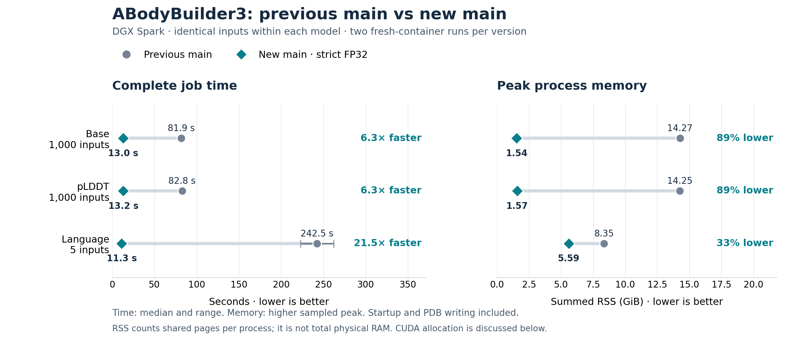

# ABodyBuilder3 on NVIDIA DGX Spark

Predict antibody variable-region structures from paired heavy- and light-chain sequences on the DGX Spark's ARM64 CPU and NVIDIA GB10 GPU. This Docker deployment uses the released [ABodyBuilder3](https://github.com/Exscientia/abodybuilder3) models, with GPU batching, saved executables and fast PDB output.

The default runs in **strict FP32**, with TF32 disabled. Base and pLDDT predictions share one GPU model process, while bounded CPU queues prepare features and write results. For the language model, the original FP32 ProtT5 encoder stays on GPU between chains. The model architectures and released weights are preserved.

## Performance compared with the previous version

On the DGX Spark, the new main completed the 1,000-input base and pLDDT jobs **about 6.3× faster**, with **89% lower summed process RSS**. The five-input language job was **21.5× faster**, with **33% lower summed RSS**.



| Model · inputs | Time: previous → new | Speedup | Peak summed RSS: previous → new | RSS reduction |
|---|---:|---:|---:|---:|
| Base · 1,000 | 81.9 → **13.0 s** | **6.3×** | 14.27 → **1.54 GiB** | **89%** |
| pLDDT · 1,000 | 82.8 → **13.2 s** | **6.3×** | 14.25 → **1.57 GiB** | **89%** |
| Language · 5 | 242.5 → **11.3 s** | **21.5×** | 8.35 → **5.59 GiB** | **33%** |

Each version ran twice in fresh containers on identical inputs, using its installed defaults. Times are medians and include startup, loading, prediction and all PDB writes; the figure shows the two-run range. Memory is the higher sampled peak. The base/pLDDT workload repeats 100 public antibodies ten times; language uses five distinct examples. Downloads, image building and optional chemistry are excluded.

The previous version uses eight model workers for the 1,000-input jobs; the new version uses one batched model with saved execution and strict FP32. **Summed RSS counts shared pages once per process, so its reduction is not a measurement of total physical RAM saved.** GPU batching uses more CUDA allocation: the new base/pLDDT process peaks at 2.39 GiB, compared with about 1.56 GiB for the *sum of the previous workers' individual peaks* (an upper bound on their simultaneous allocation). The language CUDA peak rises slightly, from 4.55 to 4.69 GiB. These memory measures overlap on Spark and must not be added.

The checkpoints are unchanged; these are deployment benchmarks, not claims of improved structural accuracy. [Measurements and protocol on dev](https://github.com/adrian-greenneuron/ABodyBuilder3-DGX-Spark/blob/dev/docs/abodybuilder3_main_comparison_261026.md) · [Previous version](https://github.com/adrian-greenneuron/ABodyBuilder3-DGX-Spark/tree/pre-aot-261026).

## Requirements

- NVIDIA DGX Spark running Linux, with Docker and the NVIDIA Container Toolkit configured for GPU containers.
- A working NVIDIA driver; this deployment was verified with **580.178.04** and pinned CUDA 13.0 dependencies.
- Internet access during the build to download the public base image, source and checkpoints. No previous local image or model files are required.
- Space for the Docker image, build cache and predictions. The language model also needs a separate **11.28 GB** ProtT5 download.

## Build and run

```bash
git clone https://github.com/adrian-greenneuron/ABodyBuilder3-DGX-Spark.git
cd ABodyBuilder3-DGX-Spark
./docker_build.sh build
./docker_build.sh test
```

The image is named `abodybuilder3-official-spark:latest`. **The build requires GPU access.** The script builds the pinned runtime, prepares and checks saved executables for both base and pLDDT, then packages them into the final image. Prediction loads these executables directly. Generated packages are kept under `.aot-build/`; set `AOT_BUILD_DIR` to use another location. Use `NO_CACHE=1 ./docker_build.sh build` to rebuild without Docker's layer cache.

Run the included public example:

```bash
mkdir -p predictions
docker run --rm --gpus all --ipc=host \
    --user "$(id -u):$(id -g)" -e HOME=/tmp \
    -e PYTORCH_CUDA_ALLOC_CONF=expandable_segments:True \
    -v "$PWD/examples:/inputs:ro" \
    -v "$PWD/predictions:/predictions" \
    abodybuilder3-official-spark:latest \
    python3 scripts/predict.py predict \
        --csv /inputs/antibodies.csv --output /predictions/ --seed 42
```

The raw heavy-atom PDB is saved in `predictions/`, owned by your host user. For your own inputs, supply a CSV with **`name,heavy,light`** columns, one antibody per row. Use unique names and uppercase amino-acid sequences. Create the output directory before running; existing files require `--overwrite`.

The CLI also accepts `--heavy`/`--light` sequences and paired FASTA files. List all options with:

```bash
docker run --rm abodybuilder3-official-spark:latest \
    python3 scripts/predict.py predict --help
```

## Models and execution

| Option | Purpose |
|---|---|
| `--model plddt` | Default released checkpoint, trained with the confidence head |
| `--model base` | Released base checkpoint |
| `--model language` | Released checkpoint using ProtT5 sequence embeddings; requires the separate download below |
| `--execution auto` | Default: saved execution for released CUDA base/pLDDT; eager execution for language, CPU or custom checkpoints |
| `--execution eager` | Run without the saved executable |
| `--batch-size auto` | Default: cap at 16 for up to 128 inputs, otherwise 32; the memory estimate can reduce it further |
| `--batch-size 16` | Set an explicit GPU batch cap |
| `--cpu-workers 2` | Default: two CPU workers per feature/output stage |
| `--batch-report /predictions/batching.json` | Save batch sizes, OOM retries and completion information |

These are different trained checkpoints; the table does not rank their structural accuracy. Base and pLDDT inputs are grouped by length to limit padding. All eight learned structure updates are retained; side-chain reconstruction is performed at the final update, and static pair features are reused. Input names stay associated with their outputs even when execution is reordered. The native PDB writer preserves the Python writer's fields and formatting; `--pdb-writer python` selects the reference writer.

Saved executables cover batch sizes **1–32** and padded combined chain lengths **200–272 residues**. Other shapes run with the same model in strict-FP32 eager execution, with a warning and a count in the batch report. Inputs are never truncated. Missing, corrupt or incompatible packages fail explicitly: rebuild the image or use `--execution eager`. Package checks include the checkpoint, source, runtime and GPU identity.

`--batch-memory-gib 6` sets an estimated inference-allocation target, **not a hard limit on total memory**. CUDA allocation failures split the affected batch and retry. Memory use depends on model, lengths and batch size; the largest supported input has not been established.

Strict FP32 is the default throughout. Saved execution and different batch shapes can change floating-point rounding, so predictions are not promised to be byte-identical to older deployments. `--precision tf32 --execution eager` explicitly permits TF32. Custom checkpoints require eager execution.

**Confidence limitation:** the current JSON export and `--confidence-threshold` use flattened confidence logits rather than converted pLDDT scores; PDB B-factors are zero. Do not interpret these exports as calibrated pLDDT or use the threshold for scientific filtering. The model's confidence head itself is unchanged.

## Language model

Download the pinned public ProtT5 snapshot once for reuse across containers:

```bash
mkdir -p prott5
docker run --rm --user "$(id -u):$(id -g)" -e HOME=/tmp \
    -v "$PWD/prott5:/prott5" \
    abodybuilder3-official-spark:latest \
    python3 tools/download_prott5.py --output /prott5

mkdir -p language_predictions
docker run --rm --gpus all --ipc=host \
    --user "$(id -u):$(id -g)" -e HOME=/tmp \
    -e PYTORCH_CUDA_ALLOC_CONF=expandable_segments:True \
    -e HF_HUB_OFFLINE=1 -e TRANSFORMERS_OFFLINE=1 \
    -v "$PWD/examples:/inputs:ro" \
    -v "$PWD/prott5:/opt/abodybuilder3/Rostlab/prot_t5_xl_uniref50:ro" \
    -v "$PWD/language_predictions:/predictions" \
    abodybuilder3-official-spark:latest \
    python3 scripts/predict.py predict \
        --csv /inputs/antibodies.csv --output /predictions/ \
        --model language --seed 42
```

The language model processes one antibody at a time. `--embedding-runtime auto` keeps the original batch-1 encoder on CUDA, preserving tokenisation, masking and heavy/light chain order. Embeddings and predictions are computed afresh. Explicit language batching is rejected.

`--embedding-runtime trainer` retains the original Lightning lifecycle. CPU execution automatically uses it; this route also needs a writable `lightning_logs` directory inside the container. GPU prediction is the supported deployment path described here.

## Optional chemical preparation

Plain prediction is the fast default. Add these options to the prediction command when needed:

```bash
# Repair missing atoms and add hydrogens at the requested pH
--add-hydrogens --ph 7

# Allow Reduce side-chain flips, then apply OpenMM protonation
--add-hydrogens --hydrogen-method reduce --sidechain-flips --ph 7

# Prepare and minimise with heavy-atom restraints on the GPU
--relax restrained --relax-platform cuda --seed 42
```

The raw `.pdb` is retained. Preparation adds `.prepared.pdb` and a `.preparation.json` audit; relaxation also adds `.relaxed.pdb`. These optional steps run serially and can take much longer than prediction.

PDBFixer repairs missing atoms; OpenMM assigns the final hydrogens. Reduce is optional and never silently substituted for another method. Restrained relaxation uses Amber ff14SB with GBn2 implicit solvent and a finite iteration budget. Review the audit for protonation, disulfides, geometry warnings and convergence. Lower energy does not establish improved structural accuracy.

The former `--relaxation`/`-r` option now fails with an explanation: use `--add-hydrogens` or `--relax restrained`. See [the preparation guide](docs/preparation.md) for options, units and limitations.

## Citation and licence

Please cite the original [ABodyBuilder3 paper](https://doi.org/10.1093/bioinformatics/btae576) by Kenlay and colleagues. The released checkpoints come from [the authors' Zenodo record](https://doi.org/10.5281/zenodo.11354577); language embeddings use [ProtT5](https://huggingface.co/Rostlab/prot_t5_xl_uniref50).

Code is distributed under [Apache License 2.0](LICENSE.txt). Model assets retain their respective providers' terms. The earlier deployment is preserved at [`pre-aot-261026`](https://github.com/adrian-greenneuron/ABodyBuilder3-DGX-Spark/tree/pre-aot-261026).
