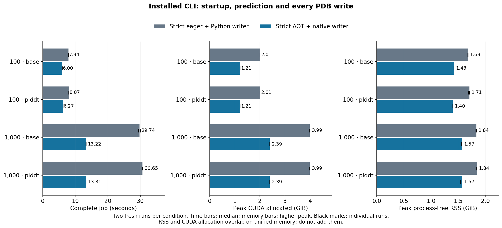

# ABodyBuilder3 on NVIDIA DGX Spark — batched development branch

Predict antibody variable-region structures from paired heavy- and light-chain sequences on the DGX Spark's ARM64 CPU and NVIDIA GB10 GPU. This repository packages [ABodyBuilder3](https://github.com/Exscientia/abodybuilder3) in a reproducible Docker environment, with a parallel prediction CLI and optional chemical preparation and restrained energy minimisation.

**This is `dev`: strict FP32, saved AOT executables and native PDB output.**
Base and pLDDT use the same released checkpoints and eight learned structure
updates, with one GPU model process and bounded CPU preparation/output queues.
The default disables TF32; earlier dev measurements permitted it.

In the installed-CLI comparison, 1,000 inputs completed in **about 13 seconds**,
versus **about 30 seconds** for matched strict-FP32 eager execution with the
Python writer. Peak CUDA allocation fell from **3.99 to 2.39 GiB**. On a separate
150-antibody validation panel, mean Cα RMSD between the two implementations was
about **0.0000016 Å**. AOT changes floating-point rounding, so predictions are
not promised to be byte-identical to eager execution. See the
[deployment results and limits](docs/abodybuilder3_dev_aot_validation_261026.md).

[Main](https://github.com/adrian-greenneuron/ABodyBuilder3-DGX-Spark/tree/main) remains the stable worker-based deployment. The original rebuild recipe is preserved at [`original-runtime-251026`](https://github.com/adrian-greenneuron/ABodyBuilder3-DGX-Spark/tree/original-runtime-251026). This dev branch includes main’s explicit chemical preparation and restrained minimisation.

## Requirements

- NVIDIA DGX Spark running Linux, with Docker and the NVIDIA Container Toolkit configured for GPU containers.
- A working NVIDIA driver. This deployment was tested with **580.178.04**; its CUDA dependencies are pinned to 13.0 for that driver.
- Internet access during the build to obtain the public base image, source and checkpoints. No existing local ABodyBuilder3 image or weights are needed.
- Space for an approximately **22 GB logical Docker image**, plus build cache and outputs. Docker layers may be shared with other images. The language model needs a separate **11.28 GB** ProtT5 download.

Memory use depends on model, batching and sequence lengths. The current numerical checks include 150 published validation antibodies of 221–248 residues, plus artificial shape fixtures. These do not establish the largest biologically supported input.

## Quick start

### 1. Build and check the environment

```bash
git clone --branch dev https://github.com/adrian-greenneuron/ABodyBuilder3-DGX-Spark.git
cd ABodyBuilder3-DGX-Spark
./docker_build.sh build
./docker_build.sh test
```

The default image name is `abodybuilder3-dev-spark:latest`. Building requires
GPU access: the script first builds the pinned runtime, then exports and compiles
both checkpoints in a GPU container and packages their executables in the final
image. No retained experimental image or compiler cache is needed. Preparation
is paid once per image build; prediction loads the executables directly.
Generated packages stay under `.aot-build/` unless `AOT_BUILD_DIR` is set.

The build verifies checkpoint hashes and checks each saved package against an
eager example. The import test reports GPU availability; it is not a substitute
for the broader prediction checks in the deployment report. To rebuild without using Docker's build cache:

```bash
NO_CACHE=1 ./docker_build.sh build
```

### 2. Predict the five public examples

The input preparation command uses only Python's standard library. Run it once in a fresh output directory:

```bash
python3 tools/prepare_benchmark_inputs.py --output benchmark_inputs --counts 5
mkdir -p predictions

docker run --rm --gpus all --ipc=host \
    -e PYTORCH_CUDA_ALLOC_CONF=expandable_segments:True \
    -v "$PWD/benchmark_inputs:/inputs:ro" \
    -v "$PWD/predictions:/predictions" \
    abodybuilder3-dev-spark:latest \
    python3 scripts/predict.py predict \
        --csv /inputs/antibodies_5.csv --output /predictions/ \
        --model plddt --batch-size auto --seed 42
```

Raw heavy-atom PDB files are saved in `predictions/` on the host. The image runs as root by default, so files written through the mount may be owned by root.

### 3. Use your own sequences

Provide a CSV with `name,heavy,light` columns, one paired antibody per row. The generated example CSV shows the expected format. Mount its directory as `/inputs`, then change the `--csv` filename above. Create and mount the output directory first, as above. A single input otherwise treats a nonexistent output path as a filename. Existing prediction files require `--overwrite`.

The CLI also accepts `--heavy`/`--light` sequences and paired FASTA files. To see all options:

```bash
docker run --rm abodybuilder3-dev-spark:latest \
    python3 scripts/predict.py predict --help
```

## Models and parallel prediction

| Selection | Model | Additional assets |
|---|---|---|
| `--model plddt` | Default checkpoint, trained with the pLDDT confidence head | Included in the image |
| `--model base` | Base checkpoint | Included in the image |
| `--model language` | Checkpoint using ProtT5 sequence embeddings | Separate ProtT5 download |

These are different trained checkpoints. Deployment checks compare each with its own original counterpart; they do not rank their accuracy against experimental structures.

Base and pLDDT use GPU batching by default. Antibodies are grouped by combined chain length into eight-residue bins, reducing padding, then processed by a single model. Results are transferred to CPU before formatting and writing. Input names remain associated with their predictions even though execution is reordered.

The inference path uses compact projection lookups, computes side-chain outputs only at the final model block, and reuses the static pair-feature buffer. All eight learned attention/backbone updates remain. The isolated [OpenFold-derived component branch](https://github.com/adrian-greenneuron/ABodyBuilder3-DGX-Spark/tree/components/openfold-structure-251026) retains the original code, accepted implementation and regression tests. The saved strict-FP32 AOT route is now enabled following the paired checks. The alternative point-attention rewrite remains disabled.

| Option | Meaning |
|---|---|
| `--execution auto` | Default: saved AOT for released CUDA base/pLDDT; explicit eager selection for language, CPU, custom checkpoints or TF32 |
| `--execution eager --precision strict` | Same-precision reference; no saved executable |
| `--precision tf32 --execution eager` | Explicitly permit TF32; no automatic precision switching |
| `--pdb-writer python` | Use the retained Python reference writer |
| `--batch-size auto` | Default: cap at 16 for at most 128 inputs, otherwise 32; the memory estimate can reduce batches further |
| `--batch-size 16` | Explicit cap with lower measured CUDA allocation than 32 on the public workload |
| `--batch-size 1` | Single-item batches; AOT retains the compact batch-1 path |
| `--cpu-workers 2` | Default: two workers per preparation/output stage, with bounded queues |
| `--batch-memory-gib 6` | Estimated inference-allocation target; not a hard total-memory limit |
| `--batch-report /predictions/batching.json` | Optional record of actual batches, CUDA OOM splits and completion |

Batching accepts `--workers auto` or `--workers 1`, using one GPU model process. To compare the worker approach, explicitly select `--execution eager --batch-size 1 --workers 8`. Invalid worker counts are rejected; the old DataLoader worker-selection helper is not used by the current CLI.

Saved packages cover batches 1 and 2–32 and padded lengths 200–272. Shapes
outside that domain use the same checkpoint in strict-FP32 eager execution,
with a warning and counts in the batch report. Nothing is truncated. A missing,
corrupt or incompatible package fails explicitly: rebuild the image or choose
`--execution eager`. Checkpoint, source, package checksum and runtime/GPU
identities are checked before saved execution.

The language checkpoint keeps its established single-model path: `auto` selects batch size 1 and one worker. Explicit language batching is rejected until a qualified implementation demonstrates an improvement. Its separate ProtT5 download is described below.

**Confidence export limitation:** the current CLI's JSON and `--confidence-threshold` paths use flattened confidence logits rather than properly converted pLDDT scores; PDB B-factors are zero. Do not interpret those exported values as calibrated pLDDT or use the threshold for scientific filtering. This existing limitation is documented in the [reproducibility notes](docs/abodybuilder3_reproducibility_251026.md#interpretation-and-limitations); the model's confidence head itself is unchanged.

### Prepare a reusable ProtT5 download

The CLI can download ProtT5 on first use, but a host-mounted snapshot avoids downloading it again in disposable containers. The helper pins the revision and downloads only the five inference assets:

```bash
mkdir -p prott5
docker run --rm \
    -v "$PWD/tools:/tools:ro" -v "$PWD/prott5:/prott5" \
    abodybuilder3-dev-spark:latest \
    python3 /tools/download_prott5.py --output /prott5

mkdir -p language_predictions language_logs
docker run --rm --gpus all --ipc=host \
    -e PYTORCH_CUDA_ALLOC_CONF=expandable_segments:True \
    -v "$PWD/benchmark_inputs:/inputs:ro" \
    -v "$PWD/prott5:/opt/abodybuilder3/Rostlab/prot_t5_xl_uniref50:ro" \
    -v "$PWD/language_predictions:/predictions" \
    -v "$PWD/language_logs:/opt/abodybuilder3/lightning_logs" \
    abodybuilder3-dev-spark:latest \
    python3 scripts/predict.py predict \
        --csv /inputs/antibodies_5.csv --output /predictions/ \
        --model language --workers 1 --seed 42
```

The language path uses eager execution and the explicit precision policy. The writable Lightning log mount is needed when running as a non-root user; the ProtT5 snapshot remains read-only. Its historical timings include embedding generation and exclude downloading.

## Optional chemical preparation and relaxation

Plain prediction is the fast default. Preparation runs only when requested, saves separate outputs and preserves the raw PDB. Add the desired options to the prediction command inside the container:

| Options | Behaviour |
|---|---|
| `--add-hydrogens --ph 7` | Repair missing heavy/terminal atoms and add hydrogens at pH 7 |
| `--add-hydrogens --hydrogen-method reduce --sidechain-flips` | Also allow Reduce to optimise Asn/Gln/His side-chain orientations |
| `--relax restrained --relax-platform cuda` | Prepare, then perform restrained energy minimisation on the Spark GPU |

For example, keep the quick-start Docker command and change its final line to:

```bash
        --model plddt --workers 1 --seed 42 --relax restrained --relax-platform cuda
```

| Output | Contents |
|---|---|
| `.pdb` | Unmodified raw prediction |
| `.prepared.pdb` | Repaired structure with hydrogens |
| `.relaxed.pdb` | Restrained energy-minimised structure, when requested |
| `.preparation.json` | Options, repairs, protonation, inferred disulfides, warnings, timings and minimisation results |

PDBFixer repairs missing heavy/terminal atoms; OpenMM places the final hydrogens. Optional Reduce processing changes side-chain orientations only when requested, then OpenMM rebuilds hydrogens against the repaired topology. There is no silent fallback between methods. Preparation does not reconstruct missing sequence stretches, and unsupported protonation/force-field combinations fail explicitly.

Relaxation uses Amber ff14SB with GBn2 implicit solvent. It first optimises hydrogen positions with heavy atoms fixed, then minimises with positional restraints on heavy atoms. Select `--relax-platform cuda` on Spark: the portable default is `cpu`, which was substantially slower. Inspect the audit's convergence and geometry warnings before downstream use. Lower energy or fewer overlaps does not establish greater accuracy against an experimental structure.

**Changed options:** `--relaxation` and `-r` have been removed and now fail with an explanation. Use `--add-hydrogens` for preparation or `--relax restrained` for genuine minimisation. `-H` selects the heavy-chain sequence; it is not a hydrogen-addition alias. Preparation currently requires PDB output.

See the [preparation guide](docs/abodybuilder3_preparation_251026.md) for settings, units, failure handling and scientific limits.

## Measured performance

Complete fresh-container jobs on DGX Spark / GB10, 26 October 2026, including
imports, checkpoint/package loading, features, inference and every PDB write.
Both conditions use strict FP32 and identical inputs, ordering, batch policy and
seed. Two runs per condition were interleaved; ranges are retained in the report.
This compares the combined AOT/native route with eager/Python, not AOT alone.



| Inputs | Checkpoint | Eager + Python writer | AOT + native writer | Speedup |
|---|---|---:|---:|---:|
| 100 | base | 7.94 s | **6.00 s** | **1.32×** |
| 100 | pLDDT | 8.07 s | **6.27 s** | **1.29×** |
| 1,000 | base | 29.74 s | **13.22 s** | **2.25×** |
| 1,000 | pLDDT | 30.65 s | **13.31 s** | **2.30×** |

These throughput jobs use the previous 100-target cohort; 1,000 inputs repeat
it. The separate validation uses all 150 upstream validation targets from 149
PDB entries, excluded from our implementation tuning. It is not an unseen model
test, because the authors used that split during model development. Framework-
aligned CDR accuracy, local distances, side-chain symmetry/torsions, geometry and
confidence are reported alongside Cα agreement. The largest change in
experimental CDR-H3 backbone RMSD was **0.0000073 Å**. These results support
implementation agreement on the tested panel; they do not establish a model
accuracy improvement.

A sustained 20,000-output job, cycling those 150 validation antibodies, completed
in **161 seconds** with no OOM retries or missing outputs. It exercises deployment
and output accounting; 20,000 outputs are not 20,000 independent antibodies.
RSS grew modestly as job/audit metadata accumulated. Host metadata is still
retained for the whole job; bounded worker queues are not a constant-memory
promise for arbitrarily large CSVs.

See the [current report, plots and compact data](docs/abodybuilder3_dev_aot_validation_261026.md).
The [25 October exact-output optimisation report](docs/abodybuilder3_dev_optimisation_251026.md)
and [earlier batching/main comparison](docs/abodybuilder3_dev_batching_251026.md)
retain their original measurements and precision policies. Optional chemistry
keeps the [established protocol and timings](docs/abodybuilder3_preparation_benchmarks_251026.md).

## Reproducible builds and verification

The Dockerfile pins the NGC base image by digest, the source foundation by commit, Reduce by revision and Python dependencies by version. It verifies all three ABodyBuilder3 checkpoint hashes. This checkout's scripts, batching/feature adapters and reviewed OpenFold-derived inference module are copied into the image separately. The trained weights and all other captured runtime sources/dependencies match the preceding dev runtime.

| Component | Tested runtime |
|---|---|
| Base image | NVIDIA NGC PyTorch 25.11, pinned digest |
| Python / PyTorch / CUDA | 3.12 / NGC 2.10 prerelease / 13.0 |
| OpenMM / PDBFixer | 8.6.1 / 1.12.0, published ARM64 packages |
| OpenMM CUDA dependencies | Published wheels pinned to CUDA 13.0 |
| Reduce | 4.17, pinned source revision |
| ABodyBuilder3 weights | Three checkpoints from [Zenodo 11354577](https://zenodo.org/records/11354577); approximately 441 MB compressed archive |

The deployment retains the Flash Attention import compatibility fix, PyTorch checkpoint-loading compatibility and fast PDB writer. It replaces the historical custom OpenMM/PDBFixer builds with published packages. CUDA dependency pins avoid the unsupported-PTX failure observed with newer NVRTC wheels on the tested driver.

Ubuntu packages and build tools can change, so an identical Docker image digest is not promised across build dates. The [rebuild and verification guide](docs/abodybuilder3_reproducibility_251026.md) explains source/checkpoint/runtime checks, prediction comparisons, the original build tag and the limits of reproducibility. For the integrated image, use `tests/reference_dev_aot_runtime_261026.json` for
source/checkpoint/runtime comparisons. Earlier references remain attached to
their historical results. Package binary checksums are verified against their
own build manifest; a new build is not promised to emit identical compiler
binaries. Strict FP32 is the CLI default, overriding the earlier NGC TF32 policy. `--seed` alone does not guarantee identical prepared or relaxed coordinates across platforms.

CPU-only interface and measurement checks:

```bash
python3 -m unittest discover -s tests -p 'test_batch_pipeline.py' -v
python3 -m unittest discover -s tests -p 'test_structure_preparation.py' -v
python3 -m unittest discover -s tests -p 'test_deployment_comparison.py' -v
```

The measurement checks require NumPy. `tests/test_batch_cli.py` and `tests/test_inference_features.py` run inside the deployment image. `tests/test_aot_runtime.py` checks saved-execution guards and `tests/check_aot_shapes.py` qualifies its shape domains. `tests/check_native_formatter.py` compares writer bytes. `tests/check_optimised_gpu.py` retains the exact eager-shortcut checks; the older `tests/check_batch_gpu.py` checks batching against serial execution with its original tolerance. Mount the repository when running its tests/tools inside Docker. Real chemistry tests run inside the Docker environment with saved public predictions, as described in the preparation guide. An import test alone does not verify CUDA minimisation or prediction agreement.

## Citation and licence

Please cite the original ABodyBuilder3 work when using the model:

> Kenlay H, Dreyer FA, Cutting D, Nissley D, Deane CM. **ABodyBuilder3: improved and scalable antibody structure predictions.** *Bioinformatics* 40(10), btae576 (2024). [doi:10.1093/bioinformatics/btae576](https://doi.org/10.1093/bioinformatics/btae576).

This repository is distributed under [Apache 2.0](LICENSE.txt). External components and downloaded assets retain their own licences; see [upstream ABodyBuilder3](https://github.com/Exscientia/abodybuilder3), the [checkpoint record](https://zenodo.org/records/11354577) and [ProtT5](https://huggingface.co/Rostlab/prot_t5_xl_uniref50).
