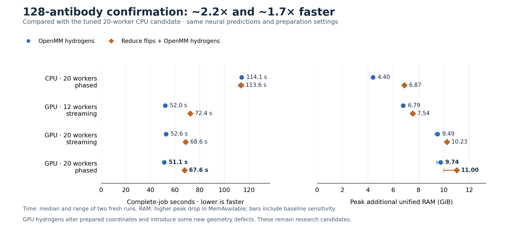

# GPU hydrogen and streaming-preparation experiments

**GPU hydrogen preparation with 20 workers was 2.23× faster for OpenMM and
1.68× faster with Reduce than the tuned CPU candidate on 128 antibodies.**
Raw neural predictions matched byte for byte throughout all 65 jobs.

The GPU preparation introduced some new chemical-geometry defects, so it is
**not enabled on dev or main**. Bounded streaming worked, but did not improve
throughput consistently. See the [report with figures and results](docs/hydrogen_pipeline_271026.md).



This isolated component branch preserves original and modified third-party code:

- `reference/`: original OpenMM Modeller, original/CPU-candidate preparation and original CLI/pool.
- `candidate/`: scoped OpenMM Context-properties patch, hydrogen policy, bounded stream and reviewable diffs.
- `Dockerfile.hydrogen` and `Dockerfile.streaming`: experimental layers over the retained CPU candidate.
- `tests/`: source-scope, policy, failure, backpressure and analysis checks.
- `tools/`: frozen-protocol measurements, chemical diagnostics, paired analysis and plotting.

```bash
python3 -m unittest discover -s tests -p 'test_*.py' -v
```

Chemistry and plotting tools use the pinned application container. The report
links compact evidence, input/source identities and artifact checksums; all
sequences, structures and per-residue identity lists stay local. The recipes
are incremental experiment layers; use the exact base/image identities in
[provenance](provenance_hydrogen_pipeline_261026.json), not a mutable `latest` tag.
No production defaults or image tags changed and nothing was deleted.

The earlier [deterministic-repair](docs/deterministic_repair_261026.md) and
[preparation concurrency](docs/preparation_optimisation_261026.md) studies remain
available as historical evidence.
