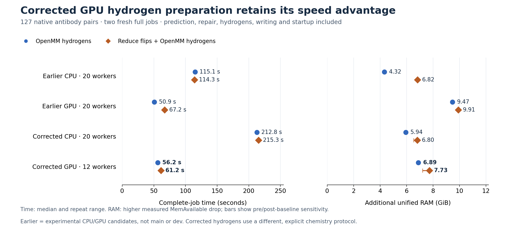

# Hydrogen geometry correction experiments

**Corrected GPU hydrogen preparation is about 3.5–4× faster than corrected CPU
preparation, with the tested bond, angle, chirality and planarity defects
removed on 509 compatible antibody pairs.** Three of the original 512 have
incompatible fixed-heavy geometry and are explicitly rejected.

On 127 matched inputs, full jobs take **56.23 s** for OpenMM hydrogens or
**61.18 s** with Reduce orientation first, using **6.89 / 7.73 GiB** of additional
unified RAM. Hydrogen-contact flags fall by about 29–30% relative to the earlier
GPU candidate, although residual clashes remain. Raw neural predictions and
prepared heavy atoms are unchanged; hydrogen coordinates use a different
geometry protocol.

**Not enabled on dev or main.** See the [new report and figures](docs/hydrogen_geometry_271026.md)
for paired measurements, chemistry changes, rejected inputs and the recorded
CUDA-initialisation retry. This branch is experimental review material.



This isolated component branch preserves original and modified third-party code:

- `reference/`: original OpenMM Modeller, original/CPU-candidate preparation and original CLI/pool.
- `candidate/`: scoped OpenMM callback/properties patch, fixed-heavy geometry optimiser, explicit steric back-off, hydrogen policy and bounded stream.
- `Dockerfile.geometry`: the current experimental layer over the retained earlier GPU candidate; `Dockerfile.hydrogen` and `Dockerfile.streaming` preserve earlier recipes.
- `tests/`: source-scope, policy, failure, backpressure and analysis checks.
- `tools/`: frozen-protocol measurements, chemical diagnostics, paired analysis and plotting.

```bash
docker run --rm --network none -v "$PWD:/component:ro" \
  abodybuilder3-dev-spark:hydrogen-geometry-planar-r8-271026 \
  python -m unittest discover -s /component/tests -p 'test_*.py' -v
```

Chemistry and plotting tools use the pinned application container. The report
links compact evidence, input/source identities and artifact checksums; all
sequences, structures and per-residue identity lists stay local. The recipes
are incremental experiment layers; use the exact base/image identities in
[source/runtime manifest](docs/data/hydrogen_geometry_sources_271026.json), not a mutable `latest` tag.
No production defaults or image tags changed and nothing was deleted.

The earlier [GPU/streaming](docs/hydrogen_pipeline_271026.md),
[deterministic-repair](docs/deterministic_repair_261026.md) and
[preparation concurrency](docs/preparation_optimisation_261026.md) studies remain
available as historical evidence.
