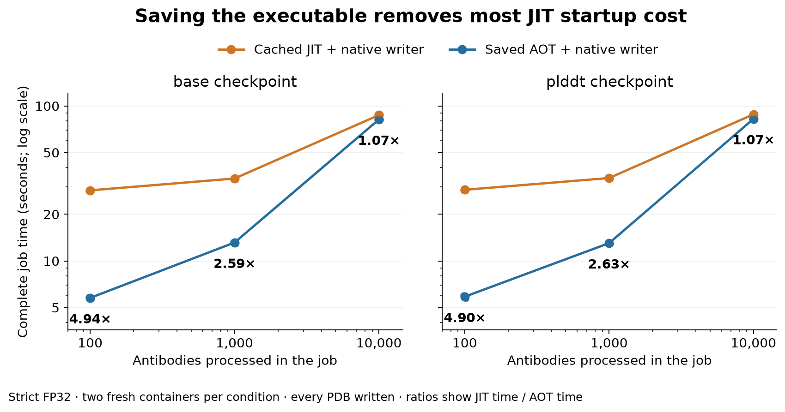
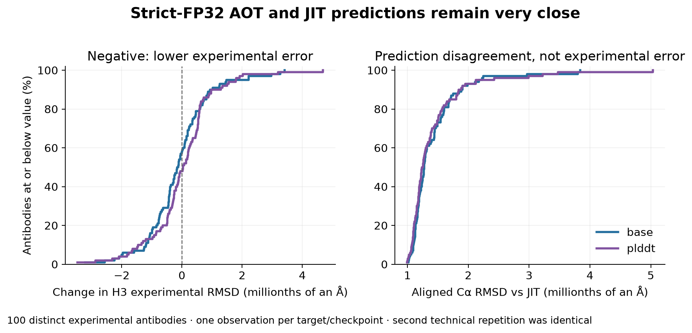
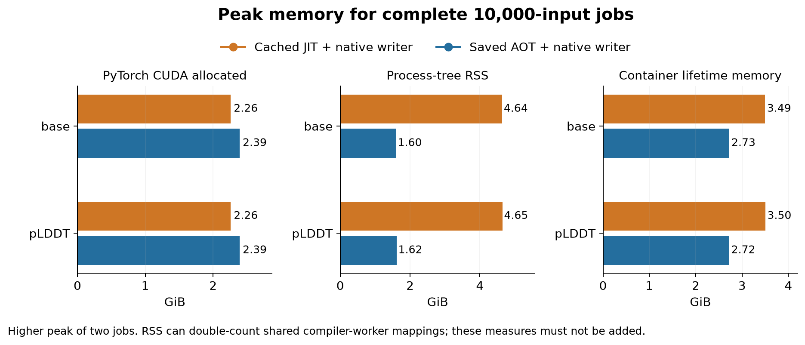

# Ahead-of-time deployment results — 26 October 2026

**Saving and loading the complete executable works.** Strict-FP32 AOT deployment is **4.9× faster at 100 inputs, 2.6× at 1,000 and 1.07× at 10,000** than the existing cached-JIT compiler path. These are complete fresh-container jobs, including every PDB write. Both use the same native writer. Main and dev remain unchanged; the candidate is available only on this isolated component branch.

## Complete-job performance

| Inputs | Checkpoint | Cached JIT (s) | Saved AOT (s) | Speedup |
| --- | --- | --- | --- | --- |
| 100 | base | 28.54 | **5.77** | 4.94× |
| 100 | plddt | 28.78 | **5.88** | 4.90× |
| 1,000 | base | 34.04 | **13.14** | 2.59× |
| 1,000 | plddt | 34.28 | **13.03** | 2.63× |
| 10,000 | base | 87.31 | **81.80** | 1.07× |
| 10,000 | plddt | 88.32 | **82.58** | 1.07× |

Values are medians of two fresh containers. Small dots retain both measurements; ranges are not confidence intervals. Bold marks the lower measured median, not statistical significance. The comparison used the same input order, batch shapes, two CPU preparation/writer threads, native formatter, seed 42, checkpoint weights and eight learned structure updates. No job retried after OOM. All **24 jobs and 88,800 PDB outputs** completed. Jobs above 100 inputs repeat the same **100 distinct published test antibodies**, with unique output names and no prediction cache; they do not add independent biological targets.

The earlier 1,000–1,500-input crossover described the **disk-cached JIT implementation**. It should not be applied to this AOT implementation. We did not rerun eager inference or test jobs below 100 inputs in this study, so these results do not establish a new universal AOT/eager threshold.

## What was saved

A tensor-input wrapper exports the existing model with `torch.export.export(strict=False)`, then `torch._inductor.aoti_compile_and_package` produces a loadable executable package. Each checkpoint has separate packages for batch size 1 and batch sizes 2–32. The adapter selects a package by microbatch size; it never changes precision or silently falls back to another implementation. The packages declare length bounds 200–272; the actual experimental antibodies span 219–242 residues, so empirical qualification is narrower than the export bounds.

Fixed-shape export worked directly. Dynamic export initially failed because the original identity-tensor LRU caches cannot hash symbolic dimensions. During export only, the adapter calls the exact undecorated `identity_rot_mats`, `identity_trans` and `identity_quats` functions. It restores their original bindings afterwards. Focused CPU tests and all four preparation probes confirmed exact eager outputs for this cache bypass. No quaternion/rotation formula, checkpoint weight or third-party source file was rewritten.

The pinned NGC loader also requires an explicit `torch._inductor.codecache` import. This is handled in the isolated adapter. The failed direct-loader attempt, symbolic-cache failure and an initial Docker parent-reference packaging failure remain in the audit records. Completed preparation was reused after the controller fix.

Fresh deployment containers read both executable packages from Docker, with **no host model-package or compiler-cache mount**. Their compiler-cache paths were redirected to fresh unused directories. Every AOT job recorded **zero Dynamo graphs**; JIT controls still performed graph setup. Package loading took roughly **0.09–0.11 seconds per package**. Synchronized, fresh-process preparation probes took **0.20–0.45 seconds for the first model call**, depending on batch size. Those probes are distinct from complete CLI time and are not isolated kernel timings.

Preparing the four executable packages required 184.8 seconds of compilation in total, plus export/model setup. Each two-package checkpoint bank is about 49.0 MiB for base and 49.9 MiB for pLDDT. Preparation is outside timed inference and need not repeat for each job. The Docker layers also inherit the existing parent image; these sizes describe package payloads, not complete image downloads.

## Predictions and experimental accuracy

AOT is **not bit-identical to JIT**. Across the 100 distinct targets, mean Cα RMSD after whole-Fv Cα alignment was about **0.0000014 Å**. The largest change in CDR-H3 experimental backbone RMSD was **0.00000479 Å**. Mean H3 errors round to the same six decimals (base 2.914036 Å; pLDDT 2.799067 Å), with no target changing by 0.01 Å. That is a descriptive reporting band, not a formal equivalence threshold or a proof of universal accuracy preservation.

| Inputs | Checkpoint | Mean Cα RMSD vs JIT (Å) | Largest absolute H3 error change (Å) | Largest valid-atom shift (Å) |
| --- | --- | --- | --- | --- |
| 100 | base | 1.42e-06 | 4.79e-06 | 0.000909 |
| 100 | plddt | 1.45e-06 | 4.56e-06 | 0.000236 |
| 1,000 | base | 1.43e-06 | 3.42e-06 | 0.002394 |
| 1,000 | plddt | 1.42e-06 | 4.69e-06 | 0.000201 |
| 10,000 | base | 1.43e-06 | 3.42e-06 | 0.002394 |
| 10,000 | plddt | 1.42e-06 | 4.69e-06 | 0.000201 |

H3 error follows heavy-framework Cα alignment, using the same retained experimental coordinates and masks. Accuracy and disagreement use only valid atoms; larger preliminary differences in padded/nonexistent atom slots were excluded from scientific scoring. The plot uses one observation per target/checkpoint from the 10,000-input jobs. Both fresh repetitions were scored separately and gave identical raw fingerprints within every condition. Across all job sizes and both methods, **44,400 paired prediction fingerprints** matched between fresh repetitions; repetitions are not pooled as extra antibodies.

The largest valid-atom disagreement was 0.002394 Å (base, H66 CE1); this is a prediction displacement, not an experimental side-chain error. The largest Cα-lDDT change was 0.004219 percentage points and the largest pLDDT confidence change was below 0.00050 points. Compiler changes can alter rounding even under strict FP32. There is no evidence here of a material backbone-accuracy gain or loss, but neither atomic identity nor broader structural accuracy is established. Native-writer exactness relies on its existing regression evidence; this study verified use of that writer and all expected outputs rather than rerunning an unrelated formatter qualification.

## Memory

| Checkpoint | Execution | CUDA allocated (GiB) | CUDA reserved (GiB) | Process-tree RSS (GiB) | Container lifetime (GiB) |
| --- | --- | --- | --- | --- | --- |
| base | Cached JIT | 2.259 | 2.359 | 4.639 | 3.494 |
| base | AOT | 2.391 | 2.477 | 1.604 | 2.726 |
| plddt | Cached JIT | 2.260 | 2.361 | 4.646 | 3.501 |
| plddt | AOT | 2.392 | 2.479 | 1.616 | 2.722 |

These are the higher peaks of the two complete 10,000-input jobs. CUDA allocation increases by about **0.132 GiB (5.8%)**, while sampled process-tree RSS falls from about **4.64 to 1.60–1.62 GiB**. Container lifetime accounting also falls. RSS can double-count shared compiler-worker pages; container accounting includes a different set of memory. On the Spark’s unified memory, **do not add these columns** or interpret CUDA allocation alone as total physical usage. All job sizes and both individual timings are retained in the resource CSV.

## Scope, decision and reproduction

These results support reviewing **strict FP32 + saved AOT executable + native writer** as the next deployment candidate. They remove much of the earlier startup objection without requiring a geometry rewrite. Main/dev defaults remain unchanged pending discussion. The language checkpoint, TF32 AOT, optional chemistry, jobs below 100 inputs, wider sequence lengths, different runtimes/GPUs and complete-image download cost were not tested here. Exported input bounds must not be confused with validated biological coverage.

The experimental cohort has already been used during runtime optimisation. This is a regression assessment on those reused targets, not an independent new validation set.

Preparation: `tools/prepare_aot_package.py` exports and packages a checkpoint; `tools/check_aot_package.py` tests loading in a fresh process. `tools/aot_model.py` supplies the export wrapper and guarded deployment adapter. `tools/run_aot_study.py` freezes prepared packages into Docker layers and queues paired, fresh-container comparisons; its `--resume` path verifies completed preparation before reuse. The comparison uses `tools/measure_pipeline.py --mode aot --precision strict --aot-root /aot_packages`; this option belongs to the isolated measurement harness, not the production CLI.

The preparation/controller records retain exact commands, package hashes, source hashes and parent/new image identities. Fresh-study preparation requires the frozen component checkout, the `aot_packages_261026.json` package-path map and the retained input/cache study described in the preceding reports. CPU scoring uses `tools/analyse_bulk_pipeline.py --reference-label cached_compiled_native --expected-jobs 8` once per job size; `tools/publish_aot_results.py` regenerates this report from those records.

The runtime remains NGC PyTorch 2.10.0a0+b558c986e8.nv25.11, CUDA 13.0, DGX Spark GB10. Every GPU process set `PYTORCH_CUDA_ALLOC_CONF=expandable_segments:True` before CUDA initialization, `float32_matmul_precision=highest` and CUDA matrix `allow_tf32=False`. Base/pLDDT parents are the same pinned cached-JIT/native images as before. Five focused CPU checks cover cache-binding restoration and fail-closed precision/path/shape guards; the real pipeline covered both exported batch domains.

- [Individual times and resource peaks](data/abodybuilder3_aot_resources_261026.csv)
- [Per-target paired metrics, including H3 and confidence](data/abodybuilder3_aot_paired_predictions_261026.csv)
- [Protocol, identities, commands, preparation, raw fingerprints and full scores](data/abodybuilder3_aot_deployment_evidence_261026.zip)

Large exported preparation graphs, executable packages, raw predictions, PDBs and every Docker image remain local and intact. The evidence archive contains no model weights, raw coordinates or biological sequences. Main remains `a5deeb1b73994491f94b5724d2f2baa9993d47a6`; dev remains `bd8a12ea9f58fa3577215532653a05c47e90e256`.
