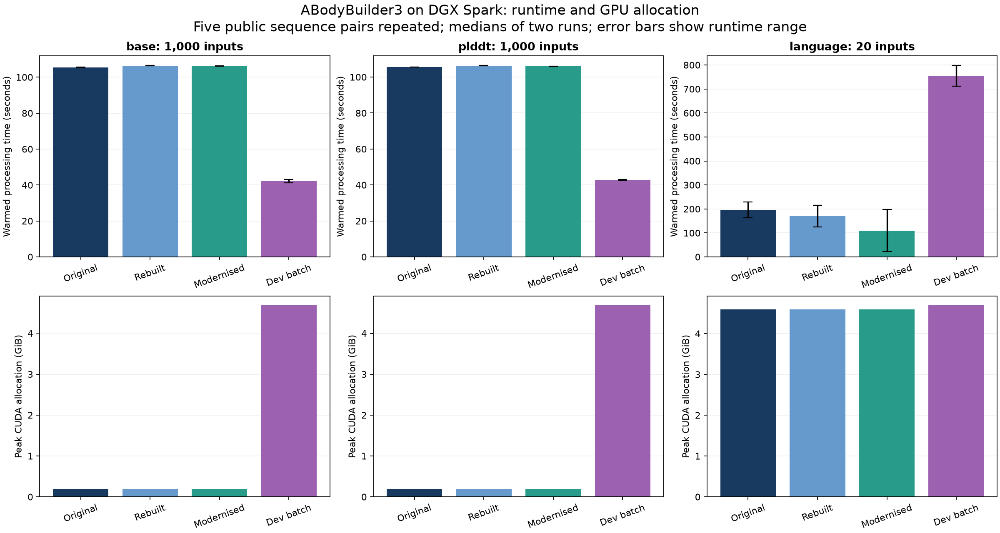

# ABodyBuilder3 deployment benchmarks — 25 October 2026

The original remains the default. All images, containers, checkpoints, inputs and outputs were retained.

## Warmed processing

One warm-up workload followed by two measured repetitions in the same loaded process. Times include feature/embedding preparation, inference and PDB string generation; imports, model loading and disk output are excluded. The workloads cycle five public sequence pairs. Language includes live ProtT5 embedding generation, with no embedding cache.

| Model | Inputs per repetition | Condition | Time, median (range), s | CUDA allocated peak, GiB | CUDA reserved peak, GiB | Sampled process RSS peak, GiB | Container lifetime accounted peak, GiB |
|---|---:|---|---:|---:|---:|---:|---:|
| base | 1,000 | Original | 105.49 (105.44–105.53) | 0.181 | 0.260 | 1.633 | 1.361 |
| base | 1,000 | Rebuilt | 106.38 (106.28–106.49) | 0.181 | 0.260 | 1.631 | 1.359 |
| base | 1,000 | Modernised | 106.18 (106.12–106.23) | 0.181 | 0.260 | 1.676 | 1.358 |
| base | 1,000 | Dev batching | 42.23 (41.32–43.15) | 4.682 | 6.062 | 3.508 | 3.251 |
| plddt | 1,000 | Original | 105.48 (105.48–105.48) | 0.181 | 0.262 | 1.636 | 1.364 |
| plddt | 1,000 | Rebuilt | 106.31 (106.20–106.41) | 0.181 | 0.262 | 1.634 | 1.362 |
| plddt | 1,000 | Modernised | 106.02 (105.91–106.12) | 0.181 | 0.262 | 1.674 | 1.357 |
| plddt | 1,000 | Dev batching | 42.86 (42.57–43.16) | 4.683 | 6.062 | 3.563 | 3.304 |
| language | 20 | Original | 195.41 (162.30–228.52) | 4.591 | 4.688 | 8.651 | 8.377 |
| language | 20 | Rebuilt | 170.13 (125.19–215.07) | 4.591 | 4.688 | 8.669 | 8.396 |
| language | 20 | Modernised | 110.11 (22.23–197.99) | 4.591 | 4.688 | 8.885 | 8.561 |
| language | 20 | Dev batching | 754.87 (711.90–797.84) | 4.690 | 4.695 | 9.000 | 8.720 |

CUDA and RSS peaks are the higher measured peak or loading peak. The container column is lifetime cgroup accounting, including warm-up. RSS is sampled every 50 ms and includes shared pages; container memory is cgroup-accounted memory and is a different measure. CUDA allocated/reserved memory must not be added to RSS to estimate physical unified-memory use.

Base and pLDDT dev results use batch size 32, selected from the 100-input screen (16, 32 and 64). Language uses a benchmark-only adapter that inserts unchanged ProtT5 embeddings into the dev batch representation, with batch size 3. That adapter is not an existing CLI feature.

Language timings vary strongly between repetitions, especially the modernised result. These data do not establish a reliable language-model speed ranking or an embedding-speed improvement. The language adapter was slower in these measurements and is not recommended for deployment.

## Complete eight-worker CLI jobs

Each measurement is a fresh container, including startup, model loading, prediction and writing all 1,000 PDB files. One whole-process warm-up precedes two measured fresh-container runs. These timings have a different scope from the warmed-processing table.

| Model | Condition | Complete time, median (range), s | Sampled concurrent CUDA allocated peak, GiB | Summed process RSS peak, GiB | Container lifetime accounted peak, GiB |
|---|---|---:|---:|---:|---:|
| base | Original | 82.14 (81.99–82.30) | 1.000 | 14.184 | 10.951 |
| base | Rebuilt | 81.38 (80.66–82.09) | 0.980 | 14.211 | 10.978 |
| base | Modernised | 80.23 (80.08–80.39) | 0.974 | 14.632 | 10.932 |
| plddt | Original | 81.34 (80.51–82.17) | 1.020 | 14.204 | 10.985 |
| plddt | Rebuilt | 82.28 (81.43–83.13) | 1.015 | 14.135 | 10.955 |
| plddt | Modernised | 82.76 (82.01–83.51) | 1.062 | 14.645 | 10.962 |

Worker CUDA usage is sampled every 100 ms and reconstructed as a concurrent sum. This can miss short allocation peaks; exact individual worker peaks are also retained in the measurement JSON. Summed RSS double-counts shared pages. Cgroup memory helps assess aggregate container use; neither column is total server memory.

## Prediction agreement

- All 88 captured source files, 322 installed Python distributions, three checkpoint hashes, OpenMM revision, Reduce binary and Reduce dictionary match in the original rebuild.
- All 54 source files under `src/` and all three checkpoints match between original and modernised.
- Rebuilt and modernised raw coordinates, atom masks, sequence identities and confidence arrays match the original exactly on the five saved public pairs in both measured repetitions, at every tested stage.
- All 19 larger-stage acceptance checks passed. The largest dev Cα coordinate difference was 0.00578 Å, below the pre-existing dev tolerance of 0.01 Å. Cα local-distance agreement was 1.0 on the evaluated pairs.
- All 18,000 PDB files from the 1,000-input CLI jobs were checked for correct heavy/light sequences and finite coordinates. For each model/input pair, all repeats and runtimes gave identical PDB bytes.
- The checks assess deployment agreement, not accuracy against experimental structures. The five-pair workload is a throughput test, not a diverse accuracy benchmark.

## Dev prediction differences by model

Worst differences across the evaluated distinct pairs, stages, batch sizes and both measured repetitions. All atom masks and residue identities match. The base model has no confidence head.

| Model | Maximum Cα coordinate difference, Å | Maximum atom coordinate difference, Å | Maximum aligned Cα RMSD, Å | Minimum Cα local-distance agreement | Maximum pLDDT difference, points |
|---|---:|---:|---:|---:|---:|
| base | 0.005778 | 0.041744 | 0.000716 | 1.000 | — |
| plddt | 0.005206 | 0.030111 | 0.000834 | 1.000 | 0.0449 |
| language | 0.002497 | 0.043825 | 0.000557 | 1.000 | 0.0220 |

The model output called `plddt` contains 50-bin confidence logits. The pLDDT differences above use softmax probabilities and the upstream bin centres (1, 3, …, 99), rather than interpreting the logits as scores.

An existing CLI limitation was identified: its JSON/confidence-filter path flattens these logits, and its PDB writer uses zero B-factors. Those annotations should not be interpreted as per-residue pLDDT scores. This comparison leaves the original CLI unchanged; the default coordinate predictions do not use a confidence threshold.

## Optional hydrogen addition

The CLI option named `--relaxation` currently calls hydrogen addition; it does not perform energy minimisation. Both supported hydrogen paths were checked separately on the 229-residue public example.

Legacy Reduce 4.16 emits an otherwise usable structure but exits with code 1 for this example, causing the CLI to fall back to PDBFixer. Reduce 4.17 exits with code 0, so the modernised CLI uses its Reduce output. The former path produced 3,407 atoms (1,688 hydrogens); Reduce produced 3,399 atoms (1,682 hydrogens). Direct Reduce atom counts match between releases; the CLI difference is the fallback behaviour. PDBFixer succeeds in all three images. Unrelaxed prediction identity does not imply identical optional hydrogen-added files.

## Interpretation

The original rebuild is reproducible from pinned public sources. Modernisation removes the custom OpenMM/PDBFixer builds while preserving the tested unrelaxed predictions. Its base/pLDDT speed is similar to the original. Dev GPU batching improves warmed structure processing by about 2.5× versus sequential processing, at higher CUDA allocation. It has not been wired into the existing dev CLI: that CLI currently parses `--batch-size` without dispatching the batch helper. No default was changed and no resources were deleted.

Only two timed repetitions were used. Language timings are not stable enough for a firm speed claim. Additional diverse sequences, longer loops and broader experimental-structure evaluation would be needed before making accuracy or general scaling claims.

