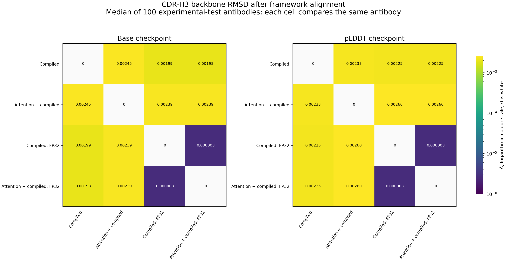

# Attention plus compilation — 25 October 2026

**Normal precision:** adding the point-attention rewrite reduced warmed model-pass time by about **4–5%** beyond compilation alone. **Strict FP32:** the combination was about **1–2% slower** than compilation alone. Memory use was almost unchanged. Neither combination is enabled on dev; main and dev are unchanged.

## Controlled comparison

All **100 experimental antibodies from the earlier published test set** were included, for both base and pLDDT checkpoints. No new targets were selected and the earlier 15 engineering fixtures were excluded. Each checkpoint ran compilation alone and attention-plus-compilation, each with normal TF32-permitted settings and globally strict FP32 settings: **8 conditions and 800 saved predictions**.

The controls and combinations used the same candidate module, weights, eight backbone updates, compact features, final-only side-chain outputs and pair-buffer reuse. Within each precision pair, the only model option changed was enabling the weighted-point matrix-multiplication rewrite. Strict FP32 was set before model loading and compilation. Normal settings were `high` with TF32 permitted; strict settings were `highest` with TF32 disabled. Both store FP32 weights and tensors.

Normal precision permits accelerated matrix multiplication with lower internal input precision and FP32 accumulation. Strict FP32 requests full FP32 matrix multiplication. This changes arithmetic, not the model or its weights, and does not double stored tensor memory. Strict FP32 still rounds results, and compilation can change operation order, so it does not guarantee bit-identical coordinates or better agreement with experiment.

Unlike the earlier strict-arithmetic diagnostic, **every condition here used compact features**. The old strict controls retained dense CPU features and should not be mixed with these resource results. Matching dataset hashes, observed-atom masks, feature mode, precision flags and model options were checked after execution.

## Speed

Values are medians of **four warmed passes** over the 100 antibodies. Negative runtime changes mean faster. Bold marks the lower runtime within each matched checkpoint/precision pair, not statistical significance.

| Checkpoint | Precision | Compilation alone | Attention + compilation | Runtime change |
|---|---|---:|---:|---:|
| base | Normal | 0.8867 s | **0.8536 s** | -3.73% |
| base | Strict FP32 | **0.9286 s** | 0.9436 s | +1.62% |
| plddt | Normal | 0.8946 s | **0.8494 s** | -5.05% |
| plddt | Strict FP32 | **0.9266 s** | 0.9378 s | +1.21% |

The normal-precision gain is modest: attention and compilation do not multiply their separate speedups. The benchmark used fixed **B=16, padded length 272**, with 100 real targets plus 12 dummy rows excluded from every score. It includes prepared-feature transfer, projection and model execution; it excludes imports, checkpoint loading, atom conversion, PDB writing, scoring and compilation. These are **model-stage timings, not complete CLI throughput**.

Every condition ran in a fresh offline container with a fresh compiler-cache directory. Condition order was reversed for the second checkpoint. The first forward, including compilation and kernel startup, took **24.1–25.1 seconds**. Four timed passes in one process are not four independent process replicates. The raw timing ranges and startup measurements are retained; a mixed-length production workload has not been qualified.

## Memory

| Checkpoint | Precision | Condition | Warm peak CUDA allocated | Sampled process-tree RSS peak | Container lifetime peak |
|---|---|---|---:|---:|---:|
| base | Normal | Compiler only | 1.495 GiB | 4.121 GiB | 2.298 GiB |
| base | Normal | Combined | 1.500 GiB | 4.127 GiB | 2.310 GiB |
| base | Strict FP32 | Compiler only | 1.495 GiB | 4.120 GiB | 2.300 GiB |
| base | Strict FP32 | Combined | 1.500 GiB | 4.123 GiB | 2.314 GiB |
| plddt | Normal | Compiler only | 1.495 GiB | 4.127 GiB | 2.303 GiB |
| plddt | Normal | Combined | 1.500 GiB | 4.130 GiB | 2.306 GiB |
| plddt | Strict FP32 | Compiler only | 1.495 GiB | 4.119 GiB | 2.293 GiB |
| plddt | Strict FP32 | Combined | 1.500 GiB | 4.129 GiB | 2.306 GiB |

Adding attention used approximately **4.8 MiB more peak CUDA allocation**. Sampled process-tree RSS stayed around **4.12–4.13 GiB**; container lifetime accounting stayed around **2.29–2.31 GiB**. Strict FP32 does not require larger stored tensors, so it did not materially increase memory here.

CUDA peaks are PyTorch allocator peaks during warmed passes; startup CUDA peaks were not collected. RSS sums the main process and its children and can count shared pages more than once. Container accounting is a separate lifetime measure, including startup. **Do not add these columns** to estimate physical unified memory. The data also retains main-process lifetime RSS, sampled-RSS definitions, reserved CUDA memory and all repetitions.

## Experimental accuracy

Each combined condition is compared with **compilation alone at the same precision**, using the original experimental coordinates and observed-atom masks. CDRs are scored after fitting that chain’s framework Cα atoms. All six CDRs, both frameworks, whole-Fv Cα/backbone RMSD, Cα-lDDT and confidence were assessed. No target was excluded.

| Checkpoint | Precision | Mean CDR-H3 RMSD, compiler → combined | Largest absolute CDR-H3 accuracy change | Closer / further from experiment |
|---|---|---:|---:|---:|
| base | Normal | 2.913913 → 2.913903 Å | 0.00505580 Å | 50 / 50 |
| base | Strict FP32 | 2.914038 → 2.914037 Å | 0.00000444 Å | 71 / 29 |
| plddt | Normal | 2.799087 → 2.799141 Å | 0.00390664 Å | 51 / 49 |
| plddt | Strict FP32 | 2.799069 → 2.799068 Å | 0.00001071 Å | 64 / 36 |

Better/worse counts use unrounded values with a 1e-10 numerical tie tolerance. They are not biological wins: **all 100 targets tie within a 0.01 Å reporting tolerance** for CDR-H3 backbone accuracy in every comparison. The normal-precision changes vary in direction across antibodies; the strict changes are smaller still. Tiny mean or bootstrap differences do not establish improved structural accuracy.

With normal precision, the maximum absolute CDR-H3 accuracy change was about **0.0051 Å**. With strict FP32 it was at most **0.000011 Å**. Strict combinations had exactly the same Cα-lDDT scores as their matched compiler-only controls on all 100 antibodies. These results provide no meaningful backbone-accuracy reason to prefer the combined approach.

## Local side chains

| Checkpoint | Precision | Largest atom displacement | Largest χ change | Largest per-residue side-chain accuracy worsening |
|---|---|---:|---:|---:|
| base | Normal | 0.774677 Å | 12.7114° | 0.177031 Å |
| base | Strict FP32 | 0.000697 Å | 0.0332° | 0.000086 Å |
| plddt | Normal | 0.327580 Å | 7.2933° | 0.157495 Å |
| plddt | Strict FP32 | 0.000338 Å | 0.0042° | 0.000046 Å |

The normal-precision base model’s largest change was **histidine H66 CE1 in 6dc4**, moving **0.775 Å**, with about **12.7°** change in χ1. Its symmetry-aware side-chain RMSD to experiment increased from **5.209 to 5.386 Å** after framework fitting. For pLDDT, glutamate L105 in **7k8o** worsened from **1.607 to 1.764 Å**. These are one-based input-chain positions, not IMGT residue numbers. Other residues improved. These local effects should not be hidden by whole-antibody averages or called universally harmless.

Across all observed side-chain atoms, the largest per-antibody RMSD change was about **0.0034 Å**. CDR-H3 side-chain accuracy changes reached about **0.012 Å** in magnitude. Strict-FP32 combinations stayed much closer locally: atom displacements were below **0.0007 Å**, and the largest per-residue accuracy worsening was below **0.00009 Å**. Equivalent side-chain atom names are handled per residue; unknown residues have no assigned χ torsions.

The same backbone-bond, peptide-continuity and heavy-atom clash screens were retained. The clash screen is a geometric proxy, not MolProbity. Normal conditions moved a few atom pairs across the cutoff in either direction; the strict combinations left clash counts unchanged for every target. No hydrogenation or relaxation was performed. The largest pLDDT score change was **0.243/100** with normal precision and below **0.0005/100** with strict FP32. The base checkpoint has no confidence head.

## Pairwise structure comparisons

All eight predictions of each same antibody were compared, giving **28 pairs per antibody and 2,800 pairs**. Four distances were retained: aligned Cα RMSD, aligned backbone RMSD, framework-aligned CDR-H3 backbone RMSD and local Cα distance RMSD. Individual matrices and average-linkage trees are in the evidence archive. The strict compiler/combined pair remained closer to each other than to either normal condition for all 100 antibodies in both checkpoints.

Each cell is a median of same-antibody comparisons across the 100 targets, not an alignment of unrelated antibodies. In the figure, “FP32” denotes strict arithmetic; all conditions store FP32 tensors. Zero cells are white; colours are logarithmic.

## Decision

**Strict FP32:** compilation alone is the better measured choice here: faster, slightly less CUDA allocation, and effectively the same accuracy. **Normal precision:** combining attention adds a small warmed compute-stage gain but introduces additional local side-chain changes. A production throughput comparison would be needed to determine whether that small gain survives CPU work, output writing and varying lengths. Neither combination has been enabled or merged into dev.

The scope is the authors’ published 100-antibody test set and the base/pLDDT checkpoints. The LM checkpoint, other GPUs, dynamic production batches, functional binding effects and docking were not tested. This is a controlled engineering screen, not a new universal accuracy claim.

## Evidence and reproduction

- [Timing, resource metadata and paired directions](data/combined_compilation_251026/comparison_summary_251026.json)
- [All region/accuracy summaries](data/combined_compilation_251026/structural_summary_251026.json)
- [Per-antibody accuracy changes](data/combined_compilation_251026/per_antibody_accuracy_changes_251026.csv)
- [Local side-chain assessment](data/combined_compilation_251026/sidechain_assessment_251026.json)
- [Pairwise matrices and cluster summary](data/combined_compilation_251026/pairwise_summary_251026.json)
- [Full comparison archive](data/combined_compilation_251026/abodybuilder3_combined_comparisons_251026.zip)
- [Checksums](data/combined_compilation_251026/abodybuilder3_combined_checksums_251026.txt)

The original tensors, 800 raw predictions/PDBs, compiler caches, logs and frozen source remain in the local study. The existing dataset was reused read-only, with every input tensor hash and observed-atom mask matched. All first-batch repeated coordinates and confidence outputs matched exactly within each condition (16 targets × 8 conditions).

Use the unchanged pinned runtime from the earlier study, or a verified rebuild supplied with `--image`. The reusable controller was run with `--experimental-only --feature-mode compact --implementation candidate --variants compiled combined_compiled strict_compiled strict_combined_compiled --repeats 4 --reference compiled --strict-reference strict_compiled --matched-precision --reverse-second-model`, a fresh study directory/frozen component copy and the verified dataset supplied through `--data`. The same parameters for reference/precision selection are supported by the structural and side-chain scorers. The pairwise tool accepts the four variants explicitly. Protocol, source hashes and validation records are in the archive.

Model execution and all stored-output validations passed. The existing scoring/model tests remain applicable: no model equations or scoring formulas changed in this follow-up; the experiment composes the already tested attention and compiler paths and adds explicit dataset/feature/reference selection. Main remains `a5deeb1`, dev remains `bd8a12e`. The full source/runtime identities are retained in the data.
