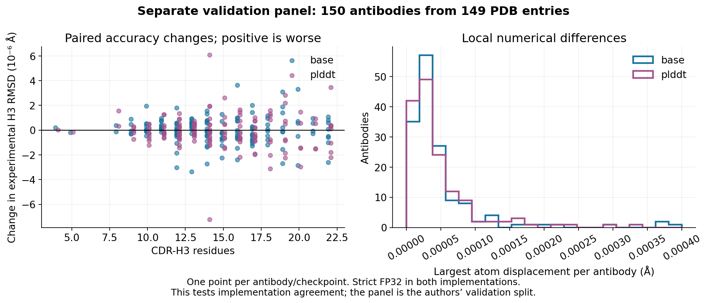
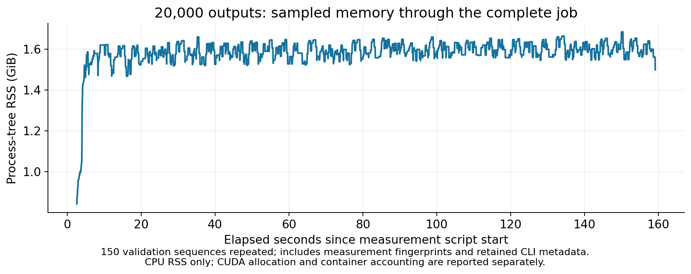

# Saved AOT deployment: installed-CLI validation — 26 October 2026

The approved **strict FP32 + saved AOT executable + native writer** route is
integrated on dev. At 1,000 inputs it completed in about 13 seconds, compared
with about 30 seconds for matched strict-FP32 eager execution and the Python
writer: **2.25× for base and 2.30× for pLDDT**. The trained models, weights and
all eight structure updates are unchanged. Main is unchanged.

This is a combined deployment comparison, not an estimate of AOT alone. The
[isolated AOT study](https://github.com/adrian-greenneuron/ABodyBuilder3-DGX-Spark/blob/components/openfold-structure-251026/docs/abodybuilder3_aot_deployment_261026.md)
retains the earlier matched-writer comparison with cached JIT.

## Complete-job speed and memory


Each condition ran twice in a fresh offline GPU container, interleaved with its
control and reversing order for the second repetition. Timings include imports,
checkpoint/package loading, features, inference, fingerprint instrumentation,
and every PDB write. Compact raw evidence was saved after the timed CLI call;
container wall time includes that saving and container startup/exit. Both sides
used strict FP32, seed 42, the same inputs and automatic batch policy. The 100
inputs are the previous published test cohort; 1,000 inputs cycle those targets.
This is throughput evidence, not 1,000 independent biological samples.

Time is median (range); memory is the higher measured peak of the two runs.

| Inputs | Checkpoint | Execution / writer | Complete container seconds | CUDA allocated GiB | Sampled RSS GiB |
|---:|---|---|---:|---:|---:|
| 100 | base | eager | 7.94 (7.94–7.95) | 2.007 | 1.684 |
| 100 | base | aot | 6.00 (5.96–6.04) | 1.213 | 1.425 |
| 100 | plddt | eager | 8.07 (8.03–8.10) | 2.007 | 1.709 |
| 100 | plddt | aot | 6.27 (6.24–6.30) | 1.213 | 1.402 |
| 1,000 | base | eager | 29.74 (29.41–30.06) | 3.987 | 1.837 |
| 1,000 | base | aot | 13.22 (13.06–13.38) | 2.390 | 1.572 |
| 1,000 | plddt | eager | 30.65 (30.58–30.71) | 3.987 | 1.844 |
| 1,000 | plddt | aot | 13.31 (13.30–13.31) | 2.390 | 1.569 |

CUDA values are exact per-process PyTorch allocator peaks; RSS is sampled
process-tree memory every 50 ms. Container/cgroup lifetime peaks are retained in
the data and include a different set of pages and caches. These quantities
**must not be added** on Spark's unified-memory system. Earlier dev defaulted to
TF32-permitted FP32; these paired controls explicitly disable TF32 in both
matmul and cuDNN. The older timings are not substituted for these new controls.

## Independent implementation-validation panel

All **150 published upstream validation antibodies from 149 PDB entries** were
selected, with no exclusion after prediction. They were not used in our earlier
100-target implementation tuning. Combined lengths were 221–248 residues and
CDR-H3 lengths 4–22. The model authors used this validation split, so this is not
a new held-out test of model accuracy. Both checkpoints ran twice per mode.



| Checkpoint | Mean aligned Cα RMSD, AOT vs eager | Largest Cα displacement | Largest atom displacement | Largest change in experimental H3 backbone RMSD |
|---|---:|---:|---:|---:|
| base | 0.00000158 Å | 0.0000530 Å | 0.000388 Å | 0.00000363 Å |
| pLDDT | 0.00000155 Å | 0.0000536 Å | 0.000332 Å | 0.00000721 Å |

Each antibody contributes once to means and distributions. Fresh-process
repetitions assess repeatability, not independent biological replication.
Raw coordinates/masks/confidence repeated exactly within each condition.
AOT versus eager is **not byte-identical**, because compiled floating-point
operations round differently. The predeclared gates were maximum Cα displacement
0.001 Å, aligned Cα RMSD 0.0001 Å and maximum valid-atom displacement 0.01 Å;
all cases passed.

Accuracy uses the published observed-atom masks and region labels. Whole-Fv
Cα superposition, framework-aligned CDR backbone RMSD, Cα lDDT, symmetry-aware
experimental side-chain RMSD, χ-torsion changes, a stated clash proxy and model
confidence were assessed. The largest χ change was 0.00893 degrees. The clash
proxy counts were unchanged. Maximum changes in framework-aligned H3
side-chain RMSD were below 0.000015 Å. Cα lDDT has discrete thresholds: the
largest per-target change was 0.00419 percentage points; its mean paired change
was under 0.000001 percentage points. No experimental accuracy gain is claimed.

Confidence comparisons correctly convert the confidence-head logits to expected
scores; maximum change was 0.000686 points. This does **not** correct the
production JSON/filtering issue: those paths still flatten logits and PDB
B-factors remain zero. That separate correctness change remains for discussion.

## Shape, failure and sustained-operation checks

- **90 paired GPU shape cases** cover both checkpoints, batches 1, 2, 3, 16,
  31 and 32, a batch-33 fallback, lengths 199, 200, 201, 225, 271, 272 and 273,
  plus mixed padding. These length edits are engineering fixtures, not accuracy
  observations. All numerical gates passed; the largest fixture Cα displacement
  was 0.000257 Å. Outside-domain calls used the same model in strict eager mode,
  with explicit warnings and audit counts.
- **213 native-writer regression fixtures**, plus concurrent formatting, matched
  the Python reference byte for byte. The C++ source is unchanged from the
  separately reviewed component. Existing real-prediction writer evidence also
  applies to this unchanged implementation.
- **23 focused CPU checks** passed: seven saved-execution guards and 16 CLI/
  pipeline checks, including simulated OOM splitting, non-OOM error propagation,
  duplicate names, output formats, invalid sequences/names, missing custom
  checkpoints and explicit overwrite. A nonexistent custom checkpoint cannot
  silently select released weights.
- The actual GPU CLI rejects a missing package without writing a prediction.
  CPU guard checks cover corrupt packages, escaping paths, mismatched sources,
  checkpoint/runtime/protocol identities and incompatible precision.
- A deliberately interrupted qualification job exited 130 after its first
  batch, retained 32 complete PDBs, and marked its batch audit incomplete. Only
  that dedicated test container received SIGINT; normal runs were not stopped.
- The installed CLI completed a real optional OpenMM hydrogen-preparation call
  with separate raw/prepared files and an audit. The chemical implementation
  and protocol are unchanged; existing Reduce and CUDA-minimisation evidence is
  reused rather than rerunning the whole chemistry suite.
- The language checkpoint completed one offline strict-FP32 eager prediction.
  Its existing Lightning embedder needs a writable log mount when run as a
  non-root user; the initially missing mount failed explicitly and its log was
  retained. This is a compatibility smoke test, not a language benchmark or
  AOT qualification.



A **20,000-output pLDDT job** cycled the 150 validation antibodies, taking
**161.02 seconds** including the container, and 159.18 seconds to CLI completion
inside the process. All outputs were accounted for in 734 batches, with 20,000
native-writer calls, no OOM retries and no JIT graphs. Peak CUDA allocation was
2.429 GiB, sampled process-tree RSS 1.684 GiB and container lifetime accounting
4.196 GiB. They measure different things and are not summed.

RSS medians were approximately 1.571 GiB at 10–30 seconds, 1.589 GiB at 60–90
seconds and 1.599 GiB at 120–150 seconds. This short test found no queue stalls or
large memory growth; it does not prove leak freedom. Input/job/audit metadata
and measurement fingerprints accumulate with job size, so this is not a
constant-memory claim. Repeating sequences here tests sustained execution, not
new biological targets.

## Build and provenance

The clean source checkout at `159c8af` built from the pinned public NGC base,
model foundation, Reduce revision and published checkpoints, with Docker build
cache disabled. No retained experimental parent image or compiler cache was
used. All four base/pLDDT batch-domain packages were compiled in that new runtime
and checked through the saved-package loader before assembly. Preparation and
build time are excluded from prediction measurements. Inference creates no
Dynamo graphs; missing packages are never recompiled silently.

The main measured image was
`sha256:6410939e2ce98851b28002e3574f1ecad1dcf10d81c6bd3bf9380ce7a4ea324e`.
The later CLI-only qualification image adds invalid-input/overwrite/custom-path
checks; model code, writer code, weights and saved executables are unchanged.
The final image is
`sha256:2774ec553f5653e8ba97c761824f55b6d6c49b5df3573382079a23a1ae912354`;
its source/runtime reference is `tests/reference_dev_aot_runtime_261026.json`. This reuses applicable numerical evidence for the unchanged model path.

The build script first produces a fresh runtime image, then runs GPU export and
finally packages the executables with `Dockerfile.aot`. GPU export is separate
because ordinary Docker builds do not expose the GPU. The final image contains
both checkpoints' batch-1 and batch-2–32 packages for padded lengths 200–272.
Package hashes, source hashes, checkpoint identity, precision, Python/PyTorch/
CUDA versions, machine architecture and GPU compute capability are checked on
loading. A different runtime needs its own package preparation/qualification.

The initial measurement adapter needed two corrections: adding the installed
scripts to its import path and creating its single-job output directory. Those
failed attempts are retained locally. Measurement sources were snapshotted
after the completed runs and before later instrumentation; that timing is
stated in the evidence. Exact per-job commands are retained. No failed job is
included in the performance medians.

## Reproducing and inspecting the evidence

```bash
NO_CACHE=1 ./docker_build.sh build
# Mount the repo at /workspace for CPU guards and GPU shape checks:
docker run --rm --gpus all --ipc=host -v "$PWD:/workspace" \
    abodybuilder3-dev-spark:latest \
    python3 -m unittest discover -s /workspace/tests -p test_aot_runtime.py
```

`tools/measure_deployment.py` instruments the installed CLI without substituting
another model, forward function or scheduler. `tools/run_deployment_study.py`
queues the finite interleaved comparison when supplied with its recorded input
CSVs; `tools/run_deployment_checks.py` performs the compatibility and sustained
checks. `tools/prepare_validation_panel.py` verifies selected, checksum-recorded
published tensors and writes CSV/truth files. The selection manifest records
all source archive members and hashes. `tools/score_deployment.py` reuses the
existing structural scorer unchanged and scores all paired saved raw results;
`tools/publish_deployment_results.py` creates the plots and compact evidence.

[Paired per-antibody data](data/abodybuilder3_dev_aot_paired_accuracy_261026.csv) ·
[Compact measurements](data/abodybuilder3_dev_aot_evidence_261026.json) ·
[Evidence archive](data/abodybuilder3_dev_aot_evidence_261026.zip) ·
[Checksums](data/abodybuilder3_dev_aot_checksums_261026.txt)

Weights, raw predictions, sequences, preparation graphs, compiler caches and
executable packages remain outside Git. The published archive contains compact
metrics, source identities, selection hashes and audit records, not those
payloads. Profiling and later speed experiments are the next priorities; no
additional attention or reduced-precision default is enabled by this change.
