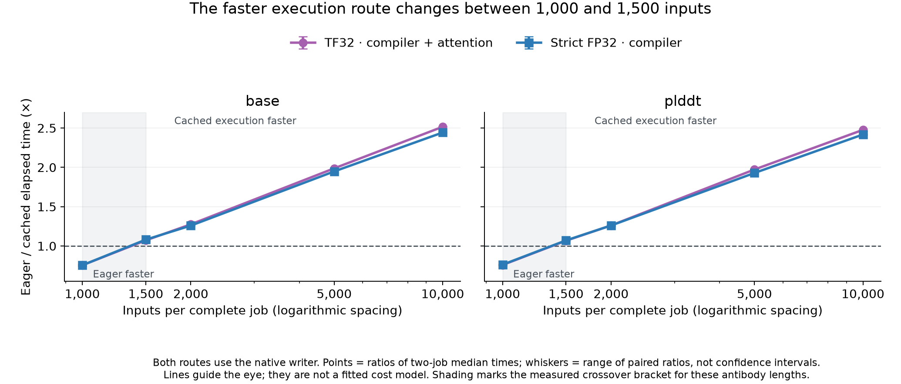

# Choosing eager or compiled inference by job size — 26 October 2026

For the tested 219–242-residue antibodies, **eager inference was faster at 1,000 inputs; cached compilation was faster at 1,500, 2,000, 5,000 and 10,000 inputs**. Both strict-FP32 and TF32-permitted speed profiles showed this pattern on both checkpoints. This supports making the execution decision once at startup, while keeping precision an explicit user choice. Main and dev are unchanged; no automatic selector has been deployed.

Above 1, cached execution is faster; below 1, eager inference is faster. Points are ratios of the two-job median times. Whiskers show the range of the two paired job ratios, **not confidence intervals**. The lines guide the eye rather than fit a cost model; [both individual timing pairs](data/abodybuilder3_crossover_plot_data_261026.csv) are available.

## Matched complete-job times

All approaches use the exact-output native PDB writer. The **TF32-permitted profile** uses cached compilation plus point-matmul attention. The **strict-FP32 profile** uses cached compilation alone: its bulk speed was similar without introducing another arithmetic replacement. These profiles were selected for calibration after the preceding bulk study, not as new models or an independent accuracy test. References use the same precision as their candidate.

Times are medians of two fresh-container commands including startup, imports, weights, all inference, atom conversion and every PDB write. Each row compares the same input order, batch shapes, two CPU preparation/writer threads and no OOM retries. Bold marks the lower displayed time within each precision pair; it does not imply significance. The ratio is eager time divided by cached time, so **above 1 favours compilation**.

| Inputs | Checkpoint | Eager TF32 (s) | Cached TF32 profile (s) | Ratio | Eager strict FP32 (s) | Cached strict FP32 profile (s) | Ratio |
| --- | --- | --- | --- | --- | --- | --- | --- |
| 1,000 | base | **25.61** | 33.89 | 0.76× | **25.89** | 34.27 | 0.76× |
| 1,000 | plddt | **25.87** | 34.09 | 0.76× | **26.14** | 34.27 | 0.76× |
| 1,500 | base | 35.54 | **33.15** | 1.07× | 36.06 | **33.36** | 1.08× |
| 1,500 | plddt | 35.82 | **33.55** | 1.07× | 36.32 | **33.90** | 1.07× |
| 2,000 | base | 46.46 | **36.42** | 1.28× | 46.94 | **37.26** | 1.26× |
| 2,000 | plddt | 46.72 | **37.04** | 1.26× | 46.97 | **37.24** | 1.26× |
| 5,000 | base | 108.10 | **54.38** | 1.99× | 109.15 | **56.01** | 1.95× |
| 5,000 | plddt | 108.35 | **54.92** | 1.97× | 109.28 | **56.65** | 1.93× |
| 10,000 | base | 213.58 | **84.87** | 2.52× | 216.22 | **88.48** | 2.44× |
| 10,000 | plddt | 213.96 | **86.36** | 2.48× | 215.63 | **89.18** | 2.42× |

The new calibration comprises **64 fresh jobs and 152,000 written PDBs** at 1,000/1,500/2,000/5,000 inputs; 10,000-input rows reuse the prior matched bulk measurements. The 1,500-input boundary was tested after the first screen bracketed the crossover between 1,000 and 2,000. Each workload repeats the same **100 distinct published experimental-test antibodies**, with unique output names and no prediction caching. This is a job-size calibration, not extra independent biological evidence.

## What a startup decision should consider

The total job size determines whether startup costs can be amortised. The **GPU microbatch cap** is a separate setting; it stayed at 32 throughout these jobs. The measured crossover lies between the 1,000- and 1,500-input points for this particular workload and cache bank. Compiled time need not rise monotonically with job size: partial batches, graph/guard reconstruction and available cached shapes affect startup.

Within this measured scope, choosing eager for the small jobs and cached execution from 1,500 inputs would select the faster measured route. The exact boundary inside that interval has not been established. A production selector should also consider checkpoint, requested precision, antibody-length distribution, memory budget, compatible cache availability and runtime/GPU identity. It should expose the selected route and an explicit override. A different precision should never be selected silently. Unknown length/cache regimes require further qualification rather than treating this one crossover as universal.

## Prediction and accuracy checks

All jobs wrote the expected number of PDBs; every native-writer call was counted. Batch shapes matched between eager and compiled conditions. Every raw fingerprint reproduced exactly across the two fresh processes for all 32 matched condition pairs. This repeatability result applies to these prepared caches and workload shapes; it does not promise bit-identical results on other software or hardware.

Both repetitions were scored against the retained experimental structures using the first occurrence of each of the 100 distinct targets. Distances below are Å, relative to eager inference at the same precision. H3 error is backbone RMSD after heavy-chain framework Cα alignment; Cα-lDDT changes are percentage points. The maxima cover both checkpoints and all four new job sizes, without treating repeated inputs as independent antibodies.

| Profile | Largest H3 error change | Largest raw Cα displacement | Largest raw atom displacement | Largest Cα-lDDT change (pp) |
| --- | --- | --- | --- | --- |
| TF32 permitted | 0.00338361 | 0.062709 | 0.293824 | 0.025130 |
| Strict FP32 | 0.00000462 | 0.000063 | 0.001338 | 0.004188 |

The changes are consistent with the [bulk accuracy results](abodybuilder3_overnight_optimisation_261026.md): strict-FP32 changes are much smaller, while TF32-permitted results can move individual side-chain atoms more visibly despite tiny backbone-error differences. Neither profile is enabled on dev. The earlier matched all-PDB writer exactness checks remain separate from these deliberate compiler arithmetic changes.

Peak CUDA allocated/reserved memory, process-tree RSS, container memory, all individual times and per-target structural/confidence scores are in the [calibration evidence](data/abodybuilder3_job_size_crossover_evidence_261026.zip) and [resource CSV](data/abodybuilder3_job_size_resources_261026.csv). CUDA allocation remains around 4.0 GiB for eager and 2.26–2.27 GiB for compiled execution, with higher CPU RSS for compiled paths. These quantities must not be added on the Spark's unified-memory system.

## Reproduction

`tools/run_cached_formatter_study.py` now accepts `--reuse-images`, `--counts`, `--speed-profiles` and `--skip-probes`. The calibration reused the exact eight Docker image identities from the completed bulk study, with no rebuilding or changes to the baked kernel banks. New input CSVs are prefixes of the retained 10,000-row workload and are mounted read-only; model and component code remain in the prepared images. Existing passing 100-input qualification was reused, not rerun. `tools/analyse_bulk_pipeline.py --count ... --reference-label native_writer --expected-jobs 16 --output-prefix ...` scores each job size with the same structural metrics.

The pinned runtime, checkpoints, allocator and preserved main/dev commits are documented in the [overall results](abodybuilder3_overnight_optimisation_261026.md). All images, caches, raw outputs and frozen launcher/analysis identities remain retained locally.
