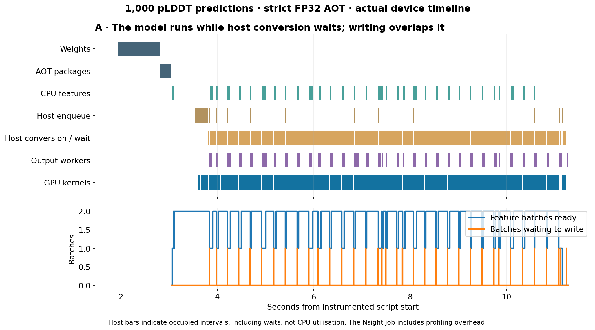
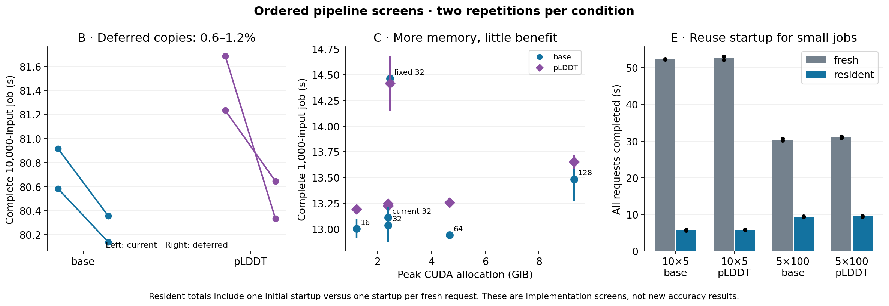
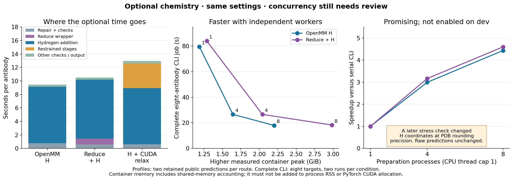

# Ordered optimisation results — 26 October 2026

The list has now been worked through to J. Dev keeps **strict FP32 + saved AOT
executables + native writer**, with the accepted direct batch-1 language encoder.
The largest additional opportunities are repeated small requests and parallel
chemical preparation. The former is a local prototype; the latter needs review
because final qualification found small hydrogen-coordinate differences. Main
and its Docker image are unchanged; all experimental images and data are retained.

## What the profile changed about the priorities

The normal 1,000-input pLDDT job took 13.183 seconds. CUDA/NVTX instrumentation
gave 13.213 seconds; Nsight collection/export gave 17.989 seconds. All outputs
matched. The trace shows the GPU model running while host conversion waits for
it; the roughly seven-second host conversion interval is largely a synchronisation
wait, not seven seconds of conversion arithmetic. Features and writing overlap
inference, and the queues remain bounded.

Deferred copies preserved all raw/PDB bytes, but improved the 10,000-input median
by only 0.6–1.2% over two repetitions. Wider batch domains and fixed-length banks
did not give a convincing complete-job gain; batch 128 used about 9.3 GiB of
CUDA allocation. Newly exported packages also changed floating-point results.
The existing transfer, package and batch defaults were retained. No additional
output-streaming rewrite was justified by the timeline or sustained-memory trace.

The resident-process prototype reuses weights/executables, not predictions.
Ten separate five-input requests took about 5.8 seconds in one resident process
instead of 52 seconds in fresh containers, with exact outputs. Five 100-input
requests improved about 3.2×. These are startup savings for separate requests;
combining an already known workload in one CSV avoids that repeated startup too.
The prototype is not enabled as a production job service.

The G kernel screen compared the existing strided geometry update with whole-
tensor concatenation. Concatenation preserved outputs but was about 14–15×
slower in the standalone update. The current kernel path was retained.

The [pipeline component report](https://github.com/adrian-greenneuron/ABodyBuilder3-DGX-Spark/blob/components/aot-pipeline-261026/docs/aot_pipeline_optimisation_261026.md)
contains individual timings, numerical comparisons and the original/candidate
code. [Compact measurements](data/aot_pipeline_measurements_261026.json) and a
[checksummed archive](data/aot_pipeline_evidence_261026.zip) accompany this report.

## The language improvement is accepted

The [language lifecycle change](abodybuilder3_language_lifecycle_261026.md),
pushed in dev `49080c3`, keeps the same batch-1 ProtT5 encoder on the GPU rather
than repeatedly tearing it down and transferring it between devices. The
five-input stage comparison improved 19.2×; the separate eight-input installed-
CLI check improved 22.3×. These measurements use different CPU-thread protocols,
documented in that report, and should not be pooled into one benchmark.

Embeddings, raw outputs and PDBs were exact across 13 distinct checked targets.
The old Trainer backend remains available explicitly. No language batching,
precision or weights change is enabled, and no accuracy gain is claimed.

## H–J: optional chemistry is promising, but held back

OpenMM hydrogen addition took about 8–9 seconds per antibody; Reduce itself took
about 0.7 seconds. ForceField caching already existed. Rewriting Reduce or
missing-atom detection would target a small fraction of the present cost.

Independent CPU-1 preparation processes gave substantial complete-job gains:

| Eight-input pLDDT CLI job | Serial median | Four workers | Eight workers |
|---|---:|---:|---:|
| OpenMM hydrogens | 79.62 s | 26.60 s | 17.95 s |
| Reduce flips + OpenMM hydrogens | 84.07 s | 26.57 s | 18.28 s |

The eight-worker candidate used higher measured container peaks of about
2.20/2.99 GiB, compared with 1.19/1.29 GiB serial. Summed process RSS is a
different, overlapping measure; OpenMM CUDA allocations are not captured by
PyTorch's allocator. Model and chemistry precision settings were held fixed.

The matched comparisons initially produced identical PDBs. A later independent
check changed eleven hydrogen coordinate fields by 0.001 Å in one antibody.
Raw predicted coordinates and original heavy atoms remained unchanged. A
full-float trace located the first difference in PDBFixer's **added-atom repair**:
about 1.49 × 10⁻⁷ Å in a Cartesian coordinate, propagating to about 0.000212 Å in
hydrogen coordinates. This can cross a PDB rounding boundary. The unchanged
repair selects single-precision CUDA with deterministic forces disabled; its
settings are separate from the model's strict-FP32 setting.

The four-worker stress trace also showed that variation, so reducing the cap
does not establish exactness. Parallel preparation remains on its component
branch; **dev's chemical preparation stays serial**. This small difference is
not evidence of worse model accuracy, but must be reviewed before changing
the default. A deterministic-repair experiment would be an explicit new
comparison, not a silent patch.

Extra CPU threads inside one hydrogen engine were faster but produced much
larger hydrogen differences, up to 2.21 Å. Concurrent CUDA relaxation reduced
five-input group time from about 56.6 to 31.3 seconds, but changed relaxed
coordinates; all cases converged and no experimental-accuracy equivalence is
claimed. Both candidates remain isolated. No internal Reduce, PDBFixer or
OpenMM rewrite is enabled.

The [preparation component report](https://github.com/adrian-greenneuron/ABodyBuilder3-DGX-Spark/blob/components/structure-preparation-261026/docs/preparation_optimisation_261026.md)
includes within-condition variation, energies, forces, geometry, failure
retention and original/candidate code. The [measurements](data/preparation_optimisation_measurements_261026.json)
and [checksummed archive](data/preparation_optimisation_evidence_261026.zip)
retain the final qualification limitation as well as the passing tests.

Plain base/pLDDT prediction was exact across all 4,000 paired raw fingerprints
and PDBs in the preparation-candidate regression. Median timings were within
1% of dev, with identical peak CUDA allocation. Nothing from this candidate
is promoted on the strength of those plain-prediction checks alone.

## State after this pass

The accepted AOT/native and language lifecycle improvements are on dev.
Resident jobs are a separate exact-output prototype; transfer/shape/kernel
candidates are not adopted. Parallel chemistry is available only in isolated
experimental code and retained candidate images pending review of its
repeatability. The existing confidence-export bug remains a separate
correctness change for discussion. No new accuracy claim or main-branch change
is made by these screens.
