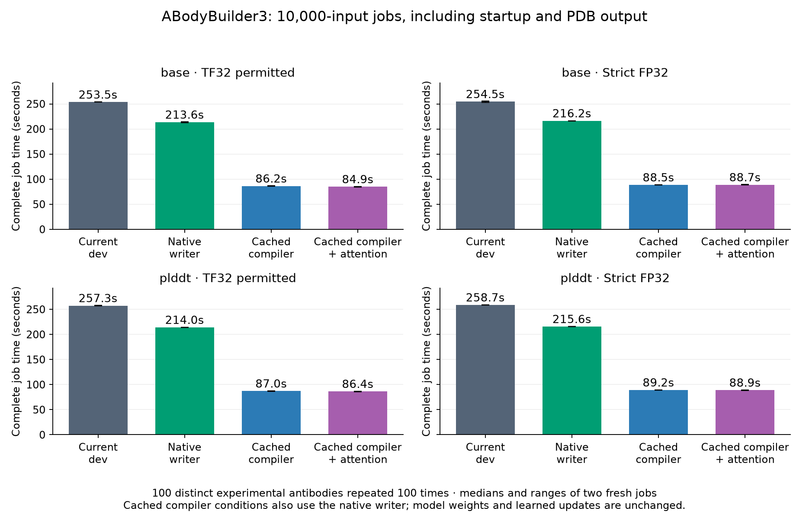

# Batching optimisation results — 26 October 2026

**Two useful gains emerged.** Replacing Python PDB formatting with an exact-output native writer gives **1.19–1.22× throughput** on 10,000-input jobs. Combining that writer with Docker-packaged compilation gives approximately **2.9–3.0× throughput**, including fresh startup and writing every PDB. Compilation changes floating-point results, so it remains a candidate for review. **Main and dev are unchanged; no new option is enabled there.**

## Full-pipeline results for 10,000 inputs

Each value is the median of two fresh-container jobs; the evidence retains both times. The four approaches used matched input order and GPU batch shapes. All times include imports, weight loading, CPU preparation, inference, coordinate conversion, common raw fingerprints, PDB output and container exit. The compiler conditions also use the native writer. Bold marks the lowest displayed median within each row, not significance.

| Checkpoint | Precision | Current dev (s) | Native writer (s) | Cached compiler + writer (s) | Cached attention + compiler + writer (s) | Combined vs dev |
| --- | --- | --- | --- | --- | --- | --- |
| base | TF32 permitted | 253.52 | 213.58 | 86.20 | **84.87** | 2.99× |
| base | Strict FP32 | 254.53 | 216.22 | **88.48** | 88.72 | 2.87× |
| plddt | TF32 permitted | 257.34 | 213.96 | 87.04 | **86.36** | 2.98× |
| plddt | Strict FP32 | 258.72 | 215.63 | 89.18 | **88.90** | 2.91× |

These throughput jobs repeat **100 distinct published experimental antibodies** 100 times, using unique output names and **no prediction cache**. They are not 10,000 independent antibodies or a broader accuracy test. Both released base/pLDDT checkpoints, seed 42 and eight learned structure updates were preserved. Optional chemistry and the language checkpoint are outside the comparison. Two preparation and two writer threads overlap one model-owning GPU process; the automatic GPU batch cap is 32 here. Earlier tests use 16 for 100 inputs. Every job completed without OOM retries.

## Precision is an explicit choice

The two tested modes both store weights and tensors in FP32. **TF32 permitted** is the existing NGC/dev setting: `float32_matmul_precision='high'`, CUDA matrix `allow_tf32=True`. **Strict FP32** uses `highest` and disables TF32 matrix multiplication before inference; compiler fusion/reassociation can still change the final bits. These experiments did not use BF16, FP16 or autocast. No precision is changed automatically.

Strict-FP32 cached compilation is only a few percent slower here than TF32-permitted compilation, while its numerical changes are much smaller. Attention adds around 1–2% to normal-precision bulk throughput; its strict-FP32 benefit is inconsistent between checkpoints. Two repetitions do not establish that these small differences are repeatable. A sensible review candidate is **strict FP32 + cached compiler** for close arithmetic agreement, with **TF32 + cached compiler/attention** as an explicitly selected faster mode. This is a proposal, not a change to the default.

## Prediction differences and experimental accuracy

The native writer alone passed every fingerprint and PDB-byte comparison in all **88,820** matched predictions of its original screen, plus **80,000** matched predictions in this bulk comparison. This is separate from the compiler's numerical differences. All 16 bulk condition pairs also reproduced every raw prediction fingerprint across their two fresh runs.

For scientific accuracy, the **first occurrence of each of the 100 distinct experimental targets** was scored in **both** fresh repetitions. Masks and experimental backbone coordinates came from the retained published test dataset. CDR-H3 RMSD follows alignment on the heavy-chain framework Cα atoms; Cα-lDDT measures local distances on all matched Cα atoms. Both frameworks, all six CDRs and confidence changes are retained in the per-target evidence. Distances are Å; lDDT changes are percentage points.

The table shows the larger deviation across the two fresh runs, always against current dev at the **same precision**. H3 mean is averaged across the two process replicates, not treated as 200 independent antibodies. Smaller accuracy changes do not establish a scientifically superior predictor.

| Checkpoint | Precision | Candidate | Mean H3 RMSD to experiment | Largest H3 RMSD change | Largest raw Cα displacement | Largest raw atom displacement | Largest Cα-lDDT change (pp) |
| --- | --- | --- | --- | --- | --- | --- | --- |
| base | TF32 permitted | Cached compiler + native writer | 2.913793 | 0.00248318 | 0.023713 | 1.403312 | 0.013080 |
| base | TF32 permitted | Cached attention + compiler + native writer | 2.913700 | 0.00271644 | 0.030447 | 0.293824 | 0.022641 |
| base | Strict FP32 | Cached compiler + native writer | 2.914036 | 0.00000434 | 0.000031 | 0.001338 | 0.000000 |
| base | Strict FP32 | Cached attention + compiler + native writer | 2.914036 | 0.00000795 | 0.000032 | 0.000401 | 0.004186 |
| plddt | TF32 permitted | Cached compiler + native writer | 2.799059 | 0.00297330 | 0.070995 | 0.224426 | 0.016504 |
| plddt | TF32 permitted | Cached attention + compiler + native writer | 2.799105 | 0.00338361 | 0.062709 | 0.186948 | 0.025130 |
| plddt | Strict FP32 | Cached compiler + native writer | 2.799067 | 0.00000462 | 0.000063 | 0.000242 | 0.004188 |
| plddt | Strict FP32 | Cached attention + compiler + native writer | 2.799067 | 0.00000732 | 0.000113 | 0.000458 | 0.004219 |

At TF32-permitted precision, compiler-related H3 accuracy changes stayed below **0.0034 Å** in this bulk test. Individual side-chain atoms still moved by up to **1.403 Å versus dev**, or **1.560 Å between attention-plus-compiler and compiler alone**. Such movements are not backbone accuracy losses, and atom displacement alone cannot tell whether a side chain became more accurate. Strict-FP32 changes were much smaller: H3 error changes below **0.000008 Å**. Accuracy gains/losses varied by target; neither arithmetic approach is uniformly closer to experiment.

Comparing TF32-permitted to strict-FP32 arithmetic within each approach changed H3 experimental error by at most **0.0080 Å** on this set. These small changes support an explicit speed/precision choice; they do not qualify BF16/FP16 or establish behaviour for all antibodies. Detailed pairwise, local and confidence results are in the evidence. Result-changing options remain subject to user review before dev adoption.

## Memory at 10,000 inputs

Each entry is the higher peak across two jobs, in GiB. Compiler paths lower CUDA allocated memory from **3.99 to about 2.26–2.27 GiB**, but increase sampled process-tree RSS from **about 1.85 to 4.64–4.67 GiB**. They therefore do not demonstrate a universal system-memory saving. RSS can double-count shared compiler-worker mappings; container lifetime memory is a different accounting measure. On unified memory, **do not add these columns** to estimate physical usage.

| Checkpoint | Precision | Approach | CUDA allocated | CUDA reserved | Process-tree RSS | Container lifetime |
| --- | --- | --- | --- | --- | --- | --- |
| base | TF32 permitted | Current dev | 3.992 | 4.195 | 1.835 | 2.924 |
| base | TF32 permitted | Native writer | 3.992 | 4.195 | 1.836 | 2.908 |
| base | TF32 permitted | Cached compiler + native writer | 2.259 | 2.359 | 4.643 | 3.472 |
| base | TF32 permitted | Cached attention + compiler + native writer | 2.268 | 2.359 | 4.666 | 3.457 |
| base | Strict FP32 | Current dev | 3.992 | 4.195 | 1.847 | 2.921 |
| base | Strict FP32 | Native writer | 3.992 | 4.195 | 1.874 | 2.937 |
| base | Strict FP32 | Cached compiler + native writer | 2.259 | 2.359 | 4.646 | 3.497 |
| base | Strict FP32 | Cached attention + compiler + native writer | 2.268 | 2.359 | 4.646 | 3.495 |
| plddt | TF32 permitted | Current dev | 3.992 | 4.197 | 1.859 | 2.945 |
| plddt | TF32 permitted | Native writer | 3.992 | 4.197 | 1.849 | 2.923 |
| plddt | TF32 permitted | Cached compiler + native writer | 2.260 | 2.361 | 4.652 | 3.487 |
| plddt | TF32 permitted | Cached attention + compiler + native writer | 2.268 | 2.361 | 4.657 | 3.484 |
| plddt | Strict FP32 | Current dev | 3.992 | 4.197 | 1.861 | 2.951 |
| plddt | Strict FP32 | Native writer | 3.992 | 4.197 | 1.876 | 2.929 |
| plddt | Strict FP32 | Cached compiler + native writer | 2.260 | 2.361 | 4.638 | 3.521 |
| plddt | Strict FP32 | Cached attention + compiler + native writer | 2.268 | 2.361 | 4.639 | 3.524 |

## Other completed experiments

**Docker caches and job size.** The [packaged-cache comparison](abodybuilder3_cached_pipeline_261026.md) completed 48 fresh jobs with the original writer. At 100 inputs, dev took around 7 seconds and cached compilation 28 seconds. At 1,000 inputs, dev took around 29 seconds and cached compilation 38 seconds. Cache packaging removes much of cold kernel code generation, but fresh-process tracing/guards still cost time. The 10,000-input bulk results show that this cost can be amortised. The exact crossover with the native writer has **not** been measured; an automatic job-size selector needs intermediate matched measurements before choosing a threshold. The number of antibodies in the job and the GPU microbatch size are different decisions.

**CUDA graph replay.** Small and large graph-only jobs and graph-plus-native-writer jobs completed. All **177,600** matched graph predictions and PDBs were exact. Graph replay added startup and private-buffer costs; it did not give a dependable full-pipeline gain. At 1,000 inputs it took around 53 seconds versus 29 seconds without the writer change; with the native writer, around 51 versus 26 seconds. At 10,000 inputs, graphs plus the writer took around 248–251 seconds versus 213–216 seconds for the writer alone. Graph-only CUDA peaks rose to about 5.15 GiB. This implementation is not recommended for adoption.

**GPU batch cap.** A 1,000-input screen used caps 16, 32, 64 and 128 with two CPU preparation/writer threads. The memory-estimate budget was 24 GiB to permit the largest cap; this was an explicitly labelled policy screen. The time column below averages the four model/precision medians, so it is a compact screen summary, not one job. Memory is the largest peak across those conditions. The small cap-16 timing advantage needs confirmation; it is not a demonstrated universal speed gain. Changing batch shape can alter floating-point output: cap comparisons reached about 0.0184 Å Cα displacement and 0.00384 Å H3 accuracy change versus cap 32. No policy was changed on dev.

| GPU batch cap | Mean complete time (s) | Largest CUDA allocated peak (GiB) | Largest Cα displacement vs cap32 (Å) |
| --- | --- | --- | --- |
| 16 | 25.84 | 2.013 | 0.015785 |
| 32 | 26.00 | 3.987 | 0.000000 |
| 64 | 26.28 | 7.799 | 0.017248 |
| 128 | 26.85 | 15.543 | 0.018385 |

**CPU workers.** At cap 16, more than two preparation/writer threads did not yield a dependable gain; one was slower. All **24,000** predictions and PDBs from the worker-only variations were exact versus the two-thread control with the same batches. The summary averages model/precision medians.

| Preparation and writer threads each | Mean complete time (s) |
| --- | --- |
| 1 | 27.26 |
| 2 | 25.84 |
| 4 | 25.93 |
| 8 | 26.01 |

## Recommended next step

Review the exact-output writer for adoption first. Keep explicit strict-FP32 and TF32-permitted modes, optimise each separately, and qualify any automatic eager/compiled selector on intermediate job sizes and wider length distributions. Keep the existing batch/worker policy while those measurements are incomplete. The language checkpoint, optional preparation stages, broad antibody-length coverage and cross-hardware cache portability need their own checks before claiming universal support.

The isolated [PDB formatter branch](https://github.com/adrian-greenneuron/ABodyBuilder3-DGX-Spark/tree/components/pdb-formatting-261026) contains the original and C++ candidate, regression tests and [writer report](https://github.com/adrian-greenneuron/ABodyBuilder3-DGX-Spark/blob/components/pdb-formatting-261026/docs/abodybuilder3_pdb_formatting_261026.md). The [overnight evidence archive](data/abodybuilder3_overnight_optimisation_evidence_261026.zip) contains per-job timing/memory, both-replicate per-target accuracy, repeatability, exactness, cache identities and policy results. Raw predictions, model weights, cache payloads and all Docker images remain local and intact.

Main is still `a5deeb1b73994491f94b5724d2f2baa9993d47a6`; dev is still `bd8a12ea9f58fa3577215532653a05c47e90e256`. The pinned parent runtime is image `sha256:18456b5147ea1ec35d8de4f664962baeea6af1bb473ad9107bb1cbfa37fd844d`, NGC PyTorch 2.10.0a0+b558c986e8.nv25.11/CUDA 13.0 on DGX Spark GB10. Every GPU job used `PYTORCH_CUDA_ALLOC_CONF=expandable_segments:True`. Sources, input identities, commands and cache preparation records were frozen for each study; compact evidence omits bulky per-forward logs, which remain retained locally.
