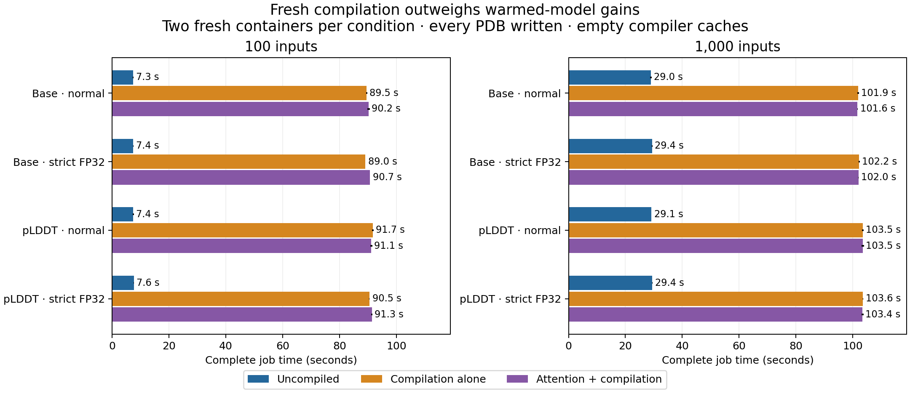

# Complete batching pipeline: attention and compilation — 26 October 2026

**Current dev remains faster for these fresh jobs.** Including imports, model loading, compilation, features, atom conversion and output writing, both compiled approaches took about **89–104 seconds**, compared with **7–8 seconds for 100 inputs** and **29 seconds for 1,000 inputs** without compilation. Adding attention did not give a dependable complete-job gain over compilation alone. Main and dev are unchanged, and neither experimental option is enabled.

## Protocol

The same 100 published experimental-test antibodies were used. The 1,000-input workload cycles them ten times, with distinct output names and **no prediction cache**; it is not 1,000 independent antibodies. Both base and pLDDT checkpoints ran uncompiled, compilation-only and attention-plus-compilation conditions, at normal and strict FP32 precision. Each condition had **two independent fresh-container repetitions**, giving **48 jobs and 26,400 PDBs**. Condition order was reversed between repetitions and checkpoints.

The prediction CLI, bounded CPU feature queues, length-aware scheduler, automatic batch caps, atom conversion and PDB writer were frozen from dev `bd8a12e`. Batch shapes matched across conditions and no OOM retries were needed. The automatic cap was 16 for 100 inputs and 32 for 1,000 inputs; two preparation and two writing threads overlapped one GPU-owning model process. Optional hydrogenation/relaxation and the language checkpoint were outside this comparison.

The retained optimised image was `sha256:18456b5147ea1ec35d8de4f664962baeea6af1bb473ad9107bb1cbfa37fd844d`: NGC PyTorch 2.10.0a0, CUDA 13.0, NVIDIA GB10. Every job was offline and used the expandable-segments allocator. No image was rebuilt and no model weights, learned updates or chemistry dependencies changed. Normal precision retained `high`/TF32-permitted settings; strict used `highest` with TF32 disabled before model loading.

Unlike the earlier fixed-shape model screen, this experiment used **`torch.compile(mode="default", dynamic=True)`** for the unchanged scheduler’s varying shapes. Each job started with fresh empty compiler/Triton cache directories. These are cold-compiler results, not a reused-cache or persistent-server benchmark. The experimental adapter was confined to this isolated component branch and local frozen runs.

## Complete-job speed

Times are medians of two fresh container commands, in seconds. They include startup, every PDB write, common prediction fingerprints and final raw-evidence writing. Evidence writing took only **0.014–0.019 seconds per job**. Bold marks the lowest recorded median in each matched row, not statistical significance. Individual runs and ranges are retained in the data.

| Inputs | Checkpoint | Precision | Uncompiled | Compilation alone | Attention + compilation |
|---:|---|---|---:|---:|---:|
| 100 | base | normal | **7.35** | 89.54 | 90.23 |
| 100 | base | strict | **7.43** | 89.03 | 90.66 |
| 100 | plddt | normal | **7.44** | 91.67 | 91.13 |
| 100 | plddt | strict | **7.60** | 90.49 | 91.33 |
| 1,000 | base | normal | **29.01** | 101.87 | 101.60 |
| 1,000 | base | strict | **29.35** | 102.23 | 101.97 |
| 1,000 | plddt | normal | **29.12** | 103.49 | 103.52 |
| 1,000 | plddt | strict | **29.45** | 103.58 | 103.40 |

Compilation dominates these job sizes. In one 1,000-input base combined run, the first forward took about **54.6 seconds** on the host; a later one-item partial batch took **21.0 seconds**, whereas ordinary already-compiled forwards took fractions of a second. These forward labels include compiler activity and are not standalone GPU-kernel timings.

Dynamo recorded multiple graphs and graph breaks around the existing Rigid/Rotation helper objects. This is **partial compilation with eager regions**, not one fully captured model graph. No cache-limit fallback or OOM fallback occurred. We did not rewrite those helpers, change batch policy, test a warmed disk cache or measure a long-lived prediction service. The earlier 4–5% warmed-model gain therefore should not be presented as a complete-pipeline speedup.

## Peak memory for 1,000-input jobs

Values are the higher peak across the two runs, in GiB; bold marks the lowest peak within each checkpoint/precision group. CUDA allocated peaks cover the whole process, including startup. RSS is sampled process-tree RSS and can count shared pages in compiler workers more than once. Container accounting is a separate lifetime measure. **Do not add these columns to estimate physical unified memory.**

| Checkpoint | Precision | Approach | Peak CUDA allocated | Sampled process-tree RSS | Container lifetime peak |
|---|---|---|---:|---:|---:|
| base | normal | eager | 3.987 | **1.792** | **1.643** |
| base | normal | compiled | **2.258** | 4.524 | 2.772 |
| base | normal | combined | 2.266 | 4.575 | 2.864 |
| base | strict | eager | 3.987 | **1.812** | **1.659** |
| base | strict | compiled | **2.258** | 4.596 | 2.815 |
| base | strict | combined | 2.266 | 5.747 | 2.940 |
| plddt | normal | eager | 3.987 | **1.805** | **1.652** |
| plddt | normal | compiled | **2.259** | 4.576 | 2.840 |
| plddt | normal | combined | 2.267 | 5.761 | 2.833 |
| plddt | strict | eager | 3.987 | **1.815** | **1.667** |
| plddt | strict | compiled | **2.259** | 4.617 | 2.833 |
| plddt | strict | combined | 2.267 | 4.565 | 2.824 |

Compilation reduced peak PyTorch CUDA allocation from about **3.99 GiB to 2.26–2.27 GiB**, but compiler-process RSS increased from about **1.8 GiB to 4.5–5.8 GiB**. This does not establish a physical system-memory saving. All 100-input measurements and reserved-memory peaks are included in the machine-readable results.

## Prediction differences and experimental accuracy

Raw coordinates, masks and confidence fingerprints were captured for every output. Quantitative geometry and accuracy were scored for the **first occurrence of each of the 100 distinct targets in every job**, including both fresh repetitions: 4,800 saved raw predictions. The ten presentations in a 1,000-input job are not treated as independent biological samples. All six CDRs, both frameworks, Cα-lDDT, confidence and the established geometric screens were retained.

The table reports the largest absolute change in framework-aligned CDR-H3 backbone RMSD to experiment, and the largest raw atom displacement, across both workload sizes and both fresh repetitions. References use the **same precision**. Tiny backbone differences are not evidence of improved biological accuracy.

| Checkpoint | Precision | Maximum H3 accuracy change vs uncompiled | Maximum H3 accuracy change vs compiler only | Maximum atom displacement vs uncompiled | Maximum atom displacement vs compiler only |
|---|---|---:|---:|---:|---:|
| base | normal | 0.00347110 Å | 0.00348703 Å | 1.219111 Å | 2.358101 Å |
| base | strict | 0.00000795 Å | 0.00000471 Å | 0.000667 Å | 0.001215 Å |
| plddt | normal | 0.00406257 Å | 0.00520097 Å | 0.333931 Å | 0.420242 Å |
| plddt | strict | 0.00000626 Å | 0.00000598 Å | 0.000285 Å | 0.000259 Å |

All combined H3 backbone accuracy changes were below **0.01 Å** on this test set, without a consistent winner across antibodies. Local atoms can still differ substantially: normal-precision combined predictions moved a side-chain atom by **1.219 Å versus uncompiled dev**, and the combined/compiler-only difference reached **2.358 Å**. These are atom displacements, not changes in experimental RMSD; they should not be equated with accuracy loss or dismissed as universally harmless. Strict FP32 differences were much smaller, but not zero.

## Fresh-process repeatability

**All uncompiled repeats matched exactly** in raw fingerprints and PDB bytes at both precisions. Fresh compiled repeats were not consistently bit-identical, even with strict FP32. The first-occurrence comparisons found up to **0.917 Å** atom displacement between normal combined runs and **0.000551 Å** between strict combined runs. These bounds describe the quantitatively retained 100 targets per job; fingerprints alone do not quantify the other presentations in a repeated workload.

A fixed seed and strict FP32 therefore do not establish deterministic fresh compilation. The source of this fresh-compile variability was not isolated in this study; different arithmetic/kernel choices are a hypothesis, not a measured attribution. The previous same-process fixed-shape repeatability checks remain valid within their narrower scope. Exact per-job fingerprint/PDB repeat counts are retained in the summary.

## Decision and limits

**Keep current dev unchanged.** Neither precision of attention-plus-compilation improves complete fresh-job latency here, and normal precision adds noticeable local atom changes. Strict precision limits numerical drift but does not remove compilation overhead or guarantee bit-identical fresh-process results.

A persistent model worker, reuse of validated compilation caches, and fewer special partial-batch shapes are possible future experiments. They could amortise compilation and must be measured separately before claiming a production throughput benefit. They were not run or enabled as part of this comparison. The result covers one Spark, two checkpoints and these workloads; it is not a claim that compilation is always slower.

## Evidence and reproduction

- [All 48 timings, memory peaks, compiler counters and accuracy summaries](data/pipeline_compilation_261026/pipeline_summary_261026.json)
- [Per-job timing and memory CSV](data/pipeline_compilation_261026/pipeline_measurements_261026.csv)
- [Per-antibody accuracy changes, both replicates](data/pipeline_compilation_261026/pipeline_accuracy_changes_261026.csv)
- [Full comparison archive](data/pipeline_compilation_261026/abodybuilder3_pipeline_comparisons_261026.zip)
- [Checksums](data/pipeline_compilation_261026/abodybuilder3_pipeline_checksums_261026.txt)

The archive contains both scoring passes, per-target scores, compact raw-output fingerprints, protocol, source hashes and all exact container commands. Raw NPZ/PDB predictions, compiler caches and verbose logs remain local. The second scoring pass was added after observing fresh-compile differences; no GPU job was rerun or replaced.

`tools/run_pipeline_study.py` freezes the dev CLI and component source and queues the finite comparison; `tools/measure_pipeline.py` is its measurement-only adapter. `tools/analyse_pipeline_study.py --replicate 1` and `--replicate 2` use the established structural scorer. `tools/write_pipeline_report.py` generates this report and evidence package. The retained image includes the required SciPy environment; no host dependencies were installed.

Main remains `a5deeb1b73994491f94b5724d2f2baa9993d47a6`; dev remains `bd8a12ea9f58fa3577215532653a05c47e90e256`. All experimental changes are confined to the component branch and frozen local study.
