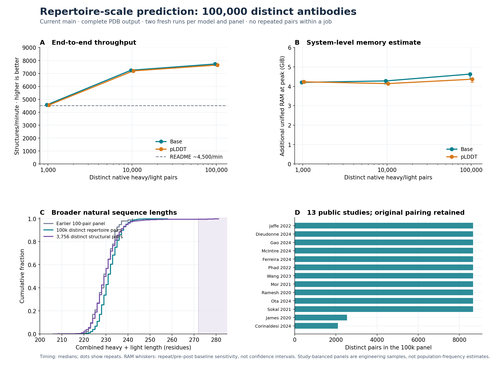
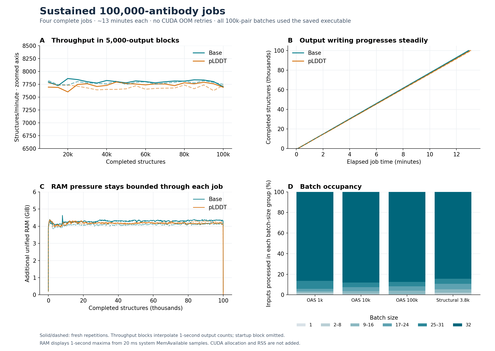

# Diverse repertoire throughput and RAM — 26 October 2026

**The ~4,500 structures/minute claim holds on these larger, diverse panels.** Current main produced 100,000 distinct, native heavy/light pairs in about **13 minutes per job**: **7,726/minute for base** and **7,646/minute for pLDDT**. Estimated additional unified-RAM peaks were **4.63 and 4.37 GiB**, respectively. All 16 runs completed, with no CUDA OOM retries or missing outputs. Main was unchanged.

| Panel · distinct pairs per job | Base structures/min | pLDDT structures/min | Base peak additional RAM | pLDDT peak additional RAM |
|---|---:|---:|---:|---:|
| Public repertoire · 1,000 | 4,569 | 4,554 | ~4.20 GiB | ~4.23 GiB |
| Public repertoire · 10,000 | 7,245 | 7,194 | ~4.28 GiB | ~4.14 GiB |
| Public repertoire · 100,000 | **7,726** | **7,646** | ~4.63 GiB | ~4.37 GiB |
| Released structural metadata · 3,756 | 6,475 | 6,453 | ~4.50 GiB | ~4.43 GiB |

Throughput is input count divided by median complete-job duration over two fresh-container repetitions. RAM is the higher observed peak, estimated from the idle-adjusted drop in system `MemAvailable`. Memory sensitivity bars include both repetitions and either pre- or post-idle baseline; they are not confidence intervals. The structural panel is a separate cohort, not another point on the nested repertoire-size curve.

## Sustained behaviour

The four 100,000-input jobs took **775.24 and 777.90 seconds** for base, and **782.07 and 787.29 seconds** for pLDDT. These durations include container startup/exit, imports, checkpoint/executable loading, CSV parsing, inference, batch-report serialization and all 100,000 PDB writes. They exclude the idle measurement windows and post-run output checks. No compiler preparation, network download, chemical preparation or energy minimisation is timed.

The initial ~4,500/minute result was a 1,000-input job. First output arrived about 5.4–5.9 seconds into each 100,000-input job; spreading startup over more predictions is consistent with the higher complete-job throughput. No model, precision or batching policy was changed to obtain it, and no prediction/sequence-result cache was used.

PDB completion was counted externally with Linux `inotify` close-write events, without modifying inference. Event counts matched every expected file, with no event-queue overflow. Cumulative counts were recorded once per second. The sustained figure uses 5,000-output blocks with linearly interpolated crossing times; the first block is omitted from that diagnostic to exclude startup. That omission does **not** affect the headline complete-job timings. Early versus late block medians were approximately 7,800→7,810 and 7,775→7,786/minute for the two base runs, and 7,694→7,760 and 7,731→7,729 for pLDDT. The traces show no sustained degradation over the tested jobs; these technical repetitions do not establish precise statistical uncertainty.

RAM curves show maxima within one-second display bins; peak values use every 20 ms sample. Additional system RAM stayed around 4.1–4.6 GiB through the large jobs. A 100-fold increase in repertoire size did not produce a corresponding memory increase. This is evidence up to 100,000 inputs, not a proof of constant memory at arbitrary scale.

## Input diversity and provenance

The read-only OAS human archive was frozen on 2 October 2026. Its committed native-pair shards contain 2,633,582 occurrences from the selected paired studies. After complete-pair, benchmark-eligibility, canonical-amino-acid and IGK/IGL filters, global exact-pair deduplication left **2,146,997 eligible distinct pairs**. Native heavy/light sequence IDs and ordered-pair SHA-256 identities were independently checked for all 100,000 selected pairs; no artificial partner combinations were made.

The main panel deliberately balances **13 contributing studies**, capping small studies at availability and redistributing the remaining quota. Selection within each study uses the smallest seeded SHA-256 ranks. The original source row, unit, study and pair identity are retained locally. The frozen catalogue also includes a fourteenth paired study; no pairs from it survive this study's eligibility filters. No generated data were substituted.

The 1,000-, 10,000- and 100,000-input panels are nested prefixes of the selected study-interleaved ordering. Every pair is distinct within its job; different jobs intentionally overlap. The 100,000 panel contains **96,669 distinct heavy chains and 72,019 distinct light chains**, with **59,039 kappa and 40,961 lambda** pairs. Shared individual chains are natural pair reuse, not duplicate heavy/light examples. These are study-balanced engineering samples, not population-frequency estimates or a single donor's repertoire.

Combined heavy/light lengths range from **211–258 residues** in the 100,000 panel, compared with 219–242 in the earlier 100-pair throughput cohort. All such repertoire batches remained within saved-executable shape coverage. The separately deduplicated released structural metadata supplies **3,756 pairs**, spanning **206–281 residues**, 3,563 distinct heavy chains and 3,377 distinct light chains. Sixteen pairs exceed the 272-residue packaged length bound. Each structural run recorded **nine eager-fallback batches** and completed successfully, using the same strict-FP32 model. No out-of-domain inputs were clipped, removed or changed. Larger or more frequent long-chain tails could reduce throughput further.

## Runtime, RAM and verification

- Runtime: `sha256:ab981f1494f2c817995a3cf767702181330af8d3f97584120d533dedd9432fd0`, the verified current-main image. Its runtime code is the accepted implementation at `78163003c6c18aa0557b23aae91848911d40553b`; the pinned main source at launch was `99b53a9b40c76d3b66e882aef248bc24624cc71f` (documentation updates only). Driver: 580.178.04, NVIDIA GB10.
- Installed defaults: strict FP32; released base/pLDDT checkpoint; saved AOT execution; native writer; automatic batch cap 32 for these jobs; two CPU workers per pipeline stage; seed 42; chemistry off. Each panel ran base→pLDDT in repetition 1 and pLDDT→base in repetition 2, in separate fresh offline containers. All 100k repertoire batches used AOT. No CUDA OOM retries occurred anywhere.
- Memory method: reuse the [calibrated shared-RAM protocol](abodybuilder3_unified_memory_261026.md): five seconds of idle baseline, 20 ms host `/proc/meminfo` samples, and eight seconds after exit. These estimates include CPU/GPU/driver pressure together, without adding RSS, PSS or CUDA allocator values. Maximum absolute pre/post baseline drift was **0.159 GiB**; none of the 16 runs triggered the predeclared 0.25 GiB drift flag. No swap change was observed.
- All **459,024 expected output filenames and complete PDB endings** were checked after timing. Finite coordinates and the expected Cα count were checked for 128 deterministic samples per run plus all out-of-AOT-length inputs: **2,112 sample instances** across the 16 jobs. This is sampled coordinate validation, not full coordinate parsing of every large-job file. Runtime correctness evidence for unchanged code/checkpoints is reused.
- All PDBs and inputs remain local. Outputs occupy **61.22 GiB**; the internal SSD had about **887 GiB available** after the runs. No prior outputs, images, weights or datasets were deleted.

## Interpretation and limits

These results support the conservative README throughput and low-RAM claims for the tested paired-Fv workloads, with stronger end-to-end throughput at 100k scale. They do not establish experimental structural accuracy, unseen-model generalisation, a new speedup over the previous version on these cohorts, or performance of the language checkpoint. The structural metadata overlaps model-development data; no accuracy inference is made. Archived completeness/quality labels were retained rather than newly re-annotated.

This is a 100,000-distinct-pair validation, **not a million-structure benchmark**. More extreme lengths, different study mixtures, dense optional chemistry, output-format changes and larger directory/job sizes can change speed or memory. The system-level RAM counter remains an OS capacity estimate and can include unrelated host activity. Two fresh-process repetitions assess technical repeatability, not biological replication or a confidence interval for every repertoire.

## Records

- [Individual runs, selection aggregates, hashes, summaries and sustained curves](data/abodybuilder3_repertoire_scale_261026.json).
- [Concise machine-readable summary](data/abodybuilder3_repertoire_scale_summary_261026.csv).
- [System-memory traces, PDB-count traces, batch reports and commands](data/abodybuilder3_repertoire_scale_evidence_261026.zip), with [SHA-256 checksum](data/abodybuilder3_repertoire_scale_checksums_261026.txt).
- [Input selector](../tools/repertoire_scale/prepare_repertoire_inputs.py), [installed-CLI controller](../tools/repertoire_scale/benchmark_repertoire.py) and [plot generator](../tools/plot_repertoire_scale.py). Selection uses the pinned archive manifest and DuckDB 1.5.6 / PyArrow 25.0.1 reader environment. The portable selector accepts `--study` and `--structure-metadata`; the frozen original script and manifests are retained in the study.
- Local study: `/home/adrian/codex_wd/projects/abodybuilder3/runs/repertoire_scale_261026`. Full source-unit/row manifests, input CSVs, original script, selection database and predictions are retained there. Individual sequences, pair-ID manifests and predictions are not included in the Git evidence archive.

Detailed research files are on dev; main and its runtime remain unchanged.
