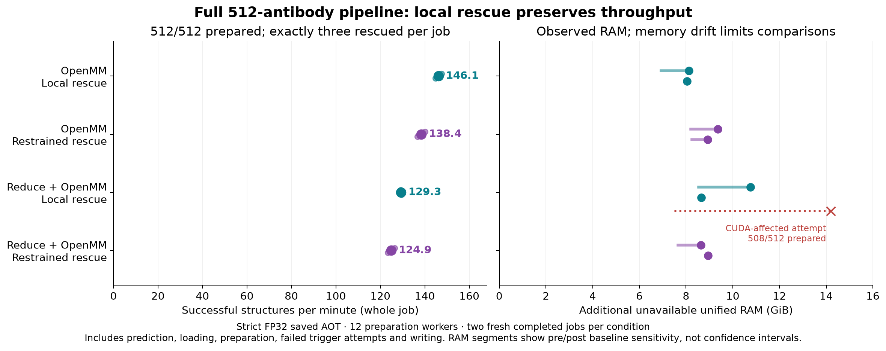

# Local rescue enabled on dev — 27 October 2026

Optional pH-7 preparation now defaults to **local rescue for rejected cases**.
`--rescue restrained` selects the more extensive repair; `--rescue off` disables
heavy-atom rescue. Main remains at its previous code and image.

```bash
# Default: normal preparation, then local rescue only if required
python3 scripts/predict.py predict --csv antibodies.csv -o predictions/ \
    --add-hydrogens --seed 42

# More extensive rescue, still only on rejected cases
python3 scripts/predict.py predict --csv antibodies.csv -o predictions/ \
    --add-hydrogens --rescue restrained --seed 42
```

The raw `.pdb` stays untouched. Rescue writes its result to `.prepared.pdb` and
records its policy, trigger, attempted repairs, geometry gates and displacement
in `.preparation.json`. A failed rescue retains the triggering failure and its
partial repair audit. Preparation failures produce a nonzero CLI exit status.
Plain prediction does not import or run chemistry.

## What was integrated

The accepted component code provides deterministic CPU atom repair, GPU
fixed-heavy hydrogen placement, bounded phased preparation workers and
rejection-only rescue. Normal preparation is always attempted first. Only the
specific frozen-heavy planar-hydrogen incompatibility can trigger rescue;
parameterisation, Reduce, CUDA and unrelated geometry failures propagate.
Local repair never silently escalates to restrained rescue.

Runtime helpers are self-contained in `scripts/`; no experimental tools directory
or local checkout is required. The geometry objective uses the frozen qualified
settings in code, rather than experimental environment switches. At most three
steric weights are attempted with unchanged acceptance thresholds. The Docker
recipe includes every module and verifies the exact upstream source hashes
before applying the already-qualified OpenMM/PDBFixer API patches. Original and
modified third-party sources and their regression tests remain on the
[component branch at the qualified commit](https://github.com/adrian-greenneuron/ABodyBuilder3-DGX-Spark/tree/da2672e33dd1afdc4f1b3fadf5d997ef9f8fdd99).

The model, checkpoints, precision, AOT executables and native writer are unchanged.
The existing dev runtime and AOT packages were reused for the installed-image
checks; this integration did not repeat a full download/export build.

## Performance evidence

The preceding frozen component study measured the full 512-antibody pipeline,
with two completed technical repeats per condition, strict FP32 saved AOT and
12 preparation workers. These timings include startup, prediction, preparation,
rescue attempts and output writing. They are **not prediction-only rates**.

| Preparation route | Local rescue | Restrained rescue | Observed additional unified RAM, local / restrained |
|---|---:|---:|---:|
| OpenMM | **146.1 structures/min** | 138.4 structures/min | 8.04–8.13 / 8.93–9.37 GiB |
| Reduce + OpenMM | **129.3 structures/min** | 124.9 structures/min | 8.65–10.76 / 8.63–8.95 GiB |



Both policies prepared all 512 inputs; only three needed rescue. The other
509 prepared outputs were byte-identical to matched no-rescue controls. Local
rescue added less than 1% median wall time relative to controls that prepared
only 509/512; restrained rescue added about 4–6%. Unified RAM was measured from
host `MemAvailable`, without summing overlapping RSS and CUDA allocations.
Baseline drift prevents a reliable memory ranking between policies.

One initial Reduce/local attempt had four unrelated CUDA-initialisation
failures. It remains in the record; an unchanged replacement completed all
512. The integration has no automatic backend substitution or retry that would
hide such failures. See the
[full benchmark report and individual attempts](https://github.com/adrian-greenneuron/ABodyBuilder3-DGX-Spark/blob/da2672e33dd1afdc4f1b3fadf5d997ef9f8fdd99/docs/rescue_pipeline512_271026.md).
The 512-input performance experiment was not rerun merely to integrate its
accepted code and public options.

## Dev integration checks

| Check | Result |
|---|---|
| Focused policy, geometry, worker and CLI tests | **39 passed**, including default/explicit policy dispatch and preservation of partial failure audits |
| Saved six-case panel, both preparation routes × both rescue policies | 24 prepared outputs; exactly three rescues in each condition |
| Local output agreement with qualified component | All 12 local prepared files byte-identical, including rescued cases |
| Compatible controls with restrained rescue | All six byte-identical to qualified controls |
| Installed CLI: previous dev, new plain prediction, default local and explicit restrained | All completed; all six raw predictions identical across the four jobs |
| Real CLI preparation | Both modes prepared all six inputs; exactly three rescues each |
| Real CLI with `--rescue off` | Expected exit code 1; six raw predictions retained, three prepared outputs and three explicit geometry rejections; no rescues |
| Independent stored-PDB checks | All 36 prepared files, comprising 25 unique hashes, passed the hydrogen screens; all 18 rescue calls passed paired heavy-geometry and topology gates |

The saved panel covers all three known rejected cases and one compatible control
from each source cohort. These are development checks, not a new independent
accuracy benchmark. Local and compatible output identity checks passed after
replacing experimental configuration and helper imports with the supported
runtime interface. Restrained results can differ numerically between executions;
they were checked by geometry and topology rather than required to match bytes.

Compact identities and check summaries are in
[the integration record](data/abodybuilder3_rescue_integration_271026.json).
Inputs, sequences, raw/prepared structures and detailed audits remain local.

## Scope and limits

Local rescue prioritises speed and limited heavy-atom movement. It repairs the
rejected motif but leaves unrelated pre-existing strain. Restrained rescue
allows larger changes and requires both physical minimisation stages to converge,
with a chirality guard and paired geometry checks. Final hydrogens use the common
geometry objective, which omits Coulomb/GB terms; the final PDB is not the full
physical minimisation endpoint. Neither policy establishes improved experimental
structural accuracy or a clash-free result.

Rescue is qualified only at pH 7 without whole-structure `--relax`. Other pH
values require explicit `--rescue off` and retain the earlier CPU protonation
protocol. The pH-7 geometry path requires CUDA even when rescue is off.
`--preparation-workers auto` uses up to 12 processes; explicit counts 1–20 are
supported. Inference finishes before chemical preparation starts.

`--relax restrained` remains a separate option that minimises every requested
structure using the earlier protocol, with rescue off by default. It does not
inherit the rejection-only rescue chirality guard. See the
[preparation guide](abodybuilder3_preparation_251026.md) for outputs, force-field
settings and failure handling.
