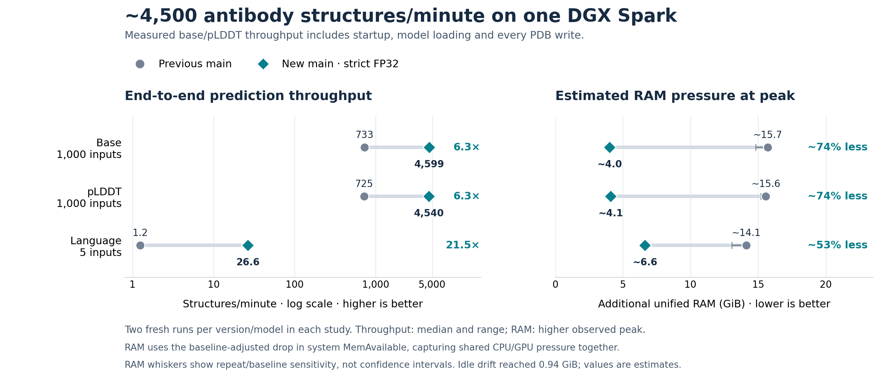

# Shared-RAM use and repertoire throughput — 26 October 2026

The system-level measurement estimates **about 11–12 GiB less peak additional RAM pressure** for base/pLDDT, and **about 7 GiB less** for language. The previous 89% summed-RSS reduction was not a physical-RAM saving. The new estimate is about **74% for base/pLDDT and 53% for language**, with baseline uncertainty described below.

| Model · inputs | Structures/min: previous → new | Speedup | Unified RAM estimate: previous → new | Approx. RAM saved |
|---|---:|---:|---:|---:|
| Base · 1,000 | 733 → **4,599** | **6.3×** | ~15.7 → **~4.0 GiB** | **~11.7 GiB (~74%)** |
| pLDDT · 1,000 | 725 → **4,540** | **6.3×** | ~15.6 → **~4.1 GiB** | **~11.5 GiB (~74%)** |
| Language · 5 | 1.2 → **26.6** | **21.5×** | ~14.1 → **~6.6 GiB** | **~7.5 GiB (~53%)** |

## What is measured

Spark's CPU and GPU use the same DRAM pool. NVIDIA recommends OS-level reporting when dedicated-VRAM fields are unavailable and notes that available allocation depends on reclaimable OS memory: [Spark memory reporting](https://nvidia.custhelp.com/app/answers/detail/a_id/5775/) and [UMA available-memory guidance](https://nvidia.custhelp.com/app/answers/detail/a_id/5728/). Linux defines `MemAvailable` as an **estimate** of memory available for new applications without swapping; it accounts for reclaimable cache and slab ([kernel documentation](https://www.kernel.org/doc/html/latest/filesystems/proc.html)).

The primary estimand is **additional system RAM pressure at peak**: median `MemAvailable` during the five-second idle period immediately before a job, minus the minimum observed during that fresh container's entire lifetime. The host sampler reads `/proc/meminfo` every 20 ms. This observes CPU, GPU and driver pressure together, without adding allocator figures or repeatedly charging shared mappings. It is a capacity-headroom estimate rather than exact process ownership, and it is not simply `MemTotal - MemFree`, which would include reclaimable file cache.

The same unchanged previous/new main images and input hashes as the [matched timing study](abodybuilder3_main_comparison_261026.md) were used. Each model/version ran twice, previous→new in repetition 1 and new→previous in repetition 2. CUDA, seed 42, PDB output and installed defaults were retained. No caches were dropped and no swap configuration changed. Five seconds before and eight seconds after each run were observed. All **8,020 expected PDBs** were complete and had finite coordinates. No model or runtime code was changed. CPU process-tree PSS/private-page counters were also sampled every 200 ms, as supporting attribution rather than a substitute for shared-RAM measurement.

## Calibration and baseline checks

A separate bounded calibration touched a known **4 GiB CPU allocation**, then added a touched **4 GiB CUDA allocation** after CUDA-context setup. Median `MemAvailable` decreased by **4.05 GiB** and **8.17 GiB**, respectively. Removing the CPU allocation left a **4.35 GiB** decrease; releasing both allocations and the CUDA cache left **0.08 GiB**. The global counter therefore detects both types of allocation on this installed Spark. These checks include allocator/driver overhead, not an assertion of exact one-to-one byte accounting.

A post-study 30-second idle control had a **0.023 GiB** `MemAvailable` range and **0.014 GiB** median drift. Job-adjacent pre/post idle medians nevertheless differed by up to **0.94 GiB**. The predeclared 0.25 GiB drift flag was triggered in six runs; all are retained, with no exclusions or reruns selected to improve the result. The cause of the post-job drift was not isolated. No swap change was observed during any measured job.

The table uses the higher of the two pre-baseline peak estimates. Figure whiskers span all estimates from either pre- or post-idle baseline and both repetitions. These are **sensitivity ranges, not confidence intervals**. Across that sensitivity analysis, old/new estimates span roughly 14.8–15.7 / 3.8–4.2 GiB for base, 15.2–15.6 / 4.0–4.2 GiB for pLDDT, and 13.1–14.1 / 6.6–6.8 GiB for language. This supports approximate savings, not exact RAM-attribution claims. Global measurements can include unrelated host activity; larger deployments and other machines need their own measurements.

## Why PSS, RSS and CUDA must stay separate

Peak summed PSS was about 10.62→1.54 GiB for base, 10.61→1.54 GiB for pLDDT and 8.26→5.40 GiB for language. PSS apportions shared CPU-mapped pages rather than charging each process for the full mapping. It does not establish the complete GPU/driver footprint; allocator buffers may also overlap CPU mappings. It must not be added blindly to CUDA allocation, RSS or the system-level drop. The global measure is the basis for the README memory comparison.

The [earlier timing study](abodybuilder3_main_comparison_261026.md) retains its original RSS and CUDA results. Its short-interval CUDA sampling missed brief allocation peaks; exact allocator peaks and the sum-of-worker-peaks bound remain distinct. None of those values are re-labelled as physical RAM.

## Throughput and repertoire-scale interpretation

The figure reuses the earlier timing study, **not** the instrumented memory-run durations. Median complete-job throughput was **76.7 structures/s (4,599/min)** for base and **75.7/s (4,540/min)** for pLDDT, about 6.3× the previous main defaults. Language achieved **26.6/min** on its five-input, live-embedding workload, about 21.5× faster. Each timing condition has two technical repetitions. Every PDB write and fresh-container startup/exit is included; image building, downloads and optional chemistry are excluded.

The base/pLDDT jobs repeat 100 distinct public paired Fv sequences ten times, with combined lengths 219–242 residues. Predictions are computed afresh; there is no sequence-result cache. These are throughput observations, not 1,000 independent accuracy tests. Different lengths and diversity can affect padding, executable coverage and speed. At 4,500/minute, a million-input job projects to about 3.7 hours only if that rate persists. This is not a million-structure validation; output scale and longer sequences may change the result.

## Evidence and reproduction

- [Protocol, calibration, idle control, individual peaks and summaries](data/abodybuilder3_unified_memory_261026.json).
- [Compressed system/PSS traces and exact commands](data/abodybuilder3_unified_memory_evidence_261026.zip) and [SHA-256 checksum](data/abodybuilder3_unified_memory_checksums_261026.txt).
- [Host comparison queue](../tools/unified_memory/run_unified_memory.py), [PSS observer](../tools/unified_memory/measure_pss.py), [allocation calibration](../tools/unified_memory/calibrate.py) and [plot generator](../tools/plot_main_throughput_memory.py).
- The queue accepts `--study` and `--prott5`. A fresh study needs the pinned `protocol_261026.json`, matching input CSVs under `inputs/`, and `tools/measure_pss.py`. It refuses existing run directories. Use the earlier study's retained image identities and checkpoint assets; no rebuild is required for measurement.
- Full local study: `/home/adrian/codex_wd/projects/abodybuilder3/runs/unified_memory_261026`.

Only the accepted comparison figure and concise table are on main. Detailed instrumentation and experiment records stay on dev. All images, checkpoints, datasets and prior evidence are retained.
