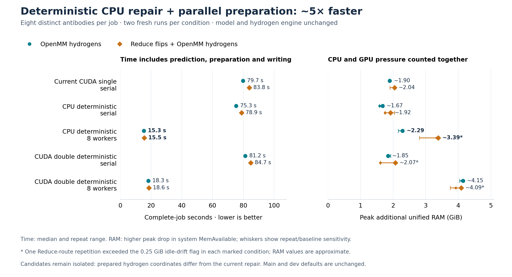
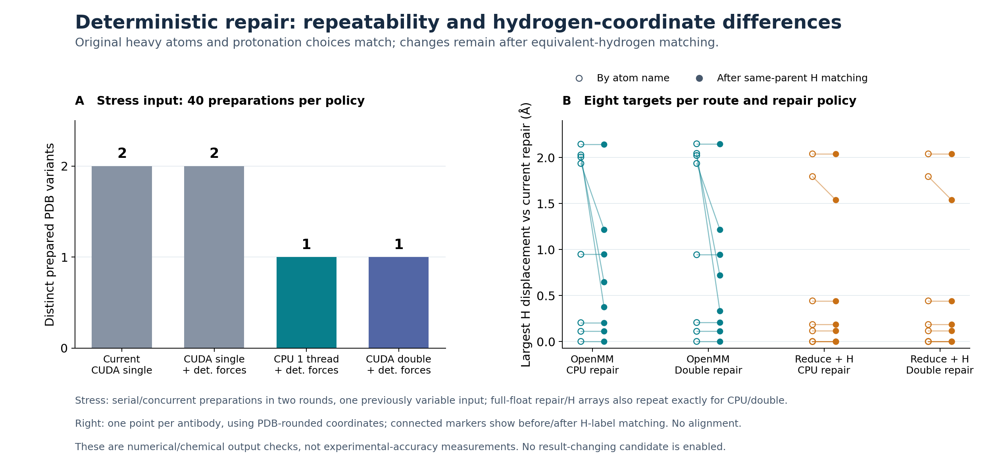

# Deterministic atom repair: speed, unified RAM and output differences — 26 October 2026

**Single-thread CPU repair with eight independent preparation workers was the
fastest repeatable candidate: 5.2–5.4× faster than current serial preparation.**
It used approximately **2.29 GiB** additional unified RAM for OpenMM hydrogens,
or **3.39 GiB** with Reduce, versus **1.90/2.04 GiB** for the serial reference.
Double-precision CUDA repair also repeated exactly, but was slower and used
more RAM when parallelised. Enabling deterministic forces alone in single-
precision CUDA did not remove the observed variation.

**No candidate is enabled on dev or main.** Both passing repair candidates
change prepared hydrogen coordinates relative to the current protocol, in
some cases by about **2.1 Å**, even after matching interchangeable hydrogen
labels. The raw model predictions, original heavy-atom PDB coordinates under the
same preparation route, atom identities and protonation choices match. These
results support a speed/repeatability improvement, not a chemical-accuracy gain.

## Complete-job results

Eight distinct public antibody pairs were processed per job. Each condition
ran twice in a fresh container, with reversed condition order in the second
repetition. The pLDDT checkpoint, strict-FP32 AOT inference, native writer,
seed 42, pH 7, one-thread CPU hydrogen engine and Reduce binary/flip policy
were fixed. Optional final relaxation was off. Time includes container startup,
model/executable loading, inference, chemical preparation and all PDB writes.

| Repair; preparation workers | OpenMM H time | Speedup | Unified RAM | Reduce + H time | Speedup | Unified RAM |
|---|---:|---:|---:|---:|---:|---:|
| Current CUDA single; serial | 79.70 s | 1.00× | ~1.90 GiB | 83.83 s | 1.00× | ~2.04 GiB |
| CPU deterministic; serial | 75.26 s | 1.06× | ~1.67 GiB | 78.86 s | 1.06× | ~1.92 GiB |
| **CPU deterministic; 8 workers** | **15.28 s** | **5.21×** | ~2.29 GiB | **15.54 s** | **5.40×** | ~3.39 GiB* |
| CUDA double deterministic; serial | 81.18 s | 0.98× | ~1.85 GiB | 84.74 s | 0.99× | ~2.07 GiB* |
| CUDA double deterministic; 8 workers | 18.26 s | 4.36× | ~4.15 GiB | 18.63 s | 4.50× | ~4.09 GiB* |

Times are medians; speedups use unrounded times against the matched route's
serial reference. Bold marks the fastest condition within each route, not
statistical significance. RAM is the higher observed peak across repetitions.
Individual times, baseline sensitivity and flags are retained in the
[measurements](data/deterministic_repair_measurements_261026.json) and
[summary CSV](data/deterministic_repair_summary_261026.csv).

The CPU-backend change alone saved about 6% of complete-job time. Most of the
overall gain came from preparing independent antibodies concurrently; it is
not a fivefold acceleration of the repair calculation itself. With eight
workers, CPU repair was about 16–17% faster in elapsed time than CUDA-double
repair. Both still use the unchanged one-thread OpenMM hydrogen engine.

### Unified RAM and measurement limits

The host sampled `/proc/meminfo` every 20 ms, using five seconds of idle
baseline before each job and eight seconds after exit. Additional RAM is the
median pre-job `MemAvailable` minus its minimum during the full job. This uses
the [previously calibrated system-level method](https://github.com/adrian-greenneuron/ABodyBuilder3-DGX-Spark/blob/dev/docs/abodybuilder3_unified_memory_261026.md),
counting shared CPU/GPU/driver pressure together without adding process RSS,
PSS or CUDA allocations. It estimates reduced allocatable system headroom,
not exact memory owned by the application.

Three of the 20 cases exceeded the predeclared 0.25 GiB pre/post idle-drift
flag, all in the Reduce route: CPU parallel repetition 1 (−0.578 GiB), CUDA
double serial repetition 1 (+0.405 GiB), and CUDA double parallel repetition 1
(−0.335 GiB). They are retained and marked `*`, not discarded or automatically
rerun. CPU-parallel Reduce peaks were 3.39 and 3.33 GiB; allowing either idle
baseline gives an envelope of **2.81–3.39 GiB**. CUDA-double parallel Reduce
gives **3.76–4.09 GiB**. All OpenMM-only conditions remained within the drift
threshold. No swap change or inference OOM retry was observed. Whiskers are
repeat/baseline sensitivity, not confidence intervals.

## Repeatability and prepared-output changes

The previously variable antibody was prepared 40 times under each policy:
four serial copies and sixteen copies with eight workers, in each of two
independent rounds. These are technical repetitions of one input, not forty
biologically distinct antibodies. Actual OpenMM Context properties were
captured, rather than inferred from the requested settings.

| Repair policy | Distinct repair arrays | Distinct hydrogen arrays | Distinct prepared PDBs |
|---|---:|---:|---:|
| Existing automatically selected CUDA single | 2 | 2 | 2 |
| CUDA single, `DeterministicForces=true` | 2 | 2 | 2 |
| CPU, `Threads=1`, `DeterministicForces=true` | **1** | **1** | **1** |
| CUDA double, `DeterministicForces=true` | **1** | **1** | **1** |

For each passing policy, the complete floating-point repair and hydrogen
arrays matched across serial/concurrent calls and both rounds. Their captured
initial repair placements also matched. The single-precision CUDA variants
differed by up to 1.49 × 10⁻⁷ Å after repair and 0.000245 Å after hydrogen
addition on this stress input. The force flag was therefore insufficient for
the whole repair path; this experiment does not identify a specific CUDA
kernel as the cause. OpenMM documents the property and advises testing
[determinism for the actual settings/platform](https://docs.openmm.org/latest/userguide/library/04_platform_specifics.html).
The passing evidence is for this pinned runtime and hardware, not a guarantee
across software versions or GPUs.

The larger comparison produced 160 prepared structures in 20 timed jobs.
All raw model PDBs matched their route's reference. Within each candidate
backend, serial/eight-worker prepared PDBs were byte-identical in all **64
paired comparisons** across routes and repetitions. All ten conditions also
matched their own two repetitions on the eight-target panel; the separate
stress experiment demonstrates why that alone cannot establish repeatability.

Against the current repair, the differences were:

- **Original heavy atoms and backbone:** identical PDB coordinates under the
  matched route. Reduce still makes its explicitly requested side-chain flips;
  this is equality between repair policies, not a claim that Reduce leaves
  the raw prediction unchanged.
- **Added heavy atoms:** OXT positions differed by up to **0.00424 Å** in the
  PDB outputs. The missing-atom lists, residue/atom identities, protonation
  variants, hydrogen counts, disulfide/severe-overlap/peptide-warning counts
  and warning messages agreed in the 320 matched between-condition audits.
- **Hydrogens:** largest displacements were **2.144 Å** for CPU repair and
  **2.149 Å** for CUDA double in the OpenMM route, and **2.039 Å** for either
  candidate with Reduce. Matching permutations of hydrogens attached to the
  same heavy atom reduced some differences but did not reduce these maxima.
  The largest differences involve single α-hydrogens, so they cannot be
  dismissed as equivalent methyl/ammonium label exchanges.
- **Average hydrogen displacement:** after same-parent permutation matching,
  mean per-target H RMS displacement was **0.0438 Å** for CPU and **0.0409 Å**
  for CUDA double without Reduce; both were about **0.0335 Å** with Reduce.
  These are unaligned, PDB-rounded coordinate comparisons, not RMSDs against
  experimental structures.

Small changes to repaired OXT positions are consistent with subsequent
hydrogen minimisation reaching different arrangements; this is an inference,
not a controlled demonstration of that causal mechanism. No new model
accuracy claim follows from unchanged protein heavy atoms.

### Chemical diagnostic, not an accuracy ranking

Fixed-coordinate Amber ff14SB/GBn2 energies and hydrogen forces were evaluated
without further minimisation, using common CUDA-double deterministic settings.
Energies changed in both directions. Some retained raw predictions are already
strained and have severe overlaps/long peptide bonds; one has an unrelaxed
energy near 1.16 × 10¹⁴ kJ/mol. These values are ill-suited to ranking preparation
quality. Finite output, matching protonation and reproducibility do not establish
correct hydrogen geometry. Further local stereochemistry/H-bond validation is
needed before recommending either candidate as chemically equivalent or better.
The [compact hydrogen diagnostics](data/deterministic_repair_hydrogens_261026.json)
retain per-target displacements, energies and the largest remaining group.

## Implementation, checks and provenance

The new branch is `components/deterministic-repair-261026`; neither main nor
dev was edited. `reference/` contains the original wrapper and the exact
installed PDBFixer 1.12.0 source, including its MIT notice. `candidate/` contains
the corresponding versions and reviewable patches. The PDBFixer extension adds
an optional repair-only Context-property dictionary to `addMissingAtoms`.
Calls without it retain the original branches; platform-global defaults,
force fields, templates, seeds and minimisation criteria are not changed.

The experimental wrapper selects a repair policy through
`AB3_EXPERIMENTAL_REPAIR` and records it in the preparation audit. This is an
isolated experiment interface, not a supported dev/main option. Ten policy/
scheduler tests passed; an AST comparison checks that no other PDBFixer method
changed. The installed runtime successfully completed all included CLI jobs,
with all raw/prepared files checked for finite coordinates and complete endings.
Existing plain-prediction regression evidence is reused: prediction code,
checkpoints, saved executables and writer are unchanged by this extension.

The reference is dev runtime image
`sha256:a4d29734d1b2ce98a09c4508e9047ad714a6da94be610fd5b8dda6b15285b590`.
The passing candidate is
`sha256:76ec04f135dd35a151207b7daa2d65227524e3bef2b1bef45c3d6688bf4365f3`,
built from the retained parallel-preparation experiment. The initial force-only
candidate is also retained. OpenMM is `8.6.1.dev-b399af4`, PDBFixer is `1.12.0`,
and the GPU is NVIDIA GB10 with driver 580.178.04. Model strict FP32 and repair
precision are separate settings. The [source/protocol manifest](../provenance_deterministic_repair_261026.json)
and [evidence archive](data/deterministic_repair_evidence_261026.zip) retain exact
commands, image/source identities, system-memory traces and validation history,
with [SHA-256 checksums](data/deterministic_repair_checksums_261026.txt).

One additional Reduce reference attempt completed successfully but failed my
post-run validator, which incorrectly forbade the side-chain flips allowed by
the protocol. Its files and log are retained. Because its container duration
had not been durably recorded before that assertion, only this case was
repeated after correcting the validator; the five completed measurements were
reused. The extra attempt is excluded from the twenty included timed cases and
their medians.

All PDBs, full per-atom arrays, identities, input sequences and detailed
hydrogen-group mappings remain local under
`/home/adrian/codex_wd/projects/abodybuilder3/runs/deterministic_repair_261026`.
The Git archive contains compact results and telemetry, not those biological
payloads. No prior data, Docker images, branches or records were deleted.

## Recommendation

CPU-one-thread deterministic repair is the stronger **performance candidate**:
it reproduced the tested outputs across process counts and used less memory
than parallel CUDA-double repair. Keep it isolated pending review of the
hydrogen-coordinate changes. Before promotion, investigate local hydrogen
stereochemistry on these strained examples and compare against a suitable
preparation reference. Do not treat the present repeatability result as proof
of improved chemical accuracy or enable it as an invisible speed patch.
