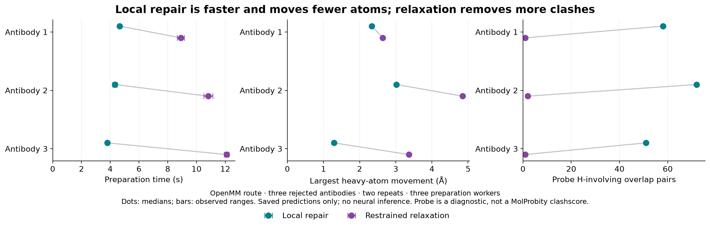
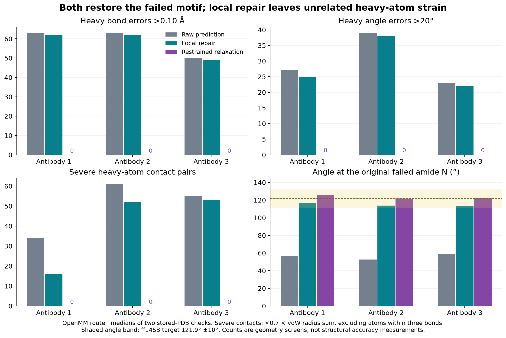

# Rescuing the three rejected antibodies — 27 October 2026

**All three can be rescued by either targeted local repair or restrained relaxation.** Both routes passed the stored-file hydrogen, valence, contact and stereochemistry checks in two repeats, with and without Reduce orientation. These remain explicit experiments on this component branch; main and dev are unchanged.

Local repair is the faster, less disruptive choice for making the previously rejected hydrogen placement possible. Restrained relaxation improves the rest of the heavy geometry much more, but moves almost the whole structure. Neither result establishes better experimental structural accuracy.

## Speed and coordinate changes

Per-antibody preparation below includes atom repair, rescue checks, hydrogen placement and writing, while three workers share the GPU. Values are medians of two calls. Coordinate changes are **unfitted displacements from the starting prediction**, not RMSD after structural alignment. The reported local count excludes newly added terminal atoms.

| Rejected input | Local preparation | Restrained preparation | Original heavy atoms moved >0.01 Å, local / restrained | Largest heavy movement, local / restrained |
| --- | ---: | ---: | ---: | ---: |
| Antibody 1 | 4.66 s | 8.91 s | 33 / 1820–1821 | 2.34 / 2.64 Å |
| Antibody 2 | 4.33 s | 10.82 s | 28 / 1885 | 3.02 / 4.85 Å |
| Antibody 3 | 3.80 s | 12.09 s | 28 / 1832–1833 | 1.29 / 3.36 Å |

OpenMM route. Local heavy-atom displacement RMS is 0.053–0.143 Å; restrained RMS is about 0.34–0.49 Å. Small global RMS values hide substantial local changes: the largest local movement is **1.29–3.02 Å**. “Local” describes the repair region, not a sub-ångström limit or a mathematically proven minimum-displacement solution.

Whole-container jobs process the same six saved predictions: the three rejected inputs and three compatible controls. Times include container/Python/worker startup and output writing; **they exclude neural inference and independent post-run scoring**. Runs reverse condition and input order in the second repeat. The fixed-heavy control is deliberately incomplete and is not a six-success throughput baseline.

| Route | Policy | Successful inputs per job | Container time, median (two individual runs) | Additional unified RAM, observed range |
| --- | --- | ---: | ---: | ---: |
| OpenMM | No rescue | 3/6; three rejected | 6.26 s (6.12, 6.41) | 1.20–1.29 GiB |
| OpenMM | Local repair | 6/6 | 10.06 s (9.52, 10.60) | 1.20–1.31 GiB |
| OpenMM | Restrained relaxation | 6/6 | 19.92 s (21.43, 18.41) | 0.87–1.18 GiB |
| Reduce + OpenMM | No rescue | 3/6; three rejected | 8.25 s (8.07, 8.44) | 1.50–1.58 GiB |
| Reduce + OpenMM | Local repair | 6/6 | 11.50 s (11.17, 11.82) | 1.41–1.54 GiB |
| Reduce + OpenMM | Restrained relaxation | 6/6 | 22.16 s (23.81, 20.51) | 1.36–1.44 GiB |

Thus local rescue takes roughly **half the complete preparation-job time** of the restrained option. These six deliberately selected cases are not a repertoire throughput benchmark. RAM uses host `MemAvailable` sampled every 20 ms, with a 5 s pre-job baseline and 8 s post-job window; it does not add RSS to CUDA memory. Three no-rescue jobs have >0.25 GiB post-idle drift. Across the study, sensitivity to the pre/post baseline is retained in the data; these small differences do **not** support a memory ranking. No swap growth was measured.

## What was wrong, and what each method fixes

The original failed backbone C–N–Cα angles are **56.3°, 52.8° and 59.2°**, against the ff14SB target of 121.9°. A planar outward amide H cannot satisfy the existing angle limit at those frozen heavy coordinates. One failed C–N bond is also 3.06 Å long; the other two are about 1.06–1.07 Å, versus a 1.335 Å target. This is a heavy-geometry problem, so changing only the hydrogen optimiser cannot resolve it.

**Local repair** moves the failed residue and its neighbours. It tries radius one first, then radius two from the original coordinates if the geometry gate fails. Antibody 1 needs radius two; antibodies 2 and 3 pass radius one. The recorded objective uses heavy-only Amber valence/torsion terms, stronger bond and angle penalties, positional restraints, a bounded steric term and orientation guards. Existing strained non-core bonds/angles retain their original targets during this small repair, so the method does not pull a local patch into fixing unrelated chain gaps. The radius-two attempt uses a stronger steric penalty. This is a geometry objective, **not full Amber minimisation**.

**Restrained relaxation** uses a global geometry prepass, then fixed-heavy physical H minimisation and CUDA mixed-precision Amber ff14SB/GBn2 minimisation with heavy-atom positional restraints of 1,000 kJ mol⁻¹ nm⁻². Restraints stay anchored to the original repaired prediction, not the prepass. An explicit signed-volume wall protects the original true protein stereocentres. Both physical stages must meet the recorded RMS-force tolerance of 10 kJ mol⁻¹ nm⁻¹ within 3,000 iterations. All 12 rescued target calls converged. The chirality wall means this is **Amber plus additional restraints**, not unmodified Amber.

All policies first use the same deterministic PDBFixer repair, which adds the missing terminal OXT atoms; no missing sequence is reconstructed. Both rescue methods then discard the temporary H coordinates and use the **same previously tested R8 GPU hydrogen protocol**, with pH 7 and the original selected protonation variants. That final H objective omits Coulomb/GB and uses exact X–H lengths, Amber angles/torsions and bounded sterics. The final file is therefore a repaired-heavy result followed by a common geometry-based H placement, not an untouched endpoint of the full physical minimisation. Reduce is an explicit orientation-first option, and its hydrogens are rebuilt against the authoritative topology; no backend or protonation fallback is used.

Local repair leaves **49–62 heavy bond flags**, **22–38 heavy angle flags** and **16–53 severe heavy contact pairs** per rescued structure, including 8–14 peptide C–N bonds longer than 1.8 Å. Restrained relaxation reduces all four heavy screens to zero in these cases. Probe still finds **one or two H-involving bad-overlap pairs** after relaxation, versus **47–73** after local repair across the repeated OpenMM/Reduce runs. Probe uses a different contact definition from the simple severe-distance screen; these numbers are not MolProbity clashscores. No output should be described as clash-free or fully chemically validated.

## Verification and boundaries

All 24 rescued outputs (three inputs × two policies × two routes × two repeats) pass independent checks after re-reading the PDB. Across the 60 completed outputs, the tests found no H bond errors >0.10 Å, H angle errors >30°, wrong-side α/tetrahedral H, tetrahedral signed-volume inversions, or planar/inward H violations >1°. Heavy atom/bond topology, disulfide connectivity and protonation identity are preserved relative to the atom-repaired, optionally Reduce-oriented reference. For each rescue, the original failed motif has heavy bond errors ≤0.05 Å and angle error ≤10°; no new heavy bond/angle flags, severe heavy contacts or true Cα/ILE/THR stereocentre inversions were introduced relative to its starting geometry.

Compatible controls take the no-heavy-repair branch. For each of the three controls and each route, **all six outputs across the three policies and two repeats are byte-identical**. Local rescued files also repeat byte-for-byte within each route. Restrained results vary across independent mixed-precision calls: the largest between-repeat heavy-atom RMS difference is 0.0083 Å, with a maximum individual heavy movement of 0.147 Å. H differences reach 1.47 Å for an individual atom; all repeated outputs still pass the same geometry screens. This is not a bitwise deterministic physical-relaxation claim.

The focused force/geometry tests and inherited preparation regression suite passed: **40 tests**. Previous neural/AOT/writer evidence is reused because those paths were not changed. This study prepares saved predictions and does not rerun the full 512-antibody inference job; the earlier 509 compatible results remain separate evidence. The three rescued cases were used to develop the repair, not held out to estimate general rescue rates. There is no experimental-structure reference here, and no claim about improved binding-site accuracy, Ramachandran quality or absolute stereochemical correctness of the initial predictions.

## Failed approaches retained

The first screen had an import-path setup failure before minimisation; the mounted candidate directory shadowed the installed PDBFixer resources. An initial image build also used unsupported bare-local-ID `FROM` syntax; the successful build verified the parent tag against its immutable ID first. Both logs remain local.

Small unguarded local repairs enabled H placement but introduced heavy valence defects. Ordinary full restrained minimisation converged but inverted **1, 3 and 1 true stereocentres** in the three rejected structures. A very stiff chirality wall prevented inversion but failed to converge. The qualified protocol uses the recorded prepass and softer wall instead. A later radius-two local attempt introduced one new severe contact; increasing its steric penalty removed that contact without lowering any geometry threshold. Screening times share a process and include scoring, so they are not pooled with the fresh-container benchmarks.

## Recommendation

Keep a geometry-gated **local rescue as an explicit experimental option** for the rejected motifs, with a clear warning that other strain remains. Offer guarded restrained relaxation separately when broader geometry improvement justifies the extra movement and runtime. Do not silently relax a structure that failed local repair. Main and dev remain unchanged pending review.

## Evidence and reproduction

[Compact sequence-free measurements and screening history](data/heavy_atom_rescue_results_271026.json), [runtime/source identities](../provenance_heavy_atom_rescue_271026.json), and [PNG/SVG figure sources](../tools/write_heavy_rescue_report.py). Input identifiers map as follows: antibody 1 = `tuned128_native_000004`, antibody 2 = `validation256_validation_000255`, antibody 3 = `fresh128_validation_000121`. Raw structures, detailed per-residue diagnostics, failed attempts and traces stay in the local `heavy_atom_rescue_271026` run directory; none are included in this repository.

The image is an incremental experimental layer, not a standalone upstream installation. Verify the R8 parent image ID from the provenance before building `Dockerfile.heavy-rescue`; the installed predictor and preparation CLI are not modified. Run `tools/run_heavy_rescue.py` explicitly with `--policy fixed|local|restrained`, `--route openmm|reduce`, a local study root containing the hashed inputs/protocol, and a new output directory. Use the frozen environment settings in the provenance. `tools/measure_frozen_commands.py` measures the recorded finite command list; `tools/validate_rescue_jobs.py` independently scores its stored outputs with the retained unmodified Probe binary. [The parent hydrogen study](hydrogen_geometry_271026.md) documents the final H objective and earlier 509 compatible cases.
