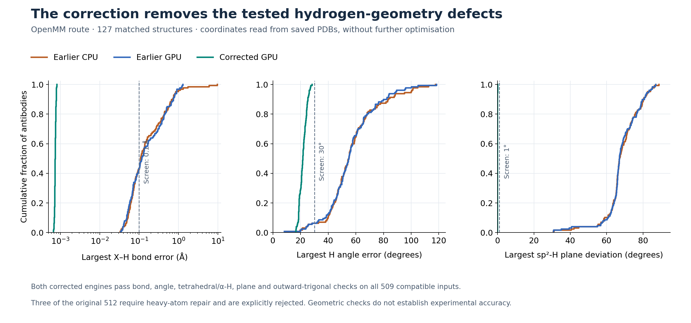
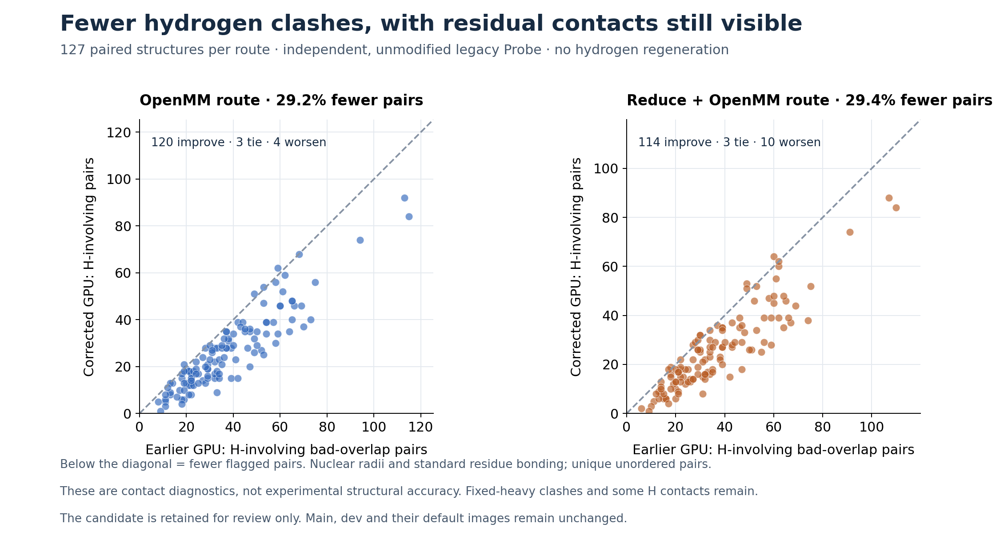

# Hydrogen geometry correction — 27 October 2026

The corrected CPU and GPU methods pass the tested hydrogen bond, angle,
chirality, planarity and outward-coordination checks on **509 of 512 distinct
antibody pairs**. The remaining three cannot meet the planar-H constraints
with their existing heavy atoms and are explicitly rejected. No structures
were silently repaired, dropped or reported as successful after a failure.

The GPU speed advantage remains. On the matched 127-antibody panel, complete
jobs took **56.23 s** with OpenMM hydrogens and **61.18 s** with
Reduce orientation followed by OpenMM. Corrected CPU preparation took
212.84 and 215.27 s: **3.79× and 3.52× slower**, respectively. The corrected
GPU method is also about **2.05× and 1.87× faster than the earlier CPU
candidate**. This comparison concerns optional chemical preparation, not
the much faster prediction-only repertoire benchmark.

**Nothing is enabled on main or dev.** This is a different hydrogen-placement
protocol, retained on the component branch for review. Raw neural predictions
and prepared heavy-atom coordinates are unchanged in every matched comparison.
Hydrogen coordinates change substantially relative to the earlier method.

## Speed and unified memory

These are medians and observed ranges of two fresh complete-container jobs;
they are not confidence intervals. RAM is the higher peak additional
system-memory pressure across repeats. “Earlier” means the previous
experimental CPU/GPU candidates, **not main or dev**. Earlier GPU uses
20 workers; the corrected configuration uses 12, following the worker screen.
The table compares tuned full-pipeline configurations, not isolated kernels.

| Route | Configuration | Seconds, median (range) | Structures/min | Additional unified RAM, GiB |
|---|---|---:|---:|---:|
| OpenMM | Earlier CPU, 20 workers | 115.14 (114.45–115.83) | 66.2 | 4.32 |
| OpenMM | Earlier GPU, 20 workers | 50.92 (50.88–50.95) | 149.7 | 9.47 |
| OpenMM | Corrected CPU, 20 workers | 212.84 (211.23–214.45) | 35.8 | 5.94 |
| OpenMM | Corrected GPU, 12 workers | 56.23 (55.55–56.91) | 135.5 | 6.89 |
| Reduce + OpenMM | Earlier CPU, 20 workers | 114.26 (114.16–114.37) | 66.7 | 6.82 |
| Reduce + OpenMM | Earlier GPU, 20 workers | 67.20 (66.54–67.86) | 113.4 | 9.91 |
| Reduce + OpenMM | Corrected CPU, 20 workers | 215.27 (213.73–216.80) | 35.4 | 6.80 |
| Reduce + OpenMM | Corrected GPU, 12 workers | 61.18 (60.75–61.61) | 124.5 | 7.73 |

For OpenMM, correction costs about 10% in runtime relative to the earlier GPU
candidate, while reducing additional RAM from 9.47 to 6.89 GiB. For the Reduce
route, it is about 9% faster and uses 7.73 rather than 9.91 GiB. The CPU
correction is substantially slower than its earlier counterpart; GPU execution
is what keeps this more demanding preparation practical.

The separate 382-antibody panel uses **one completed job per condition**:

| Route | Configuration | Seconds | Structures/min | Additional unified RAM, GiB |
|---|---|---:|---:|---:|
| OpenMM | Corrected CPU, 20 workers | 607.03 | 37.8 | 7.34 |
| OpenMM | Corrected GPU, 12 workers | 149.50 | 153.3 | 8.12 |
| Reduce + OpenMM | Corrected CPU, 20 workers | 614.20 | 37.3 | 8.10 |
| Reduce + OpenMM | Corrected GPU, 12 workers | 165.88 | 138.2 | 9.03 |

Here the GPU advantage over corrected CPU is 4.06× for OpenMM and 3.70×
with Reduce. These inputs are larger in number, not substantially longer
antibodies; repertoire-wide scaling is not established by this experiment.

RAM comes from the peak fall in whole-system `MemAvailable`, sampled every
20 ms, against a five-second pre-job idle baseline. Eight seconds of post-job
idle measurements give a baseline-sensitivity interval. No selected completed
job exceeded the 0.25 GiB drift flag or used additional swap. This avoids
adding process RSS and CUDA allocations on unified memory, but remains a
whole-host pressure measurement, not an exact attribution of physical bytes.
Runtime includes startup, neural inference, atom repair, hydrogen placement,
writing and shutdown. The memory monitor and 200 ms GPU telemetry are retained.

## What failed, and what changed

The earlier path gave OpenMM only 50 hydrogen-minimisation iterations. Some
unrelaxed predictions already contain severe heavy-atom clashes. In the six
diagnostic cases, fixed-heavy nonbonded energies reached about 10^14 kJ/mol;
these terms cannot improve when only hydrogens move. More iterations alone
did not reliably correct stretched H bonds or wrong-side hydrogens.

Removing H-independent energy terms improved numerical conditioning. On a
well-conditioned Reference-platform control, the change in an energy difference
was 4.29×10^-10 kJ/mol and the largest H-force discrepancy was
3.75×10^-12 kJ/mol/nm. **That equivalence applies only to the diagnostic
conditioned objective. It does not apply to the final correction.**

The final method uses exact force-field X–H lengths and optimises angular
coordinates. It retains H-involving Amber angle targets and torsions, strengthens
angle control, and uses a bounded, simplified donor/acceptor-aware steric penalty.
Tetrahedral C–H guards prevent placement on the wrong side. Aromatic, amide and
guanidinium hydrogens are constrained to their local heavy-atom planes; planar
three-coordinate centres must point outward rather than into the heavy bonds.

**Coulomb and GB energies are omitted from this geometry objective.** Its steric
and angle weights are empirical preparation choices. It is neither full Amber
energy minimisation nor a physically equivalent rewrite of OpenMM hydrogenation.
The existing force field still supplies topology, protonation and valence targets.
No structural relaxation or backbone movement is introduced. Reduce, when
selected, remains the unchanged orientation step before hydrogen rebuilding.

A stronger steric penalty improves contacts but can distort valence geometry.
The final policy therefore tries weights **500,000 → 200,000 → 100,000** in
that order, accepting the first that passes the same geometric checks. Each
attempt and its outcome is logged. One of the 509 compatible inputs needed
the second weight on both engines for the OpenMM route; all other tested
cases, including all Reduce cases, used the first. The third weight was not
needed in final validation. Incompatible heavy geometry is rejected immediately.
No protonation, platform or heavy-coordinate substitution is allowed.

The optimiser has a finite 2,000-iteration limit and angular gradient tolerance
5.0. All selected final first-repetition outputs reported optimiser convergence.
The earlier tolerance pilot and rejected higher-penalty trials are retained;
none of their favourable partial results is substituted for full qualification.

## Geometry and residual contacts

Bond and angle errors are measured against Amber targets after reading the
saved PDB. The independent screens count X–H errors >0.10 Å, H-angle errors
>30°, wrong-side α-H/tetrahedral H, four-substituent signed-volume inversions,
sp²-H plane deviations >1°, and inward planar coordination. The plane allowance
covers PDB rounding. The on-line gate uses exact bonds, a 29.5° angle-error
limit and wrong-side checks before writing. An inclusive numerical tolerance
of 10^-8 degrees avoids rejecting an exact bound as 29.500000000000014°.

All final candidate counts for these checks are zero on both routes and engines.
Across saved candidate structures, the largest bond error is 0.00084 Å,
largest H-angle error 29.516°, and largest plane deviation 0.047°.
These are geometric acceptance results, not experimentally measured accuracy.

The following counts use the first repetition on the same 127 inputs. They
count events, not percentages of antibodies; the two plane/orientation counts
are not added to bond/angle counts to form a composite score.

| Route | Configuration | Bond errors >0.10 Å | Angle errors >30° | Wrong-side α-H | Planar H >1° | Probe H-contact pairs |
|---|---|---:|---:|---:|---:|---:|
| OpenMM | Earlier CPU, 20 workers | 388 | 5,442 | 36 | 39,634 | 4,736 |
| OpenMM | Earlier GPU, 20 workers | 450 | 3,868 | 37 | 39,398 | 4,743 |
| Reduce + OpenMM | Earlier CPU, 20 workers | 914 | 6,867 | 33 | 40,043 | 4,833 |
| Reduce + OpenMM | Earlier GPU, 20 workers | 402 | 4,379 | 34 | 39,682 | 4,646 |
| OpenMM | Corrected CPU, 20 workers | 0 | 0 | 0 | 0 | 3,360 |
| OpenMM | Corrected GPU, 12 workers | 0 | 0 | 0 | 0 | 3,359 |
| Reduce + OpenMM | Corrected CPU, 20 workers | 0 | 0 | 0 | 0 | 3,278 |
| Reduce + OpenMM | Corrected GPU, 12 workers | 0 | 0 | 0 | 0 | 3,278 |

Unmodified legacy Probe, commit
[`f3e0fadd`](https://github.com/rlabduke/probe/tree/f3e0fadd3986d228f3b37c17f4ec20a7391daf37),
was run with nuclear radii and standard residue bonding on the stored PDBs,
without regenerating hydrogens. We count unique unordered bad-overlap pairs;
this is not the complete modern MolProbity workflow. Relative to the earlier
GPU candidate, H-involving pairs fell **29.2%** with OpenMM and **29.4%** with
Reduce. The paired plot also shows exceptions: four and ten antibodies,
respectively, have more flagged pairs. Residual contacts remain on both panels.
We have not proved that every remaining contact is unavoidable with fixed heavy
atoms, and the correction must not be described as clash-free.

The original radius-based overlap screen is retained for historical comparison.
It can count legitimate donor/acceptor contacts and is not a MolProbity clashscore.
An early correction passed bond/angle checks but placed many sp² hydrogens
out of plane. It was rejected after this additional check. Low-penalty planar
placement also raised Probe contacts; the explicit steric back-off addresses
that trade-off. All these intermediate outputs remain available locally.

## Prediction differences, repeatability and coverage

All **3,560 raw neural predictions** in the selected completed measurements
match byte for byte within their matched cohort. Prepared heavy atoms and
atom/protonation identities match across the compared methods. Both corrected
engines repeat byte for byte on all 127 inputs, on both routes, in the two
fresh runs. CPU and GPU prepared PDBs are not identical to each other.

After generous same-parent H-label matching, CPU/GPU differences across all
509 compatible inputs are:

| Route | Mean per-antibody H RMS displacement, Å | Largest individual H displacement, Å | H atoms displaced >0.1 Å |
|---|---:|---:|---:|
| OpenMM | 0.0181 | 1.532 | 1,748 / 866,195 |
| Reduce + OpenMM | 0.0176 | 1.649 | 1,660 / 866,195 |

No alignment or coordinate editing is used. Most H changes are small, but the
large local outliers mean that CPU/GPU hydrogen-bond interactions need not be
identical. Heavy-atom prediction accuracy is unchanged by this preparation;
the study does not establish experimentally optimal hydrogen positions.

The original 128-panel contains eight retained benchmark pairs plus 120
distinct native OAS pairs. Another 256 and then 128 unused native pairs were
selected from the frozen OAS panel by deterministic length-stratified order
positions, preserving partners. They were additional validation inputs when
introduced, but subsequent tuning used their failures; they are **not an
independent final test set**. All 512 pairs are distinct. Combined lengths are
220–246 residues. The compatible subsets contain 127 and 382 inputs.
The three explicit failures are retained, not silently excluded from coverage.
The 509/512 result is conditional on this narrow panel, not a population estimate.

Both engines and routes were tested on the rejected inputs: all three failures
retain raw files and failed audits, and an independent valid job completes.
The final 382-input GPU/OpenMM attempt initially had two CUDA device/context
initialisation failures. A single unchanged whole-job retry succeeded; the
failed attempt is retained and excluded from successful timings, not counted
as another replicate. The cause is not established, so GPU-startup reliability
still needs attention before deployment.

## Review decision and reproducibility

The corrected GPU method is a useful deployment candidate for **review**, with
the tested defects corrected and much of the speed advantage retained. Moving
it into dev would change the chemistry protocol and prepared hydrogens and is
therefore left for discussion. Main, dev, their default images, all historical
images and all inputs/predictions remain unchanged.

Before enabling it, agree whether invalid fixed-heavy inputs should fail or
enter a separately requested heavy-atom repair/relaxation workflow. Then test
a genuinely held-out, broader-length cohort and repeat longer GPU jobs to
investigate the context-startup failures. Residual clashes and sensitive local
H orientations should remain visible rather than being hidden by an aggregate
pass label.

The final source is isolated on `components/hydrogen-pipeline-261026`.
The original and modified OpenMM/PDBFixer-related code, scoped diffs and **35
passing regression tests** are retained. The model, checkpoint, strict FP32
inference, saved AOT executable, native writer, seed 42 and pH 7 are fixed.
GPU hydrogen forces use OpenMM mixed precision; this is separate from the
unchanged neural-network precision. CPU repair remains deterministic CPU1.

- [Aggregate measurements and paired diagnostics](data/hydrogen_geometry_results_271026.json)
- [Source/runtime identities](data/hydrogen_geometry_sources_271026.json)
- [Protocols, commands, telemetry and test evidence](data/hydrogen_geometry_evidence_271026.zip)
- [Artifact checksums](data/hydrogen_geometry_checksums_271026.txt)
- [Previous GPU/streaming study](hydrogen_pipeline_271026.md)

The evidence archive contains no input sequences, structures, checkpoints or
per-residue identity lists. Those remain under the local study directory
`projects/abodybuilder3/runs/hydrogen_geometry_271026`.
