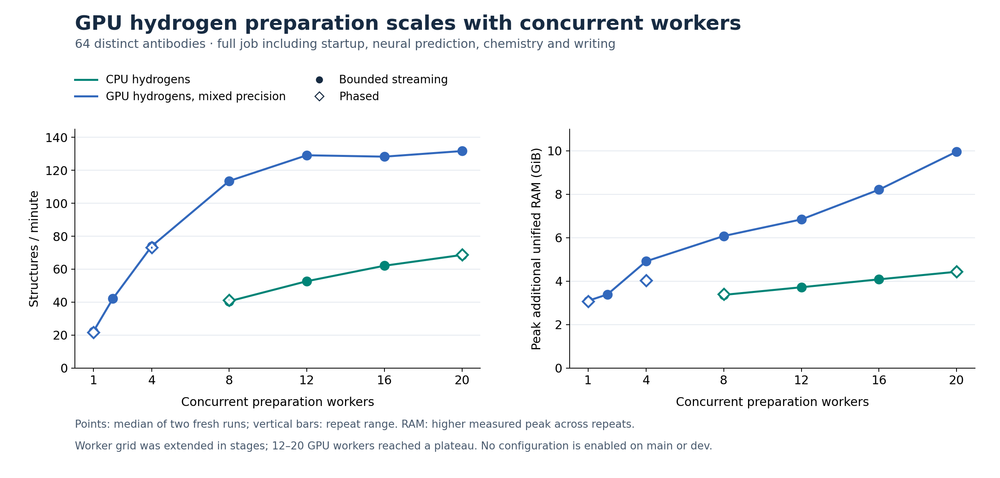
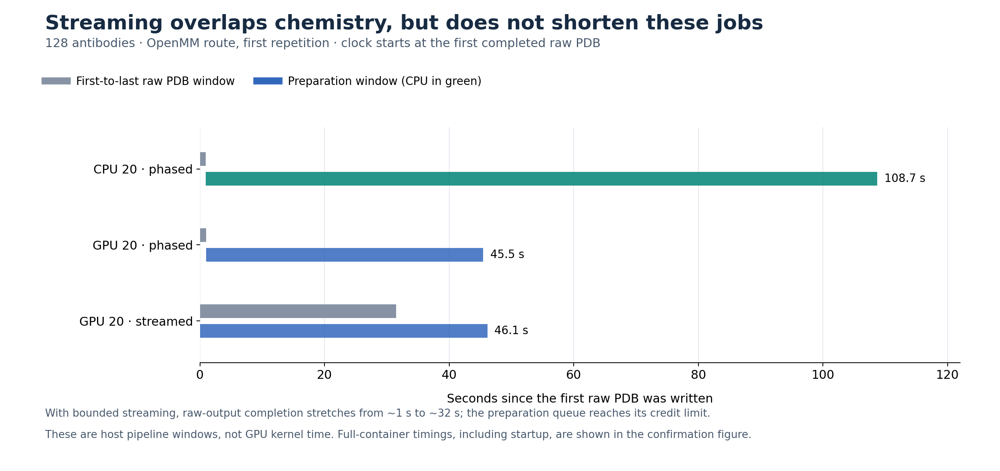
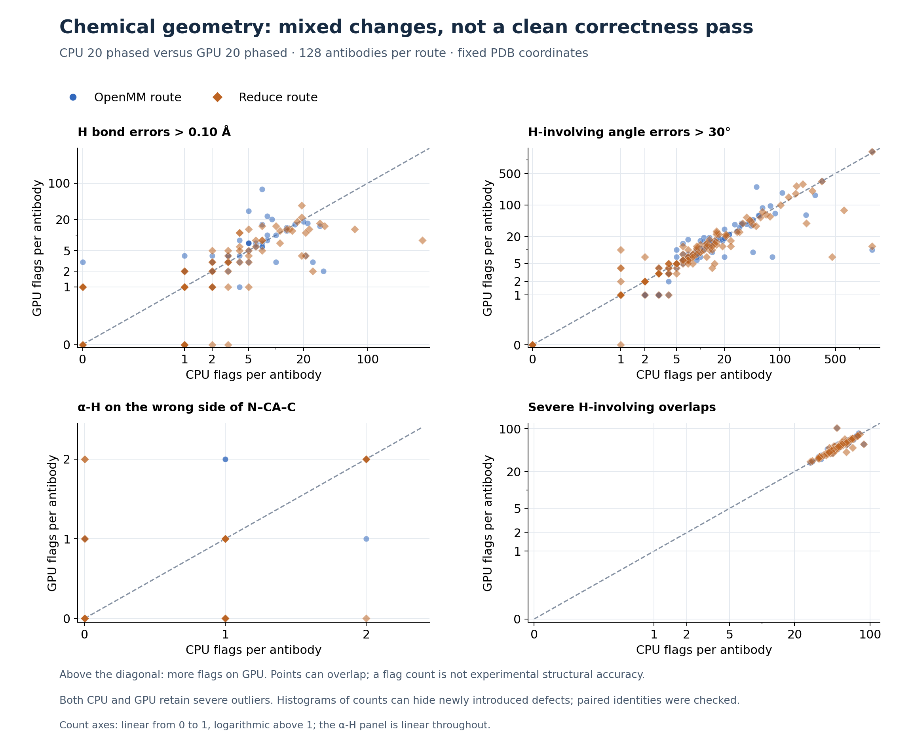

# GPU hydrogen optimisation and streaming preparation — 27 October 2026

GPU hydrogen minimisation with 20 concurrent workers completed the 128-antibody
job in **51.08 s**, versus **114.07 s** for the tuned 20-worker CPU candidate
(**2.23×**). With Reduce orientation first, the corresponding times were
**67.65 s** and **113.56 s** (**1.68×**). These include container startup, neural
prediction, repair, hydrogen preparation, output writing and shutdown.

**The GPU candidate does not pass the chemical-geometry gate.** It resolves
some CPU defects but introduces others, including new α-hydrogen orientation
flags. It is retained for research, with nothing enabled on dev or main.
Streaming works correctly as a bounded pipeline but gives no consistent speed
benefit here; the fastest measured configuration was phased GPU preparation.

The table shows medians and observed ranges of **two fresh runs**, not confidence
intervals. Bold marks the lowest median time/highest throughput and lowest RAM
within each route; it does not imply statistical significance. RAM is the higher
peak additional unified-memory pressure across the two runs.

| Hydrogen route | Engine / workers / schedule | Whole-job seconds, median (range) | Structures/min | Additional unified RAM, GiB |
|---|---|---:|---:|---:|
| OpenMM | CPU 20, phased | 114.07 (114.01–114.13) | 67.3 | **4.40** |
| OpenMM | GPU 12, streamed | 52.01 (51.31–52.72) | 147.7 | 6.79 |
| OpenMM | GPU 20, streamed | 52.59 (51.80–53.37) | 146.0 | 9.49 |
| OpenMM | GPU 20, phased | **51.08 (51.01–51.15)** | **150.3** | 9.74 |
| Reduce + OpenMM | CPU 20, phased | 113.56 (111.48–115.63) | 67.6 | **6.87** |
| Reduce + OpenMM | GPU 12, streamed | 72.42 (72.13–72.70) | 106.1 | 7.54 |
| Reduce + OpenMM | GPU 20, streamed | 68.59 (68.09–69.10) | 112.0 | 10.23 |
| Reduce + OpenMM | GPU 20, phased | **67.65 (67.41–67.88)** | **113.5** | 11.00 |

The 12-worker GPU stream was within about a second of the OpenMM 20-worker
candidates while using ~6.79 GiB rather than ~9.5–9.7 GiB. For this speed-focused
study, 20-worker phased preparation is the leading *performance* candidate.
That is a screening result on this panel, not a proven universal optimum.
These rates include optional chemistry; they should not be compared directly
with the much higher repertoire throughput for prediction alone.

The CPU control is the previous **experimental deterministic CPU repair/H
candidate**, not current main or dev. It already changes hydrogens relative to
the released preparation, as documented in the
[previous report](deterministic_repair_261026.md). Increasing its worker count
from eight to twenty is included in the present tuning.

**Worker scaling and scheduling.** The staged study comprised 65 successful
complete jobs and 4,120 predictions: an eight-antibody precision screen, three
streaming smoke jobs, two 64-antibody worker grids, and a 128-antibody
confirmation. The main comparisons use two fresh containers per condition;
the three smoke jobs use one. The second confirmation repetition reversed the
condition/route order. GPU mixed precision was selected after the small screen;
64-input results justified extending GPU concurrency to 8, 12, 16 and 20.
Larger runs characterise performance and geometry; they do not imply the earlier
geometry screen passed.

At 64 antibodies, one GPU worker was substantially slower than eight CPU
workers. GPU concurrency changed that result: streamed GPU times fell from
172.93 s with one worker to 51.97 s with four, 33.83 s with eight and about
29–30 s with 12–20. The CPU stream improved from 94.77 s at eight workers to
55.96 s at twenty. Phased CPU 20 took 55.84 s. With two repeats and a staged
grid, small differences at the GPU plateau are not convincing evidence that
one worker count is intrinsically best.

At 128 antibodies, streaming GPU 20 was **2.9% slower** than phased GPU 20 for
OpenMM and **1.4% slower** for Reduce. In the first OpenMM repetition, phased
prediction wrote the raw structures within ~0.98 s of the first raw PDB;
streaming stretched that window to ~31.50 s while the preparation queue reached
its 40-job credit limit. Chemistry started ~0.04 s after the first raw PDB,
so overlap was achieved, but it did not reduce complete-job time. The output
window includes bounded backpressure; this experiment does not isolate how much
extra delay comes from CPU scheduling, GPU competition or other overhead.

Whole-host CPU busy time during the 128-input OpenMM jobs averaged ~78% for
CPU 20 and ~41% for GPU 20, with similar results for phased/streamed GPU.
Moving hydrogen minimisation to CUDA therefore improves throughput despite
leaving more CPU capacity available. NVML samples show intermittent GPU work,
not sustained saturation. They are 200 ms device-wide busy-time samples, not
kernel occupancy or per-process execution measurements. Higher utilisation
alone is not the objective; complete-job throughput is.

**Outputs and chemical checks.** All **4,120 raw neural PDBs matched byte for
byte** against their panel controls. The checkpoint, strict-FP32 AOT packages
and manifest identities are unchanged. All jobs produced their expected raw and
prepared files, with finite coordinates, parameterisable topology, no OOM retry,
no dropped result and no observed swap increase.

For the 128-input confirmation, all conditions retained the same prepared
atom identities, protonation variants and heavy-atom coordinates as their
matched CPU control, including repaired terminal atoms. The OpenMM route kept
original heavy atoms fixed. Reduce's configured side-chain flips were retained;
its original backbone atoms remained fixed. This is a comparison within each
route, not a claim that Reduce leaves every original side-chain atom fixed.

GPU hydrogen coordinates differ on **every** antibody. After allowing all
permutations of hydrogens attached to the same heavy atom, median per-antibody
hydrogen RMS displacement was 0.035 Å for both routes, but the largest hydrogen
displacements were **9.73 Å** (OpenMM) and **9.71 Å** (Reduce). These extremes
survive the generous label matching and cannot be described as harmless
round-off. One CPU C–H bond was 10.69 Å long; the GPU condition removes that
extreme but still has C–H bond errors as large as 1.29 Å in the OpenMM route.
Neither set is a reliable finished chemical preparation.

Geometry was scored without minimisation or rewriting, on the first repetition
of each eight- and 128-input condition. Counts below are **events across the
same 128 antibodies**, not percentages of antibodies. All 217,077 H-involving
bonds, 489,666 H-involving angles and 26,431 eligible non-glycine α-H sites were
checked per route/condition. No eligible α-H site was excluded by the
near-planar-heavy-atom rule in this confirmation.

| Fixed-coordinate diagnostic, lower is better | OpenMM CPU → GPU | Reduce + OpenMM CPU → GPU |
|---|---:|---:|
| H bond error >0.10 Å from force-field target | **406** → 453 | 916 → **411** |
| H-involving angle error >30° | 5,347 → **3,940** | 6,824 → **4,427** |
| α-H on the same side as Cβ across the N–Cα–C plane | **36** → 38 | **35 → 35** |
| Severe H-involving overlap | **6,302** → 6,344 | **6,323** → 6,332 |

Paired identity checks matter: the OpenMM route introduced **five** new α-H
orientation flags and resolved three. Reduce introduced **seven** and resolved
seven, despite its unchanged total. Likewise, GPU OpenMM added 225 and resolved
178 H bond-length flags; Reduce added 142 and resolved 647. Totals alone would
hide these exchanges. Bond/angle targets come from Amber; the overlap screen
uses distance <0.7 × summed van der Waals radii, excluding atom pairs separated
by at most three covalent bonds. This is a custom screen, **not MolProbity's
clashscore or experimental structural accuracy**.

The heavy-atom inputs were already strained: 100/128 had at least one peptide
C–N distance >1.8 Å (maximum 4.65 Å), and 123/128 had a severe heavy-atom overlap
under the same distance rule. Final structural relaxation was off. These
observations limit what hydrogen-only minimisation can achieve; they do not
excuse new defects or establish the cause of every failure. The unchanged
50-iteration budget is not a convergence guarantee. Switching numerical
platform changes forces/reductions and the minimisation trajectory, which can
produce large endpoint differences on difficult fixed geometry.

**Repeatability.** In the eight-input screen, CUDA single repeated exactly on
only 1/8 prepared PDBs per route; some changes approached 2 Å. Mixed and double
repeated on 8/8 in that screen, so mixed was used for the larger tests. Across
the larger mixed-precision grids, five paired runs each differed on one target
by at most **0.001 Å** at written PDB precision. In the final confirmation,
GPU 20 streamed/OpenMM repeated on 127/128, and the other GPU conditions on
128/128; CPU repeated on 128/128 for both routes. Thus mixed is much more stable
in these tests, but it is not universally byte deterministic. Three early CPU
64-input repeats crossed midnight: all their atom records/coordinates matched,
and the only byte difference was OpenMM's generated date header. That header
was classified separately; no output was edited to normalise it.

**Implementation and measurement.** The isolated change adds per-Context
platform properties to OpenMM's `Modeller.addHydrogens`; every other Modeller
method is unchanged by AST comparison. The original MIT notice and source are
retained. CUDA single/mixed/double use `DeterministicForces=true`; CPU uses its
original hydrogen Context call. PDBFixer repair remains CPU, one thread, with
explicit deterministic forces. Force field (Amber ff14SB/GBn2), pH 7, seed 42,
CutoffNonPeriodic, massless original heavy atoms, minimiser tolerance 1.0 and
maximum 50 iterations remain fixed. Reduce and its optional flips are unchanged.
OpenMM mixed precision applies only to chemistry; neural inference stays strict
FP32. This is not full structural relaxation.

Streaming uses a separate lightweight controller and spawned chemistry workers.
It accepts at most twice the worker count in unfinished jobs, preserving the
existing bounded feature/writer pipeline and propagating backpressure. A raw
file is closed before submission. Errors drain independent work, preserve
outputs/audits and fail the job. Explicit worker counts extend to twenty;
automatic selection remains eight. These interfaces are experimental, not new
supported production flags. Original/new source, reviewable patches and 21
passing unit tests are on this component branch.

The 64/128 panels contain eight retained benchmark pairs followed by distinct
native heavy/light pairs from the frozen OAS selection, with no partner mixing.
The 128 panel nests the 64 panel and spans 221–242 combined residues. It is a
small, narrow-length performance/geometry sample, not a repertoire-wide
validation or an experimental accuracy benchmark. SHA-256 input identities and
selection code are retained; sequences and all structures remain local.

Measurements used the NVIDIA GB10 DGX Spark (driver 580.178.04), PDBFixer 1.12.0
and the pinned OpenMM 8.6.1 development runtime. Each job ran offline in a fresh
container with `OPENMM_CPU_THREADS=1`, `OMP_NUM_THREADS=1` and the expandable
PyTorch CUDA allocator. Packaged AOT caches were reused; Docker builds were not
timed and filesystem caches were not flushed. System memory was sampled every
20 ms: peak additional RAM is median pre-job MemAvailable minus the lowest
value during the job, with five seconds of pre-idle and eight of post-idle.
It counts CPU, GPU and driver pressure together, without summing RSS or CUDA
allocations. It is a whole-system estimate, not exact process attribution.
Three of the 65 jobs exceeded the 0.25 GiB idle-drift flag and are retained;
**none of the 16 confirmation jobs did**. Repeat/baseline sensitivity is saved
alongside every peak.

The measured streaming image is
`sha256:3b13290a647b29766a8d0c65689fbbe0dea40bdf600318a9b26dcc0bd6ce2ce4`.
The image chain, protocols and source hashes are in the provenance/evidence.
Main remains `c20d119957bcbbd24d8534fddbdc3e9fc7d57795`; dev remains
`e6fabdf73aa9590431377de5f923c256576829fd`. Their default image tags are unchanged.
No images, biological data, results or audit records were deleted.

**Recommendation:** retain GPU 20 phased as the speed candidate, but resolve
the chemical-geometry failures before considering activation. Keep streaming
available for research; these panels give no throughput reason to enable it.
The next useful correctness study would isolate the worst hydrogen cases and
compare a revised, explicitly validated hydrogen minimisation/protonation
protocol while preserving raw predictions. That would change preparation
results and should be agreed separately.

Data and reproducibility:

- [Machine-readable summaries](data/hydrogen_pipeline_summary_271026.csv),
  [paired analysis](data/hydrogen_pipeline_analysis_271026.json) and
  [hydrogen matching](data/hydrogen_pipeline_matching_271026.json).
- [Compact protocols, commands, telemetry and test logs](data/hydrogen_pipeline_evidence_271026.zip),
  [source hashes](data/hydrogen_pipeline_sources_271026.json) and
  [artifact checksums](data/hydrogen_pipeline_checksums_271026.txt).
- [Experiment provenance](../provenance_hydrogen_pipeline_261026.json),
  [OpenMM patch](../candidate/gpu_hydrogen_271026.patch),
  [streaming CLI patch](../candidate/streaming_cli_271026.patch),
  [scheduler regression tests](../tests/test_stream_preparation.py) and
  [geometry scorer](../tools/measure_chemical_geometry.py).
