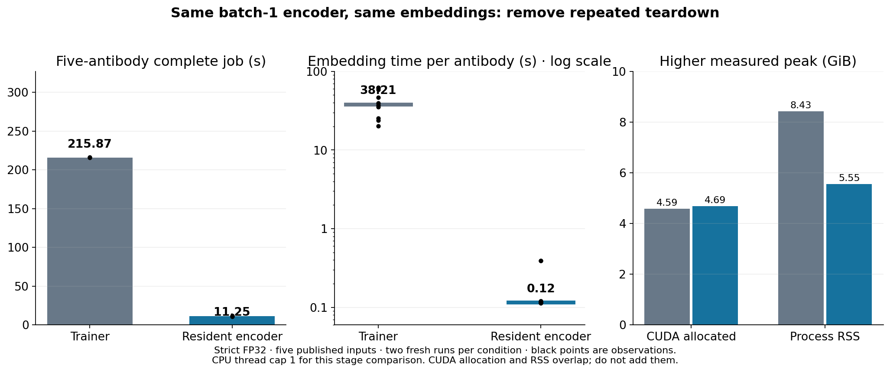

# ProtT5 lifecycle optimisation — 26 October 2026

Keeping the released encoder on its selected GPU removes repeated Lightning
teardown while preserving its batch-1 computation. In the initial five-input
comparison, total time fell from **215.87 to 11.25 seconds (19.2×)**. Through the
installed CLI, eight additional antibodies took **270.65 versus 12.12 seconds**
in one matched pair. Every tested embedding, raw structure and PDB byte matched.
Main is unchanged; the passing adapter is integrated on dev with the original
Trainer route retained as `--embedding-runtime trainer`.

## Cause and implementation

The original unpaired ProtT5 wrapper calls `Trainer.predict` separately for the
heavy and light chains. In the pinned Lightning runtime,
`SingleDeviceStrategy.teardown` moves the entire model to CPU; the CUDA
accelerator then clears CUDA memory. The next chain/request sets the same
encoder up on GPU again. This lifecycle overhead dominated the language path.
The installed encoder contains **1,208,141,824 FP32 parameters**.

The candidate keeps that same model in eval mode on its explicitly selected
single CUDA device. It preserves the original DataLoader/collator, tokenizer,
batch size 1, `predict_step`, special-token masking, unpaired chain order,
concatenation and CPU output tensors, under inference mode. It replaces only
the Trainer prediction lifecycle. It does not cache embeddings or predictions,
batch different sequences, compile the encoder, change precision or alter weights.
The installed upstream `language/model.py` is unchanged. Its original source is
retained in `reference/model.py`; `candidate/model.py` contains the reviewed
subclass and the regression tests are on this component branch.

## Matched results and scope

| Experiment | Original Trainer | Resident encoder | Repetitions per condition | Exact comparison |
|---|---:|---:|---:|---|
| Five previous benchmark inputs, strict FP32 instrumented loop | 215.87 s (215.46–216.28) | **11.25 s (10.81–11.69)** | 2 | All embeddings, raw outputs and PDB bytes |
| Eight additional validation antibodies, installed strict-FP32 CLI | 270.65 s | **12.12 s** | 1 | All embeddings, raw outputs and PDB bytes |
| One TF32-permitted compatibility case, installed CLI | 74.76 s | **10.72 s** | 1 | All embeddings, raw outputs and PDB bytes |

Times are complete fresh-container wall times, including imports, model and
encoder loading, predictions, output writing and the same raw-capture
instrumentation on both sides. The initial loop uses the installed CLI's
prediction functions with PyTorch CPU threads capped at one; the expanded
installed-CLI checks use the normal 20-thread setting. These are separate
experiments, not pooled estimates of one speedup. The first row reports median
(range); single pairs in the other rows are compatibility/coverage checks.

Initial inputs come from the previous published benchmark cohort. The eight
additional upstream validation targets were selected before new predictions,
covering total lengths **221–248** and H3 lengths **4–22**. They are not an
unseen model-accuracy test. The TF32 case overlaps the initial inputs. There are
13 distinct tested antibodies, not 19 independent targets from the repeated
comparisons. No experimental accuracy change is claimed: exact coordinates
imply identical structure-error metrics for these matched outputs.

Across the initial five inputs and two repetitions, median embedding time per
antibody, including both chains, was **38.21 versus 0.116 seconds**. Encoder
loading itself remained around four seconds. The structure-head timings were
similar and do not establish another head-speed improvement. The large gain
comes from removing lifecycle work, not a faster learned network or new weights.

Higher measured CUDA peaks were **4.586 versus 4.688 GiB** initially and
**4.558 versus 4.706 GiB** in the eight-input CLI check. Keeping the encoder alive
through structure inference increases that peak by about 2–3%. Sampled
process-tree RSS fell from **8.431 to 5.553 GiB** initially. RSS, PyTorch CUDA
allocation and container accounting overlap on Spark; **do not add them** to
estimate physical memory. Retain these trade-offs when planning concurrent jobs.

## Fast-path and interface regression

The new adapter is imported lazily only for language prediction. Two interleaved
fresh runs of each 1,000-output base/pLDDT workload compared the accepted AOT
image with the language-adapter image. All **4,000 paired raw predictions and
PDBs** were identical, with unchanged **2.390 GiB** peak CUDA allocation.
Complete-job medians were:

| Checkpoint | Accepted AOT image | Image with language adapter |
|---|---:|---:|
| base | 13.28 s | 13.22 s |
| pLDDT | 13.24 s | 13.45 s |

Medians differ by less than 1.7%; two repetitions cannot establish a precise
small latency change. There is no code-path or numerical change to either fast
model. The new backend-dispatch/cache tests and direct-loop contract checks pass.
The first fast controller mistakenly included byte validation in its outer
timing; those durations were relabelled, retained and replaced by the correctly
clocked interleaved comparison above. No validation time enters this table.

## Use and reproducibility

On dev, `--embedding-runtime auto` selects the resident encoder for a language
prediction on CUDA. `--embedding-runtime direct` requests it explicitly;
`--embedding-runtime trainer` selects the original lifecycle. CPU auto retains
the Trainer route; explicit direct CPU execution is rejected before weights are
loaded. CUDA execution is qualified here; CPU language inference is not newly
benchmarked. The reference Trainer needs a writable Lightning log directory
when run as a non-root user.

The passing installed image is
`sha256:d68278c8fe9068940319316d8aefd226e030f1af65c6ebfb4ded5e2f81762947`.
The final dev image is
`sha256:a4d29734d1b2ce98a09c4508e9047ad714a6da94be610fd5b8dda6b15285b590`;
it differs only by a whitespace cleanup in the CLI, verified to have an identical
syntax tree. Its source/runtime reference is
`tests/reference_dev_direct_language_runtime_261026.json`.
The runtime foundation is the accepted dev image
`sha256:2774ec553f5653e8ba97c761824f55b6d6c49b5df3573382079a23a1ae912354`.
All released ABodyBuilder3 checkpoints, the pinned offline ProtT5 snapshot,
precision policies and unchanged saved base/pLDDT executables were reused.
The dev Dockerfile copies the versioned adapter from its checkout; no retained
experimental image is required to rebuild it from the pinned public foundation.
ProtT5 remains a separately downloaded, pinned external asset.

`tools/measure_language.py` supplies the initial component comparison;
`tools/measure_language_cli.py` records the actual installed CLI;
`tools/check_fast_regression.py` performs the matched fast-model check.
Source and command identities, warm/cold stages, tensor dtypes and individual
measurements are retained. Weights, sequences, embeddings and raw coordinates
remain local, outside Git.

[Measurements](data/prott5_lifecycle_measurements_261026.json) ·
[Compact evidence archive](data/prott5_lifecycle_evidence_261026.zip) ·
[Checksums](data/prott5_lifecycle_checksums_261026.txt)
