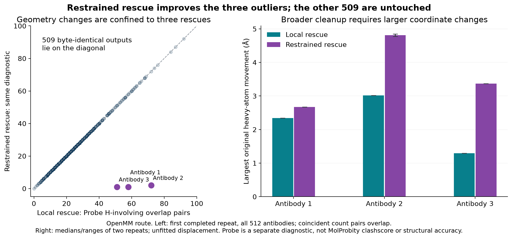

# Rejection-only rescue in the full 512-antibody pipeline — 27 October 2026

**Both rescue policies complete all 512 antibodies while changing only the three rejected cases.** Local rescue retains essentially the no-rescue runtime; guarded restrained rescue adds about 4–6% to wall time and gives much better heavy geometry on those three. All other 509 prepared outputs are byte-identical to their matched full-pipeline R8 controls within each route. Main and dev remain unchanged.

## Complete-job performance

These are complete fresh Docker CLI jobs, including model loading, saved-AOT execution, raw prediction, all chemical preparation, the failed H attempt that triggers rescue, and output writing. They are **not prediction-only repertoire rates**. Each condition has two complete technical repeats. The median wall time is used to calculate throughput as `512 × 60 / median seconds`; observed replicate ranges are not confidence intervals. Bold identifies the faster rescue within each route, not statistical significance.

| Route | Rescue policy | Median complete time | Structures/min | Additional unified RAM: two observed peaks | Prepared / rescued |
| --- | --- | ---: | ---: | ---: | ---: |
| OpenMM | Local rescue | **210.27 s** | **146.1** | 8.04–8.13 GiB | 512 / 3 |
| OpenMM | Restrained rescue | 221.93 s | 138.4 | 8.93–9.37 GiB | 512 / 3 |
| Reduce + OpenMM | Local rescue | **237.65 s** | **129.3** | 8.65–10.76 GiB | 512 / 3 |
| Reduce + OpenMM | Restrained rescue | 246.00 s | 124.9 | 8.63–8.95 GiB | 512 / 3 |

The matched no-rescue jobs take 210.20 s (OpenMM) and 235.87 s (Reduce + OpenMM), but prepare only 509/512 and retain the three explicit rejection records. Relative to those incomplete controls, local rescue changes median wall time by **+0.04% / +0.75%**, while restrained rescue changes it by **+5.58% / +4.29%**. With two repeats these are descriptive differences; the near-zero local overhead is within observed timing variation. Filling worker slots means the extra time is not the sum of the isolated per-antibody rescue durations.

## Unified RAM: measured peaks, with a material limitation

RAM is measured from host `/proc/meminfo` `MemAvailable` every 20 ms, relative to a 5 s pre-job median, followed by an 8 s post-job window. No RSS/CUDA values are added together. The completed rescue jobs have observed pre-baseline peaks of **8.04–10.76 GiB**. No swap growth was measured.

Post-idle memory drift exceeds 0.25 GiB in six of the 12 selected reference/rescue jobs. For example, the higher Reduce/local peak is 10.76 GiB from its pre-job baseline but 8.55 GiB from its post-job baseline. The plot preserves that sensitivity rather than presenting it as a confidence interval. The measured RAM burden is low relative to the Spark capacity, but **these data do not establish a reliable memory winner between rescue methods**. Host activity, caching and runtime retention can contribute to unavailable RAM; these are not isolated per-process physical-allocation measurements.

## Geometry and unchanged outputs

All 13 attempts account for their 512 raw predictions and preparation audits: 6,656 target attempts and 6,640 written prepared structures. Every unique stored PDB was independently scored—922 distinct hashes—reusing a score only when the entire file was byte-identical. This includes the retained CUDA-affected attempt. All 922 pass the H bond, angle, planar/outward and tetrahedral-orientation screens. Every one of the 27 successful rescue calls also passes the independent paired heavy/core/stereochemistry and full bond-topology checks. Of these, 24 belong to the eight complete rescue jobs; the other three belong to the retained partially failed attempt.

Raw neural predictions are byte-identical across all compared jobs. In every complete job, the 509 non-rescued prepared PDBs are byte-identical to the corresponding no-rescue route. Rescue is triggered by the exact existing frozen-heavy planar incompatibility error, followed by a confirming geometric preflight. It does not use a target whitelist and does not catch unrelated CUDA or parameterisation failures as reasons to move heavy atoms.

The three rejected motifs are restored without new heavy bond flags >0.10 Å, heavy angle flags >20°, severe heavy contact pairs or true Cα/ILE/THR stereocentre inversions. Their original failed core bonds finish within 0.05 Å and their core angles within 10° of the ff14SB targets. Disulfide connectivity, atom/bond identity and the selected protonation state are preserved. Final hydrogen placement uses the same R8 geometry objective after either repair method; the final file is not an untouched Amber-minimisation endpoint. [The isolated rescue report](heavy_atom_rescue_271026.md) describes the exact objectives, safeguards and earlier failed approaches.

| Rejected input | Local heavy bond / angle / severe-contact flags | Restrained flags | Probe H-overlap pairs, local / restrained | Largest heavy movement, local / restrained |
| --- | ---: | ---: | ---: | ---: |
| Antibody 1 | 62 / 25 / 16 | 0 / 0 / 0 | 58 / 1 | 2.34 / 2.67 Å |
| Antibody 2 | 62 / 38 / 52 | 0 / 0 / 0 | 72 / 1.5 | 3.02 / 4.81 Å |
| Antibody 3 | 49 / 22 / 53 | 0 / 0 / 0 | 51 / 1 | 1.29 / 3.37 Å |

OpenMM route; movement and Probe values are medians of two repeats. Local repair moves 28–33 original heavy atoms; restrained rescue moves almost all heavy atoms of each rejected structure. Reduce gives the same heavy-screen conclusions, with 47–73 local versus1–2 restrained Probe H-overlap pairs per rescued input. Probe is a separate contact diagnostic, **not MolProbity clashscore**. Local repair leaves substantial older strain; restrained rescue clears these heavy screens for the three repaired cases, while the other 509 retain their original heavy geometry. The full 512 cohort must not be described as fully relaxed, clash-free or chemically flawless.

No experimental reference structure is used here. These are geometry and numerical-regression results, not evidence of improved structural or binding-site accuracy. The 512 native pairs are a development panel with combined lengths 220–246 residues, not a probability sample of all antibody repertoires. The combined batch plan differs from the earlier 128/256/128 jobs; exact equality is established between the current matched conditions, not asserted for the older jobs.

## CUDA failure and explicit replacement attempt

The first Reduce/local job produced all 512 raw predictions and audits, and all three rescues succeeded, but four compatible targets failed OpenMM CUDA initialisation with `No compatible CUDA device is available`. It finished with 508 prepared structures in 235.42 s and a 14.20 GiB observed memory peak. This is a runtime failure, not a geometry rejection; its outputs, logs and memory traces remain intact. No CPU/backend fallback or per-target automatic retry was used.

After the original finite queue completed, one explicitly recorded replacement used the **same source, image, configuration and input order**. It prepared 512/512 with exactly three rescues in 237.28 s, using 8.65 GiB by the pre-job estimate. This slower but complete replacement, together with the original second repeat, supplies the two complete Reduce/local timings. The failed attempt is excluded from that summary because its coverage is incomplete, not because its time or memory is unfavourable. The CUDA-initialisation issue remains an observed runtime limitation; this study does not claim to fix it.

## Individual full-job measurements

| Job | Wall time | Prepared | Rescued | Pre-baseline RAM peak | Post-idle drift | Summary use |
| --- | ---: | ---: | ---: | ---: | ---: | --- |
| `openmm_local_r1` | 208.29 s | 512 | 3 | 8.13 GiB | -1.20 GiB | Complete rescue comparison |
| `openmm_restrained_r1` | 219.23 s | 512 | 3 | 9.37 GiB | -1.16 GiB | Complete rescue comparison |
| `openmm_off_r1` | 211.34 s | 509 | 0 | 8.11 GiB | -0.13 GiB | Incomplete no-rescue reference |
| `reduce_local_r1` | 235.42 s | 508 | 3 | 14.20 GiB | -6.71 GiB | Retained failed attempt |
| `reduce_restrained_r1` | 242.89 s | 512 | 3 | 8.63 GiB | -0.98 GiB | Complete rescue comparison |
| `reduce_off_r1` | 232.24 s | 509 | 0 | 8.82 GiB | -0.16 GiB | Incomplete no-rescue reference |
| `reduce_off_r2` | 239.51 s | 509 | 0 | 13.26 GiB | -4.31 GiB | Incomplete no-rescue reference |
| `reduce_restrained_r2` | 249.11 s | 512 | 3 | 8.95 GiB | +0.01 GiB | Complete rescue comparison |
| `reduce_local_r2` | 238.01 s | 512 | 3 | 10.76 GiB | -2.22 GiB | Complete rescue comparison |
| `openmm_off_r2` | 209.05 s | 509 | 0 | 8.09 GiB | +0.10 GiB | Incomplete no-rescue reference |
| `openmm_restrained_r2` | 224.62 s | 512 | 3 | 8.93 GiB | -0.68 GiB | Complete rescue comparison |
| `openmm_local_r2` | 212.25 s | 512 | 3 | 8.04 GiB | -0.12 GiB | Complete rescue comparison |
| `reduce_local_r1_retry1` | 237.28 s | 512 | 3 | 8.65 GiB | -0.05 GiB | Complete rescue comparison |

## Implementation, evidence and decision

The experiment retains the original R8 `prepare_structure` implementation byte-for-byte, then adds explicit opt-in dispatch. Compatible inputs return that original result unchanged; only the exact rejected cause can reach the separately qualified rescue solver. The real worker-controller smoke checks passed for both routes and policies, including exact compatible-output equality. The 45 preparation/regression tests pass. Prediction, AOT packages, model weights, native writer, batching policy and main/dev image tags are unchanged. Each full job used 18 AOT batches, no eager fallback and no OOM splitting.

For speed-focused use, these results support keeping **local rescue as the first explicit candidate**, with guarded restrained rescue as a broader-cleanup option. The full-job penalty of restrained rescue is modest when only 3/512 need it, although its coordinate changes are larger. Neither policy has been enabled on main or dev.

[Anonymised measurements and geometry summaries](data/rescue_pipeline512_results_271026.json), [source/runtime provenance](../provenance_rescue_pipeline512_271026.json), [plot/report generator](../tools/write_rescue_pipeline_report.py), [independent validator](../tools/validate_rescue_pipeline.py), and [experimental Docker layer](../Dockerfile.rescue-pipeline). All input CSVs, raw/prepared structures, detailed per-residue diagnostics, failed attempts, source snapshots and memory traces stay local in `rescue_pipeline512_271026`; none are included here. The new image inherits the exact previously qualified rescue layer. Use the recorded immutable identities and frozen environment to reproduce the optional experiment, not a mutable default tag.
